<div align="center">

## LAPORAN WEBSITE DAN SISITEM MOBILE


### Disusun Oleh:  
Nama               : MOH. Akmal Musyaffa
NIM                : 2024903430018 
Kelas              : TRKJ 3 A


### Program Studi Teknologi Rekayasa Komputer Jaringan
### Jurusan Teknologi Informasi dan Komputer
### Politeknik Negeri Lhokseumawe
### 2026


---


## Lembar Pengesahan


| No. Praktikum     | : | 05 |
|------------------:|:-:|:--------------|
| Judul Praktikum   | : | Laporan Integrasi API Login |
| Tanggal Praktikum | : | 29 Oktober 2026 |
| Tanggal Penyerahan| : | 29 Oktober 2026 |
| Nama Praktikan    | : | MOH. Akmal Musyaffa |
| NIM/Kelas Praktikan| : | 2024903430018 / TRKJ 3 A |
| Nilai Praktikum   | : | .......................... |
| Dosen Pengampu    | : | Muhammad Davi, S.Kom., M.Cs. |

Mengetahui,  
Dosen Pengampu
<br><br><br><br><br>

Muhammad Davi, S.Kom., M.Cs.
</div>


## Daftar Isi
- [Lembar Pengesahan](#lembar-pengesahan)
- [Daftar Isi](#daftar-isi)
- [Tujuan Praktikum](#tujuan-praktikum)
- [Dasar Teori](#dasar-teori)
- [Alat dan Bahan](#alat-dan-bahan)
- [Langkah Kerja](#langkah-kerja)
- [Hasil dan Pembahasan](#hasil-dan-pembahasan)
- [Kesimpulan](#kesimpulan)
- [Referensi](#referensi)
---

## A. Tujuan Praktikum
1. Membuat dan mengonfigurasi proyek Next.js menggunakan App Router.
2. Memasang library untuk pengelolaan cookies di browser.
3. Membuat form login sebagai `Client Component` dengan direktif `"use client"`.
4. Mengirim HTTP `POST` request ke API Laravel untuk autentikasi.
5. Menangani token autentikasi dari response API dan menyimpannya di cookies.
6. Membuat halaman dashboard sederhana setelah login berhasil.
7. Menguji validasi email, password, dan hasil autentikasi.

## B. Dasar Teori

### 1. Next.js

Next.js merupakan framework berbasis React yang digunakan untuk membangun aplikasi web. Next.js menyediakan fitur seperti routing, rendering halaman, dan pengelolaan komponen untuk mempermudah proses pengembangan aplikasi web.

Pada praktikum ini, Next.js digunakan untuk membangun antarmuka login dan dashboard yang terhubung dengan API Laravel. Proyek dibuat menggunakan App Router, yaitu sistem routing yang menggunakan struktur folder dan file di dalam direktori `app/`.

### 2. React dan TypeScript

React merupakan library JavaScript untuk membangun antarmuka pengguna menggunakan komponen. Dalam praktikum ini, React digunakan untuk membuat form login yang memiliki input email, password, serta tombol untuk mengirim data autentikasi.

TypeScript merupakan pengembangan dari JavaScript yang menambahkan sistem tipe data. Penggunaan TypeScript membantu mengidentifikasi kesalahan pada kode dan memberikan informasi tipe data yang lebih jelas selama proses pengembangan.

### 3. App Router

App Router adalah sistem routing Next.js yang menggunakan struktur direktori `app/`. Setiap folder dapat mewakili jalur halaman, sedangkan file `page.tsx` digunakan untuk mendefinisikan tampilan halaman tersebut.

Pada praktikum ini, struktur halaman yang digunakan adalah:

- `app/login/page.tsx` untuk menampilkan halaman login.
- `app/dashboard/page.tsx` untuk menampilkan halaman dashboard.

Dengan struktur tersebut, halaman login dapat diakses melalui `/login`, sedangkan halaman dashboard dapat diakses melalui `/dashboard`.

### 4. Client Component

Dalam Next.js App Router, komponen secara default dapat berjalan sebagai Server Component. Komponen yang membutuhkan interaksi pengguna, seperti pengelolaan input dan state, dapat menggunakan Client Component dengan menambahkan direktif `"use client"` pada bagian awal file.

Pada halaman login, Client Component digunakan untuk mengelola nilai email, password, status proses login, dan pesan kesalahan. Pengelolaan tersebut dilakukan menggunakan hook `useState` dari React.

### 5. npm dan Package

npm merupakan pengelola paket yang digunakan untuk memasang dan mengelola dependensi pada proyek JavaScript dan Node.js. Pada praktikum ini, npm digunakan untuk menginstal library yang diperlukan dan menjalankan server pengembangan Next.js.

Perintah yang digunakan antara lain:

```bash
npm install js-cookie
npm install -D @types/js-cookie
npm run dev

## C. Alat dan Bahan
- Laptop atau PC dengan Windows.
- Visual Studio Code.
- Node.js dan npm.
- Google Chrome atau browser lain.
- Backend Laravel aktif dengan endpoint `POST /api/login`.
- Akun pengguna yang sudah terdaftar di database Laravel.
```

## D. Langkah Kerja
 ### Langkah 3.1 — Buka folder proyek

Buka folder kerja yang akan digunakan untuk menyimpan proyek. Pada contoh praktikum, folder kerja bernama `projek`. Klik kanan pada area kosong di File Explorer, lalu pilih **Open in Terminal** atau **Open Git Bash here**.

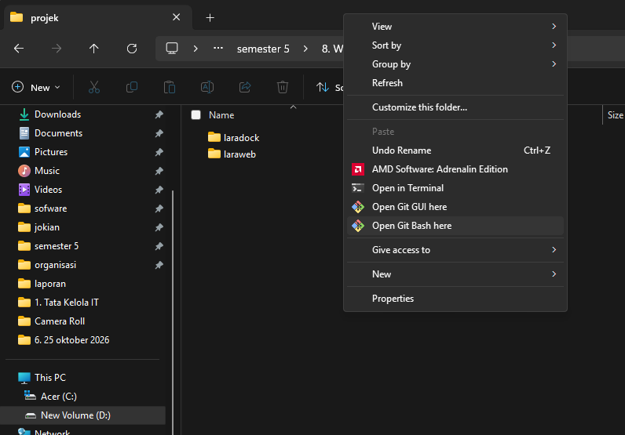

*Gambar 1. Membuka terminal dari folder kerja.*

### Langkah 3.2 — Periksa Node.js dan npm

Pada terminal, jalankan perintah berikut untuk memastikan Node.js dan npm telah terpasang:

```bash
node -v
npm -v
```

Terminal akan menampilkan nomor versi yang terpasang. Screenshot modul menunjukkan Node.js versi `v24.14.0`.

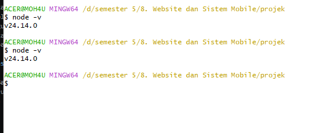

*Gambar 2. Pemeriksaan versi Node.js.*

### Langkah 3.3 — Buat proyek Next.js

Di direktori kerja, jalankan perintah:

```bash
npx create-next-app@latest nextweb
```

Saat diminta persetujuan instalasi, ketik `y` lalu tekan Enter. Pilih konfigurasi yang sesuai dengan modul:

| Pertanyaan | Pilihan |
|---|---|
| TypeScript | Yes |
| ESLint | Yes |
| Tailwind CSS | Yes |
| `src/` directory | No |
| App Router | Yes |
| Customize import alias | No |

Jika versi `create-next-app` yang digunakan menampilkan pilihan berbeda, pilih opsi yang menghasilkan struktur `app/` pada root proyek. Tunggu hingga proses selesai dan muncul pesan bahwa proyek berhasil dibuat.

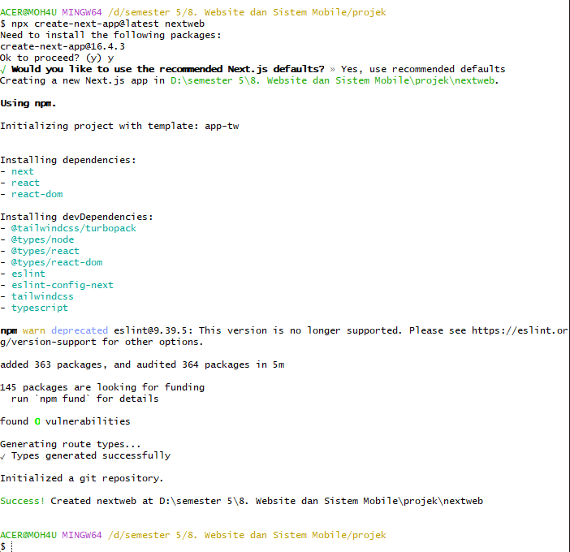

*Gambar 3. Proses pembuatan proyek Next.js bernama `nextweb`.*

### Langkah 3.4 — Masuk ke folder proyek dan instal library

Masuk ke direktori proyek yang baru dibuat:

```bash
cd nextweb
```

Pasang library `js-cookie` dan tipe TypeScript-nya:

```bash
npm install js-cookie
npm install -D @types/js-cookie
```

Periksa struktur folder:

```bash
ls
```

Folder `app/` dan file `package.json` seharusnya tersedia.

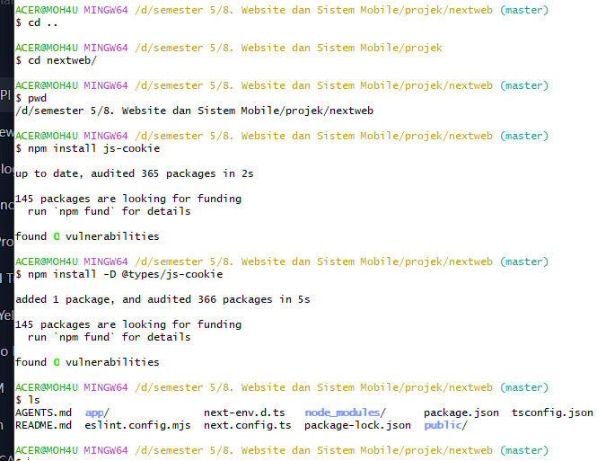

*Gambar 4. Masuk ke proyek dan memasang dependensi cookies.*

### Langkah 3.5 — Buat file `.env.local`

Pastikan terminal berada di folder `nextweb`. Buat file environment lalu buka proyek di VS Code:

```bash
touch .env.local
code .
```

Jika menggunakan Windows Explorer atau VS Code, file `.env.local` juga bisa dibuat langsung melalui **New File** pada root proyek. Letaknya harus sejajar dengan `package.json`.

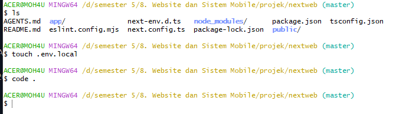

*Gambar 5. Membuat file `.env.local`.*

### Langkah 3.6 — Konfigurasikan URL API Laravel

Buka file `.env.local`, lalu isi dengan satu baris berikut:

```env
NEXT_PUBLIC_API_URL=http://laraweb.test/api
```

Simpan file dengan `Ctrl + S`. URL ini akan digunakan oleh halaman login untuk mengirim request ke `http://laraweb.test/api/login`.

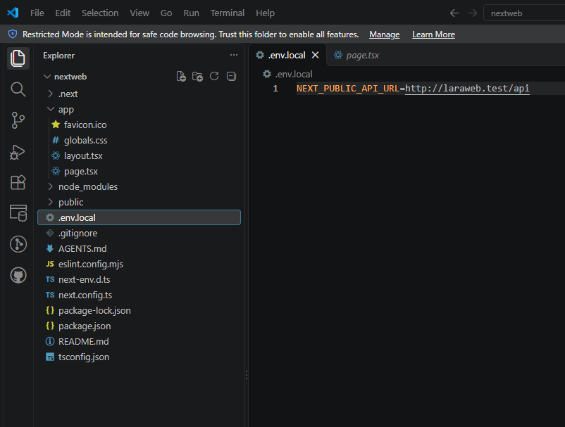

*Gambar 6. Pengaturan URL API Laravel pada `.env.local`.*

> **Catatan:** Jangan mengunggah `.env.local` ke repository publik. Jika URL backend berbeda di komputer lain, ganti nilainya sesuai alamat backend tersebut. Setelah mengubah environment, restart server Next.js.

## 4. Membuat Halaman Login

### Langkah 4.1 — Buat file halaman login

Di dalam folder `app`, buat folder `login`, kemudian buat file `page.tsx` di dalamnya. Lokasi file harus seperti berikut:

```text
nextweb/
├── app/
│   ├── login/
│   │   └── page.tsx
│   ├── layout.tsx
│   └── page.tsx
├── .env.local
└── package.json
```

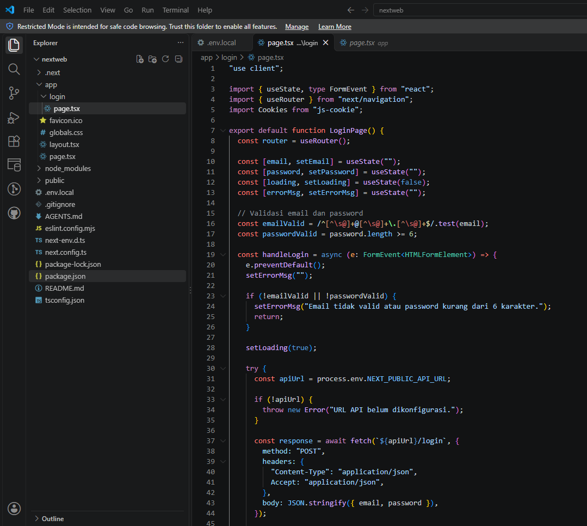

*Gambar 7. Lokasi file login dan contoh kode pada VS Code.*

### Langkah 4.2 — Masukkan kode `app/login/page.tsx`

Salin kode berikut secara lengkap ke `app/login/page.tsx`, lalu simpan dengan `Ctrl + S`.

```tsx
"use client";

import { useState, type FormEvent } from "react";
import { useRouter } from "next/navigation";
import Cookies from "js-cookie";

export default function LoginPage() {
  const router = useRouter();
  const [email, setEmail] = useState("");
  const [password, setPassword] = useState("");
  const [loading, setLoading] = useState(false);
  const [errorMsg, setErrorMsg] = useState("");

  // Validasi email dan password
  const emailValid = /^[^\s@]+@[^\s@]+\.[^\s@]+$/.test(email);
  const passwordValid = password.length >= 6;

  const handleLogin = async (e: FormEvent<HTMLFormElement>) => {
    e.preventDefault();
    setErrorMsg("");

    if (!emailValid || !passwordValid) {
      setErrorMsg("Email tidak valid atau password kurang dari 6 karakter.");
      return;
    }

    setLoading(true);
    try {
      const apiUrl = process.env.NEXT_PUBLIC_API_URL;
      if (!apiUrl) throw new Error("URL API belum dikonfigurasi.");

      const response = await fetch(`${apiUrl}/login`, {
        method: "POST",
        headers: {
          "Content-Type": "application/json",
          Accept: "application/json",
        },
        body: JSON.stringify({ email, password }),
      });

      const data = await response.json();
      if (!response.ok) throw new Error(data.message || "Login gagal.");

      // Response API harus berisi token atau access_token
      const token = data.token ?? data.access_token;
      if (!token) throw new Error("Token tidak ditemukan dari API.");

      // Cookie berlaku selama satu hari
      Cookies.set("token", token, {
        expires: 1,
        sameSite: "lax",
      });

      router.push("/dashboard");
    } catch (error: unknown) {
      setErrorMsg(
        error instanceof Error
          ? error.message
          : "Terjadi kesalahan saat login."
      );
    } finally {
      setLoading(false);
    }
  };

  return (
    <main className="min-h-screen flex items-center justify-center bg-gray-100">
      <div className="bg-white p-8 rounded-xl shadow-md w-full max-w-md">
        <h1 className="text-2xl font-bold text-center mb-6 text-gray-800">
          Login Sistem
        </h1>

        {errorMsg && (
          <div className="bg-red-100 text-red-700 p-3 rounded-md mb-4 text-sm">
            {errorMsg}
          </div>
        )}

        <form onSubmit={handleLogin} className="space-y-4">
          <div>
            <label className="block text-sm font-medium mb-1">Email</label>
            <input
              type="email"
              value={email}
              onChange={(e) => setEmail(e.target.value)}
              className="w-full border border-gray-300 rounded-md px-4 py-2"
              placeholder="admin@example.com"
              required
            />
            {email.length > 0 && !emailValid && (
              <p className="text-sm text-red-600 mt-1">
                Format email tidak valid.
              </p>
            )}
          </div>

          <div>
            <label className="block text-sm font-medium mb-1">Password</label>
            <input
              type="password"
              value={password}
              onChange={(e) => setPassword(e.target.value)}
              className="w-full border border-gray-300 rounded-md px-4 py-2"
              placeholder="Minimal 6 karakter"
              required
            />
            {password.length > 0 && !passwordValid && (
              <p className="text-sm text-red-600 mt-1">
                Password minimal 6 karakter.
              </p>
            )}
          </div>

          <button
            type="submit"
            disabled={loading || !emailValid || !passwordValid}
            className="w-full py-2 px-4 rounded-md text-white font-semibold bg-blue-600 hover:bg-blue-700 disabled:bg-blue-300 disabled:cursor-not-allowed"
          >
            {loading ? "Memproses..." : "Masuk"}
          </button>
        </form>
      </div>
    </main>
  );
}
```

**Penjelasan singkat:**

- `"use client"` mengaktifkan interaksi browser pada komponen login.
- `useState` menyimpan input email, password, status loading, dan pesan error.
- `fetch()` mengirim HTTP `POST` ke API Laravel.
- `Cookies.set()` menyimpan token yang diterima dari API.
- `router.push("/dashboard")` mengarahkan pengguna ke dashboard setelah login berhasil.

## 5. Membuat Halaman Dashboard

### Langkah 5.1 — Buat folder dan file dashboard

Di dalam folder `app`, buat folder `dashboard` dan file `page.tsx`. Lokasinya harus seperti berikut:

```text
app/dashboard/page.tsx
```

Masukkan kode berikut:

```tsx
export default function DashboardPage() {
  return (
    <main className="min-h-screen flex items-center justify-center bg-gray-100">
      <div className="bg-white p-8 rounded-xl shadow-md">
        <h1 className="text-2xl font-bold text-gray-800">
          Selamat Datang di Dashboard
        </h1>
        <p className="mt-3 text-gray-600">
          Login berhasil. Kamu sudah masuk ke halaman dashboard.
        </p>
      </div>
    </main>
  );
}
```

Simpan file dengan `Ctrl + S`.

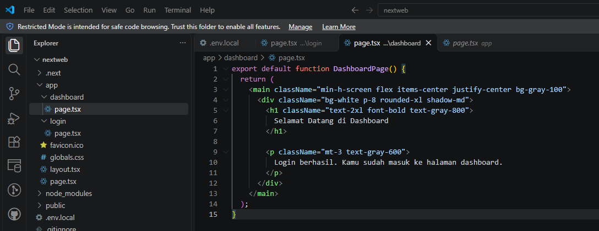

*Gambar 8. Contoh kode halaman dashboard.*

> Halaman dashboard ini masih berupa halaman dummy untuk praktikum. Halaman belum diproteksi secara server-side; jangan menganggap halaman ini sebagai mekanisme keamanan aplikasi produksi.

## 6. Menjalankan Aplikasi

### Langkah 6.1 — Jalankan server pengembangan

Buka terminal di VS Code, pastikan terminal berada di folder `nextweb`, lalu jalankan:

```bash
npm run dev
```

Tunggu sampai Next.js menampilkan status siap dan URL lokal. Jika port `3000` sedang digunakan, Next.js dapat memilih port lain, misalnya `3002`. Gunakan port yang benar-benar muncul pada terminal.

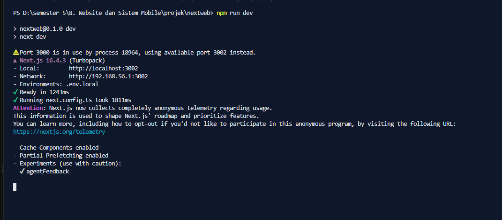

*Gambar 9. Server Next.js berjalan menggunakan port alternatif ketika port 3000 telah digunakan.*

### Langkah 6.2 — Buka halaman login

Buka browser dan akses alamat yang ditampilkan di terminal. Berdasarkan hasil praktikum, port yang digunakan adalah `3002`:

```text
http://localhost:3002/login
```

Jika port pada terminal berbeda, sesuaikan URL-nya.

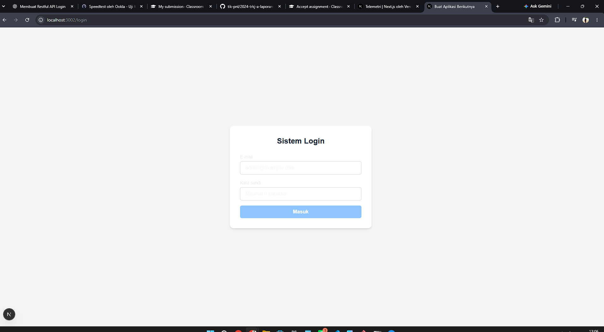

*Gambar 10. Tampilan halaman login pada browser.*

## 7. Pengujian Praktikum

Pastikan backend Laravel aktif sebelum menguji login.

| No. | Skenario | Hasil yang diharapkan |
|---:|---|---|
| 1 | Buka `/login` | Form email, password, dan tombol Masuk tampil. |
| 2 | Masukkan format email tidak valid | Validasi browser atau form menolak input yang tidak valid. |
| 3 | Masukkan password kurang dari 6 karakter | Tombol Masuk tetap nonaktif atau validasi menolak input. |
| 4 | Login menggunakan email dan password yang benar | API mengembalikan respons sukses dan token. |
| 5 | Setelah login sukses | Browser diarahkan ke `/dashboard`. |
| 6 | Periksa cookies | Cookie bernama `token` muncul pada origin frontend. |
| 7 | Gunakan password yang salah | Pesan error ditampilkan dan login tidak diarahkan ke dashboard. |

### Langkah 7.1 — Login menggunakan akun terdaftar

Isi email dan password yang benar-benar terdaftar di database backend Laravel. Placeholder `admin@example.com` hanya contoh, bukan akun otomatis.

Apabila login berhasil, aplikasi membaca `token` atau `access_token` pada respons API, menyimpannya ke cookies, lalu mengarahkan browser ke `/dashboard`.

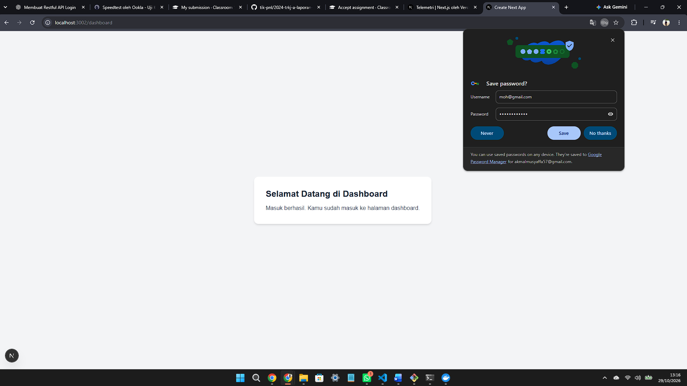

*Gambar 11. Halaman dashboard setelah login berhasil. Popup penyimpanan password pada browser bukan bagian dari aplikasi Next.js.*

### Langkah 7.2 — Periksa token di cookies

1. Tekan `F12` di Chrome.
2. Buka tab **Application**.
3. Di bagian **Storage**, pilih **Cookies**.
4. Pilih origin frontend, misalnya `http://localhost:3002`.
5. Cari cookie bernama `token`.

Cookie seharusnya muncul setelah login berhasil dan API mengembalikan token yang sesuai.

## 8. Troubleshooting

| Masalah | Pemeriksaan dan solusi |
|---|---|
| `node` atau `npm` tidak dikenali | Pastikan Node.js terpasang, lalu buka terminal baru. |
| Port 3000 digunakan | Gunakan port alternatif yang tercetak di terminal, misalnya 3002. |
| URL API tidak terbaca | Pastikan `.env.local` berada di root proyek dan restart `npm run dev` setelah mengubahnya. |
| Login menampilkan email atau password tidak valid | Pastikan kredensial akun benar dan endpoint Laravel dapat digunakan. |
| Browser menampilkan CORS error | Periksa konfigurasi CORS backend Laravel agar origin frontend diizinkan. |
| Token tidak tersimpan | Periksa response API, pastikan properti `token` atau `access_token` tersedia dan login sukses. |
| Dashboard tidak ditemukan | Pastikan file berada di `app/dashboard/page.tsx`. |
| Kode belum berubah pada browser | Simpan file dengan `Ctrl + S` dan periksa terminal untuk error compile. |


## E. Hasil dan Pembahasan


Pada praktikum ini, proyek frontend berhasil dibuat menggunakan framework Next.js dengan nama `nextweb`. Proyek dibuat menggunakan TypeScript, ESLint, Tailwind CSS, dan App Router. Proses instalasi dependensi berhasil diselesaikan dan proyek dapat dijalankan pada lingkungan lokal.

Perintah yang digunakan untuk membuat proyek adalah:

```bash
npx create-next-app@latest nextweb
```

## F. Kesimpulan

Berdasarkan praktikum yang telah dilakukan, dapat disimpulkan bahwa inisialisasi proyek Next.js dan integrasi API autentikasi Laravel berhasil diimplementasikan. Proyek Next.js dibuat menggunakan TypeScript, Tailwind CSS, dan App Router, serta dilengkapi dengan library `js-cookie` untuk mendukung penyimpanan token autentikasi.

Halaman login berhasil dibuat menggunakan Client Component dengan fitur validasi email dan password. Form login terhubung dengan endpoint `POST /api/login` pada backend Laravel untuk mengirimkan data autentikasi dalam format JSON. Setelah kredensial yang digunakan dinyatakan valid oleh API, aplikasi berhasil menerima token dan mengarahkan pengguna ke halaman dashboard.

Selain itu, halaman dashboard berhasil dibuat dan ditampilkan melalui route `/dashboard`. Pengujian menunjukkan bahwa aplikasi Next.js dapat dijalankan pada lingkungan lokal dan berkomunikasi dengan backend Laravel untuk menjalankan proses login.

Dengan demikian, praktikum ini memberikan pemahaman mengenai pembuatan aplikasi frontend menggunakan Next.js, konfigurasi URL API melalui file `.env.local`, pengelolaan state dan validasi form, komunikasi HTTP dengan backend, serta penanganan token autentikasi menggunakan cookies. Implementasi ini menjadi dasar untuk pengembangan fitur autentikasi dan pengelolaan akses pengguna pada modul selanjutnya.

## G. Referensi

[1] Vercel, “Next.js Documentation: App Router,” [Online]. Available: https://nextjs.org/docs/app. [Accessed: Oct. 29, 2026].

[2] Vercel, “Next.js Documentation: Getting Started,” [Online]. Available: https://nextjs.org/docs/app/getting-started. [Accessed: Oct. 29, 2026].

[3] Laravel, “Laravel Documentation,” [Online]. Available: https://laravel.com/docs. [Accessed: Oct. 29, 2026].

[4] js-cookie, “A Simple, Lightweight JavaScript API for Handling Cookies,” GitHub Repository. [Online]. Available: https://github.com/js-cookie/js-cookie. [Accessed: Oct. 29, 2026].

[5] OpenJS Foundation, “Node.js Documentation,” [Online]. Available: https://nodejs.org/docs/. [Accessed: Oct. 29, 2026].

[6] npm, “npm Documentation,” [Online]. Available: https://docs.npmjs.com/. [Accessed: Oct. 29, 2026].

