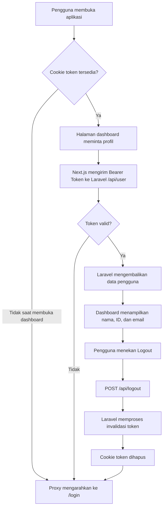

<div align="center">

### LAPORAN WEBSITE DAN SISITEM MOBILE


### Disusun Oleh:  
Nama               : MOH. Akmal Musyaffa
NIM                : 2024903430018 
Kelas              : TRKJ 3 A


### Program Studi Teknologi Rekayasa Komputer Jaringan
### Jurusan Teknologi Informasi dan Komputer
### Politeknik Negeri Lhokseumawe
### 2026


---


## Lembar Pengesahan

| No. Praktikum     | : | 06 |
|------------------:|:-:|:--------------|
| Judul Praktikum   | : | Laporan Middleware & Integrasi Protected API |
| Tanggal Praktikum | : | 29 Oktober 2026 |
| Tanggal Penyerahan| : | 29 Oktober 2026 |
| Nama Praktikan    | : | MOH. Akmal Musyaffa |
| NIM/Kelas Praktikan| : | 2024903430018 / TRKJ 3 A |
| Nilai Praktikum   | : | .......................... |
| Dosen Pengampu    | : | Muhammad Davi, S.Kom., M.Cs. |

Mengetahui,  
Dosen Pengampu
<br><br><br><br><br>

Muhammad Davi, S.Kom., M.Cs.
</div>


## Daftar Isi
- [Lembar Pengesahan](#lembar-pengesahan)
- [Daftar Isi](#daftar-isi)
- [Tujuan Praktikum](#tujuan-praktikum)
- [Dasar Teori](#dasar-teori)
- [Alat dan Bahan](#alat-dan-bahan)
- [Langkah Kerja](#langkah-kerja)
- [Hasil dan Pembahasan](#hasil-dan-pembahasan)
- [Kesimpulan](#kesimpulan)
- [Referensi](#referensi)
---

## A. Tujuan Praktikum
1. Membuat proteksi rute menggunakan Proxy pada Next.js.
2. Mengarahkan pengguna yang belum login ke halaman `/login`.
3. Mengarahkan pengguna yang sudah login dari `/login` ke `/dashboard`.
4. Mengambil data profil dari Protected API Laravel menggunakan Bearer Token di Server Component.
5. Membuat fitur logout yang memanggil API Laravel, menghapus cookie token, dan mengarahkan pengguna ke halaman login.
6. Menguji alur login, akses dashboard, dan logout.

## B. Dasar Teori

1. Middleware dan Proxy pada Next.js

Middleware atau Proxy merupakan mekanisme yang digunakan untuk memeriksa permintaan (request) sebelum pengguna melanjutkan ke halaman tertentu. Pada Modul 5, fitur ini digunakan untuk mengatur akses pengguna ke halaman login dan dashboard berdasarkan keberadaan token autentikasi di dalam cookies.

Pada proyek Next.js 16, mekanisme ini diimplementasikan menggunakan file proxy.ts. File tersebut memeriksa cookie bernama token dan menentukan apakah permintaan dapat dilanjutkan atau harus diarahkan ke halaman lain menggunakan NextResponse.redirect().

2. Route Protection

Route protection adalah proses membatasi akses ke halaman tertentu agar sesuai dengan kondisi autentikasi pengguna. Dalam praktikum ini, halaman /dashboard hanya dapat diakses apabila cookie token tersedia. Jika token tidak ditemukan, pengguna akan diarahkan ke halaman /login.

Sebaliknya, pengguna yang sudah memiliki token akan diarahkan kembali ke /dashboard apabila mencoba membuka halaman /login. Pengaturan rute yang diperiksa dilakukan melalui properti matcher pada file proxy.ts.

Pemeriksaan keberadaan cookie di dalam Proxy tidak menjamin bahwa token masih valid. Oleh karena itu, validitas token tetap harus diperiksa oleh backend Laravel melalui middleware autentikasi.

3. Cookies sebagai Penyimpanan Token

Cookies merupakan mekanisme penyimpanan data yang dapat digunakan untuk mempertahankan informasi sesi atau autentikasi pengguna pada browser. Pada praktikum ini, token yang diterima setelah proses login disimpan menggunakan pustaka js-cookie dengan nama token.

Token tersebut kemudian digunakan oleh Proxy untuk memeriksa keberadaan autentikasi dan oleh Server Component untuk mengakses Protected API. Ketika pengguna melakukan logout, aplikasi menghapus cookie tersebut agar browser tidak lagi menggunakan token yang tersimpan.

Dalam implementasi praktikum ini, cookie diakses melalui JavaScript browser. Untuk aplikasi produksi, penyimpanan token juga perlu mempertimbangkan keamanan, termasuk penggunaan cookie HttpOnly, Secure, dan pengaturan SameSite yang sesuai.

4. Server Components pada Next.js

Server Component merupakan komponen React yang dirender di sisi server. Dalam Next.js App Router, Server Component dapat digunakan untuk mengambil data dari backend sebelum menampilkan halaman kepada pengguna.

Pada Modul 5, halaman app/dashboard/page.tsx menggunakan Server Component untuk membaca token melalui fungsi cookies() dari next/headers. Token tersebut kemudian digunakan dalam permintaan HTTP ke API Laravel untuk mendapatkan informasi profil pengguna.

Pendekatan ini memungkinkan proses pengambilan data profil dilakukan di sisi server, sehingga token tidak perlu disisipkan ke dalam kode tampilan dashboard.

5. Protected API

Protected API adalah endpoint yang hanya dapat diakses apabila permintaan memenuhi persyaratan autentikasi dan otorisasi yang ditetapkan oleh backend. Dalam praktikum ini, endpoint GET /api/user digunakan untuk mengambil informasi pengguna yang sedang login.

Endpoint tersebut dilindungi oleh middleware auth:api pada Laravel. Middleware memeriksa autentikasi sebelum mengizinkan permintaan mengakses data pengguna.

Jika autentikasi berhasil, API mengembalikan data profil dalam format JSON, seperti ID, nama, dan email. Jika token tidak valid atau autentikasi gagal, API dapat mengembalikan respons seperti 401 Unauthorized.

6. Bearer Token dan JWT Authentication

Bearer Token merupakan format pengiriman token autentikasi melalui header HTTP Authorization. Pada praktikum ini, token yang diterima dari API login Laravel disertakan dalam permintaan ke endpoint yang dilindungi.

Contoh header yang digunakan adalah:

Authorization: Bearer <token>

Backend Laravel pada proyek ini menggunakan autentikasi JWT (JSON Web Token) melalui guard api dan middleware auth:api. Token digunakan untuk mengidentifikasi dan memverifikasi pengguna saat mengakses endpoint yang dilindungi.

Token harus dikirimkan hanya melalui permintaan yang sesuai dengan konfigurasi backend. Keberadaan token di browser saja tidak membuktikan bahwa token tersebut masih sah; backend tetap bertanggung jawab memvalidasinya.

7. HTTP Request dan Respons JSON

HTTP merupakan protokol komunikasi yang digunakan aplikasi frontend untuk berinteraksi dengan backend. Dalam praktikum ini, Next.js menggunakan fungsi fetch() untuk mengirim permintaan HTTP ke API Laravel.

Permintaan GET /api/user digunakan untuk mengambil profil pengguna dengan menyertakan header Authorization dan Accept: application/json. Respons API kemudian diproses sebagai JSON agar data pengguna dapat ditampilkan pada dashboard.

Konfigurasi cache: "no-store" digunakan pada pengambilan profil agar respons permintaan tersebut tidak menggunakan hasil cache. Dengan demikian, aplikasi melakukan permintaan data baru ketika proses pengambilan profil dijalankan.

8. Logout dan Pencabutan Token

Logout merupakan proses mengakhiri sesi autentikasi pengguna. Dalam praktikum ini, tombol Logout mengirim permintaan POST /api/logout ke backend Laravel dengan menyertakan Bearer Token.

Pada AuthController, proses logout menggunakan JWTAuth::invalidate(JWTAuth::getToken()) untuk menginvalidasi token JWT yang sedang digunakan. Jika permintaan berhasil, aplikasi menghapus cookie token dan mengarahkan pengguna kembali ke halaman /login.

Pencabutan token pada backend dan penghapusan cookie browser merupakan dua proses yang berbeda. Penghapusan cookie saja tidak membuktikan bahwa token sudah tidak berlaku di backend. Oleh karena itu, respons API logout perlu diperiksa ketika melakukan pengujian.

9. Integrasi Frontend Next.js dan Backend Laravel

Integrasi frontend dan backend merupakan proses menghubungkan antarmuka pengguna dengan layanan pengolahan data melalui API. Dalam praktikum ini, Next.js berfungsi sebagai frontend, sedangkan Laravel menyediakan endpoint autentikasi dan data profil pengguna.

Alamat API disimpan pada file .env.local melalui variabel NEXT_PUBLIC_API_URL. Variabel tersebut digunakan oleh halaman login, dashboard, dan tombol logout untuk menentukan alamat backend yang akan diakses.

Secara keseluruhan, integrasi ini mencakup proses login, penyimpanan token, proteksi rute, pengambilan profil pengguna, dan logout. Pengujian dilakukan untuk memastikan bahwa pengguna tanpa autentikasi tidak dapat mengakses dashboard dan pengguna yang telah logout harus melakukan login kembali sebelum mengakses halaman yang dilindungi.

10. Kesimpulan Dasar Teori

Berdasarkan teori yang diterapkan dalam praktikum, Proxy pada Next.js digunakan untuk mengatur akses rute berdasarkan keberadaan token, sedangkan Server Component digunakan untuk mengambil data profil dari Protected API. Laravel menangani validasi autentikasi melalui middleware auth:api dan menyediakan endpoint untuk mengambil profil serta mengakhiri sesi pengguna.

Kombinasi mekanisme tersebut menjadi dasar implementasi autentikasi frontend dan backend, pengelolaan akses halaman, pengambilan data pengguna, serta proses


> **Catatan versi Next.js:** screenshot praktikum menggunakan file `proxy.ts`. Pada proyek Next.js 16 yang digunakan dalam praktikum ini, gunakan nama `proxy.ts` seperti di bawah, bukan membuat `middleware.ts` tambahan.

## Gambaran Alur Sistem



## C. Alat dan Bahan
- Node.js dan npm sudah terpasang.
- Docker/Laradock dapat dijalankan.
- Proyek Laravel berada pada folder `laraweb`.
- Proyek Next.js berada pada folder `nextweb`.
- API login Laravel sudah berjalan dan menggunakan JWT dengan middleware `auth:api`.
- Login pada modul sebelumnya sudah menyimpan token autentikasi dalam cookie bernama `token`.


## D. Langkah Kerja

### Langkah 1.1. Buka folder proyek

Buka folder kerja `projek` yang berisi folder `laradock` dan `laraweb`. Proyek Next.js yang dibuat pada langkah berikutnya akan berada di folder yang sama.

Contoh lokasi proyek:

```text
D:\semester 5\8. Website dan Sistem Mobile\projek
```

Screenshot berikut menunjukkan folder kerja dan terminal yang dipakai saat praktikum.


### Langkah 1.2. Periksa Node.js

Buka Git Bash atau terminal pada folder `projek`, lalu jalankan:

```bash
node -v
npm -v
```

Perintah `node -v` menampilkan versi Node.js. Pada screenshot praktikum, versi Node.js yang terlihat adalah `v24.14.0`.


### Langkah 1.3. Buat proyek Next.js

Jika proyek `nextweb` belum ada, jalankan dari folder `projek`:

```bash
npx create-next-app@latest nextweb
```

Ikuti pertanyaan instalasi. Pada screenshot praktikum, opsi *recommended defaults* dipilih. Tunggu sampai proses instalasi selesai dan muncul pesan keberhasilan pembuatan proyek.


> Jika folder `nextweb` sudah ada dan proyek Modul 4 telah dibuat, **jangan membuat proyek baru**. Lanjutkan dengan proyek yang sudah ada agar kode login sebelumnya tidak tertimpa.

### Langkah 1.4. Masuk ke folder dan pasang dependensi cookie

Masuk ke direktori frontend:

```bash
cd nextweb
```

Pasang `js-cookie` untuk mengelola cookie dari Client Component:

```bash
npm install js-cookie
npm install -D @types/js-cookie
```

Perintah `ls` dapat digunakan untuk memastikan file proyek tersedia:

```bash
ls
```


### Langkah 1.5. Buka proyek di VS Code dan buat file environment

Jika belum membuka proyek di VS Code, jalankan:

```bash
touch .env.local
code .
```

Perintah `touch .env.local` membuat file environment lokal bila belum tersedia. Pada Windows PowerShell, file ini juga dapat dibuat melalui **New File** di VS Code.


### Langkah 1.6. Konfigurasi URL API

Buka file `.env.local` pada root proyek `nextweb`, lalu isi:

```env
NEXT_PUBLIC_API_URL=http://laraweb.test/api
```

Simpan menggunakan `Ctrl + S`.

Pastikan host `laraweb.test` memang dapat dijangkau dari komputer dan konfigurasi Laravel/hosts yang digunakan pada modul sebelumnya masih aktif. Setelah mengubah `.env.local`, bila server Next.js sedang berjalan, hentikan dengan `Ctrl + C` lalu jalankan lagi `npm run dev` agar variabel dimuat ulang.


---

## Bagian 2. Memeriksa API Laravel

### Langkah 2.1. Masuk ke container Laradock

Buka terminal pada folder `laradock` atau gunakan terminal yang biasa dipakai untuk menjalankan Docker Compose. Jalankan:

```bash
docker compose exec workspace bash
cd /var/www
php artisan route:list --path=api
```

Perintah tersebut menampilkan daftar route API Laravel. Pada screenshot awal praktikum, route login, logout, refresh token, mahasiswa, dan dosen sudah tersedia.


### Langkah 2.2. Periksa route dan controller autentikasi

Di dalam shell container yang berada pada `/var/www`, periksa daftar route dan file yang berkaitan dengan autentikasi:

```bash
sed -n '1,220p' routes/api.php
sed -n '1,260p' app/Http/Controllers/Api/AuthController.php
php artisan route:list --path=api -v
```

Dari konfigurasi praktikum, login berada pada `POST /api/login`, sedangkan route terlindungi menggunakan middleware `auth:api`. Controller autentikasi memakai `JWTAuth`, termasuk pada proses logout.


Pada hasil `route:list -v`, pastikan route terlindungi menampilkan middleware autentikasi API. Route login pada contoh ini berada di luar grup `auth:api`, sedangkan route logout dan refresh token berada di dalam grup tersebut.


### Langkah 2.3. Tambahkan endpoint profil `GET /api/user`

Buka file Laravel berikut di VS Code:

```text
laraweb/routes/api.php
```

Tambahkan route `/user` **di dalam grup `auth:api` yang sudah ada**. Jangan menghapus route login, refresh-token, logout, mahasiswa, atau dosen.

Contoh susunan `routes/api.php`:

```php
<?php

use App\Http\Controllers\Api\AuthController;
use App\Http\Controllers\MahasiswaController;
use App\Http\Controllers\DosenController;
use Illuminate\Support\Facades\Route;

Route::post('/login', [AuthController::class, 'login']);

Route::group(['middleware' => 'auth:api'], function () {
    Route::get('/refresh-token', [AuthController::class, 'refresh_token']);
    Route::post('/logout', [AuthController::class, 'logout']);

    Route::apiResource('mahasiswa', MahasiswaController::class, [
        'except' => ['create', 'edit']
    ]);

    Route::apiResource('dosen', DosenController::class, [
        'except' => ['create', 'edit']
    ]);

    // Mengambil profil pengguna yang sedang login
    Route::get('/user', function () {
        return response()->json(auth('api')->user());
    });
});
```

Simpan file dengan `Ctrl + S`.


### Langkah 2.4. Verifikasi route profil

Kembali ke terminal container Laravel dan jalankan:

```bash
php artisan route:list --path=api/user -v
```

Hasil yang diharapkan memuat `GET|HEAD api/user` dan middleware autentikasi API. Jika muncul `ParseError` seperti `Unclosed '{'`, periksa penutup grup route. Fungsi `/user` harus diakhiri dengan `});` dan grup `auth:api` juga harus ditutup dengan `});`.


---

## Bagian 3. Mengonsumsi Protected API di Server Component

### Langkah 3.1. Buka file dashboard

Pada proyek Next.js `nextweb`, buka atau buat file:

```text
app/dashboard/page.tsx
```

Ganti seluruh isi file dengan kode berikut. Halaman akan membaca cookie token pada sisi server, mengirim token sebagai Bearer Token ke endpoint Laravel `/api/user`, dan menampilkan profil yang dikembalikan API.

```tsx
import { cookies } from "next/headers";
import { redirect } from "next/navigation";
import LogoutButton from "./logout-button";

export const instant = false;

interface UserProfile {
  id: number;
  name: string;
  email: string;
}

async function getUserProfile(): Promise<UserProfile | null> {
  const cookieStore = await cookies();
  const token = cookieStore.get("token")?.value;

  if (!token) {
    return null;
  }

  const apiUrl = process.env.NEXT_PUBLIC_API_URL?.replace(/\/+$/, "");

  if (!apiUrl) {
    throw new Error("NEXT_PUBLIC_API_URL belum dikonfigurasi.");
  }

  let response: Response;

  try {
    response = await fetch(`${apiUrl}/user`, {
      method: "GET",
      headers: {
        Authorization: `Bearer ${token}`,
        Accept: "application/json",
      },
      cache: "no-store",
    });
  } catch {
    throw new Error(
      "Tidak dapat menghubungi API Laravel. Periksa koneksi backend."
    );
  }

  if (response.status === 401 || response.status === 403) {
    return null;
  }

  if (!response.ok) {
    throw new Error(
      `Gagal mengambil profil pengguna: HTTP ${response.status}`
    );
  }

  return (await response.json()) as UserProfile;
}

export default async function DashboardPage() {
  const user = await getUserProfile();

  if (!user) {
    redirect("/login");
  }

  const initial = user.name.trim().charAt(0).toUpperCase() || "U";

  return (
    <main className="relative min-h-screen overflow-hidden bg-[#080d1b] px-4 py-8 text-white sm:px-6 lg:py-12">
      <div
        aria-hidden="true"
        className="pointer-events-none absolute inset-0 overflow-hidden"
      >
        <div className="absolute -left-40 -top-40 h-96 w-96 rounded-full bg-blue-600/20 blur-[120px]" />
        <div className="absolute -bottom-40 -right-24 h-96 w-96 rounded-full bg-violet-600/20 blur-[120px]" />
        <div
          className="absolute inset-0 opacity-[0.08]"
          style={{
            backgroundImage:
              "linear-gradient(rgba(148,163,184,.4) 1px, transparent 1px), linear-gradient(90deg, rgba(148,163,184,.4) 1px, transparent 1px)",
            backgroundSize: "48px 48px",
          }}
        />
      </div>

      <div className="relative mx-auto max-w-6xl">
        <header className="mb-9 flex flex-col gap-6 sm:flex-row sm:items-center sm:justify-between">
          <div>
            <p className="mb-3 text-sm font-bold tracking-[0.25em] text-cyan-300">
              NEXTWEB
            </p>
            <h1 className="text-3xl font-bold tracking-tight sm:text-4xl">
              Dashboard
            </h1>
            <p className="mt-3 text-sm leading-6 text-slate-400 sm:text-base">
              Semua informasi akunmu dalam satu tempat.
            </p>
          </div>

          <div className="flex items-center gap-3 self-start rounded-2xl border border-white/10 bg-white/[0.06] p-3 backdrop-blur-xl sm:self-auto">
            <div className="flex h-12 w-12 items-center justify-center rounded-xl bg-gradient-to-br from-cyan-400 to-violet-500 text-lg font-bold">
              {initial}
            </div>
            <div className="min-w-0">
              <p className="text-xs text-slate-400">LOGIN SEBAGAI</p>
              <p className="max-w-48 truncate font-semibold">{user.name}</p>
            </div>
          </div>
        </header>

        <section className="overflow-hidden rounded-3xl border border-white/10 bg-[#101729]/90 shadow-2xl shadow-black/20 backdrop-blur-xl">
          <div className="relative overflow-hidden bg-gradient-to-r from-blue-700 via-blue-600 to-violet-700 px-6 py-9 sm:px-10 sm:py-12">
            <div className="relative">
              <span className="inline-flex rounded-full border border-white/20 bg-white/10 px-3 py-1.5 text-xs font-semibold tracking-wide text-blue-50">
                AREA PENGGUNA
              </span>
              <h2 className="mt-5 text-2xl font-bold sm:text-4xl">
                Selamat Datang, {user.name}!
              </h2>
              <p className="mt-3 max-w-2xl text-sm leading-6 text-blue-100 sm:text-base">
                Login berhasil. Profil ini diperoleh langsung dari API Laravel
                menggunakan Bearer Token.
              </p>
            </div>
          </div>

          <div className="p-6 sm:p-9">
            <div className="mb-6">
              <h3 className="text-xl font-bold">Informasi Akun</h3>
              <p className="mt-2 text-sm text-slate-400">
                Detail pengguna yang sedang terautentikasi.
              </p>
            </div>

            <div className="grid gap-4 sm:grid-cols-3">
              <div className="rounded-2xl border border-white/10 bg-white/[0.04] p-5 transition hover:border-blue-400/30">
                <p className="text-sm text-slate-400">ID Pengguna</p>
                <p className="mt-4 text-3xl font-bold text-cyan-300">
                  {user.id}
                </p>
                <p className="mt-2 text-xs text-slate-500">Identitas akun</p>
              </div>

              <div className="min-w-0 rounded-2xl border border-white/10 bg-white/[0.04] p-5 sm:col-span-2">
                <p className="text-sm text-slate-400">Alamat Email</p>
                <p className="mt-4 break-all text-xl font-semibold text-white">
                  {user.email}
                </p>
                <p className="mt-2 text-xs text-slate-500">
                  Email yang terdaftar pada sistem
                </p>
              </div>
            </div>

            <div className="mt-5 flex flex-col gap-4 rounded-2xl border border-emerald-400/20 bg-emerald-400/[0.06] p-5 sm:flex-row sm:items-center sm:justify-between">
              <div>
                <p className="font-semibold text-white">Status Autentikasi</p>
                <p className="mt-2 text-sm text-slate-400">
                  Profil berhasil dimuat dari server.
                </p>
              </div>
              <span className="inline-flex w-fit items-center gap-2 rounded-full border border-emerald-400/20 bg-emerald-400/10 px-4 py-2 text-sm font-semibold text-emerald-300">
                <span className="h-2 w-2 rounded-full bg-emerald-400" />
                Terautentikasi
              </span>
            </div>
          </div>

          <footer className="flex flex-col gap-5 border-t border-white/10 bg-white/[0.025] px-6 py-5 sm:flex-row sm:items-center sm:justify-between sm:px-9">
            <div>
              <p className="text-sm font-medium text-slate-300">Sesi NextWeb</p>
              <p className="mt-1 text-xs text-slate-500">
                Pastikan logout saat selesai menggunakan akun.
              </p>
            </div>
            <LogoutButton />
          </footer>
        </section>

        <p className="mt-6 text-center text-xs text-slate-500">
          NextWeb · Protected Dashboard
        </p>
      </div>
    </main>
  );
}
```

Screenshot kode dashboard pada dokumen sumber memperlihatkan pembacaan cookie `token`, pengiriman header `Authorization: Bearer ...`, dan penggunaan `cache: "no-store"`.


### Penjelasan kode dashboard

- `cookies()` membaca cookie `token` dari request pada sisi server.
- `fetch(.../user)` mengirim token JWT ke Laravel melalui header `Authorization`.
- `cache: "no-store"` meminta data profil terbaru setiap request.
- `redirect("/login")` mengarahkan pengguna ke halaman login saat token tidak tersedia atau API menolak autentikasi.
- Data `id`, `name`, dan `email` diambil dari respons API, bukan diketik tetap pada tampilan.

---

## Bagian 4. Memproteksi Halaman dengan Proxy

### Langkah 4.1. Buat file `proxy.ts`

Di root proyek `nextweb` (sejajar dengan `app`, `package.json`, dan `.env.local`), buat file bernama:

```text
proxy.ts
```

Isi dengan kode berikut:

```typescript
import { NextResponse } from "next/server";
import type { NextRequest } from "next/server";

export function proxy(request: NextRequest) {
  const token = request.cookies.get("token")?.value;
  const pathname = request.nextUrl.pathname;

  // Dashboard hanya untuk pengguna yang memiliki token.
  if (pathname.startsWith("/dashboard") && !token) {
    return NextResponse.redirect(new URL("/login", request.url));
  }

  // Pengguna yang sudah memiliki token diarahkan ke dashboard.
  if (pathname === "/login" && token) {
    return NextResponse.redirect(new URL("/dashboard", request.url));
  }

  return NextResponse.next();
}

export const config = {
  matcher: ["/dashboard/:path*", "/login"],
};
```

Simpan dengan `Ctrl + S`.


### Penjelasan kode Proxy

1. `request.cookies.get("token")` membaca keberadaan cookie token.
2. Bila pengguna membuka `/dashboard` tanpa token, Proxy mengalihkan ke `/login`.
3. Bila cookie token tersedia dan pengguna membuka `/login`, Proxy mengalihkan ke `/dashboard`.
4. `matcher` membatasi Proxy pada rute dashboard dan login.

> Proxy memeriksa keberadaan cookie, bukan memastikan isi JWT valid. Validitas token tetap harus diputuskan backend Laravel melalui middleware `auth:api`.

---

## Bagian 5. Membuat Tombol Logout

### Langkah 5.1. Buat file `logout-button.tsx`

Di dalam folder `app/dashboard`, buat file:

```text
app/dashboard/logout-button.tsx
```


Isi file dengan kode berikut:

```tsx
"use client";

import Cookies from "js-cookie";
import { useRouter } from "next/navigation";
import { useState } from "react";

export default function LogoutButton() {
  const router = useRouter();
  const [loading, setLoading] = useState(false);
  const [error, setError] = useState("");

  async function handleLogout() {
    if (loading) return;

    const token = Cookies.get("token");

    if (!token) {
      router.replace("/login");
      router.refresh();
      return;
    }

    const apiUrl = process.env.NEXT_PUBLIC_API_URL?.replace(/\/+$/, "");

    if (!apiUrl) {
      setError("URL API belum dikonfigurasi.");
      return;
    }

    setLoading(true);
    setError("");

    try {
      const response = await fetch(`${apiUrl}/logout`, {
        method: "POST",
        headers: {
          Authorization: `Bearer ${token}`,
          Accept: "application/json",
        },
        cache: "no-store",
      });

      if (response.ok) {
        Cookies.remove("token", { path: "/" });
        router.replace("/login");
        router.refresh();
        return;
      }

      if (response.status === 401 || response.status === 403) {
        Cookies.remove("token", { path: "/" });
        router.replace("/login");
        router.refresh();
        return;
      }

      setError(`Logout gagal. HTTP ${response.status}.`);
    } catch {
      setError("Tidak dapat menghubungi API Laravel.");
    } finally {
      setLoading(false);
    }
  }

  return (
    <div className="flex flex-col gap-2 sm:items-end">
      <button
        type="button"
        onClick={handleLogout}
        disabled={loading}
        className="inline-flex items-center justify-center gap-2 rounded-xl bg-red-600 px-5 py-3 text-sm font-semibold text-white shadow-sm transition hover:bg-red-700 focus-visible:outline-none focus-visible:ring-2 focus-visible:ring-red-500 focus-visible:ring-offset-2 disabled:cursor-not-allowed disabled:opacity-60"
      >
        {loading ? "Sedang Logout..." : "Logout"}
      </button>

      {error && (
        <p role="alert" className="max-w-xs text-sm text-red-400">
          {error}
        </p>
      )}
    </div>
  );
}
```

### Langkah 5.2. Hubungkan tombol logout ke dashboard

Pada file `app/dashboard/page.tsx`, pastikan import berikut ada di bagian atas:

```tsx
import LogoutButton from "./logout-button";
```

Di bagian footer dashboard, panggil komponen:

```tsx
<LogoutButton />
```

Pada kode dashboard lengkap di Bagian 3, import dan komponen tersebut sudah dicantumkan.

### Langkah 5.3. Cara kerja logout

1. Tombol membaca token dari cookie browser.
2. Aplikasi mengirim `POST /api/logout` dengan header Bearer Token.
3. Laravel menjalankan handler logout yang ada pada `AuthController`.
4. Jika respons sukses, cookie `token` dihapus.
5. Pengguna diarahkan ke `/login`.

Pada controller Laravel di dokumen sumber, logout menggunakan `JWTAuth::invalidate(JWTAuth::getToken())`. Keberhasilan pencabutan token tetap perlu dikonfirmasi melalui respons API saat pengujian.

---

## Bagian 6. Membuat Halaman Login

### Langkah 6.1. Buka file login

Buka file:

```text
app/login/page.tsx
```

Halaman login harus mengirim kredensial ke `POST /api/login`, mengambil token dari respons Laravel, menyimpan token dalam cookie `token`, kemudian mengarahkan pengguna ke `/dashboard`.


Ganti isi file dengan implementasi berikut. Kode ini menggunakan tema gelap biru-ungu dan tetap mempertahankan integrasi API. State tahun diisi melalui `useEffect` untuk menghindari membaca waktu langsung pada render awal.

```tsx
"use client";

import { useEffect, useState } from "react";
import type { FormEvent } from "react";
import { useRouter } from "next/navigation";
import Cookies from "js-cookie";

export default function LoginPage() {
  const router = useRouter();
  const [email, setEmail] = useState("");
  const [password, setPassword] = useState("");
  const [showPassword, setShowPassword] = useState(false);
  const [loading, setLoading] = useState(false);
  const [error, setError] = useState("");
  const [currentYear, setCurrentYear] = useState("2026");

  useEffect(() => {
    setCurrentYear(String(new Date().getFullYear()));
  }, []);

  const emailValid = /^[^\s@]+@[^\s@]+\.[^\s@]+$/.test(email.trim());
  const passwordValid = password.length >= 6;

  async function handleLogin(event: FormEvent<HTMLFormElement>) {
    event.preventDefault();
    if (loading) return;

    setError("");

    if (!emailValid || !passwordValid) {
      setError("Masukkan email yang valid dan password minimal 6 karakter.");
      return;
    }

    const apiUrl = process.env.NEXT_PUBLIC_API_URL?.replace(/\/+$/, "");
    if (!apiUrl) {
      setError("URL API belum dikonfigurasi di .env.local.");
      return;
    }

    setLoading(true);

    try {
      const response = await fetch(`${apiUrl}/login`, {
        method: "POST",
        headers: {
          "Content-Type": "application/json",
          Accept: "application/json",
        },
        body: JSON.stringify({ email: email.trim(), password }),
      });

      const data = await response.json().catch(() => null);

      if (!response.ok) {
        setError(
          response.status === 401
            ? "Email atau password salah."
            : data?.message || `Login gagal. HTTP ${response.status}.`
        );
        return;
      }

      const token =
        data?.token ??
        data?.access_token ??
        data?.data?.token ??
        data?.data?.access_token;

      if (typeof token !== "string" || !token) {
        setError("Token tidak ditemukan dalam respons API Laravel.");
        return;
      }

      Cookies.set("token", token, {
        expires: 1,
        path: "/",
        sameSite: "Lax",
        secure: window.location.protocol === "https:",
      });

      router.replace("/dashboard");
      router.refresh();
    } catch {
      setError("Tidak dapat terhubung ke API Laravel. Periksa backend.");
    } finally {
      setLoading(false);
    }
  }

  return (
    <main className="relative flex min-h-screen items-center justify-center overflow-hidden bg-[#080d1b] px-4 py-10 text-white sm:px-6">
      <div aria-hidden="true" className="pointer-events-none absolute inset-0 overflow-hidden">
        <div className="absolute -left-40 -top-40 h-96 w-96 rounded-full bg-blue-600/20 blur-[100px]" />
        <div className="absolute -bottom-40 -right-20 h-[30rem] w-[30rem] rounded-full bg-violet-600/20 blur-[120px]" />
        <div
          className="absolute inset-0 opacity-[0.12]"
          style={{
            backgroundImage:
              "linear-gradient(rgba(148,163,184,0.2) 1px, transparent 1px), linear-gradient(90deg, rgba(148,163,184,0.2) 1px, transparent 1px)",
            backgroundSize: "48px 48px",
          }}
        />
      </div>

      <div className="relative z-10 mx-auto grid w-full max-w-6xl items-center gap-12 lg:grid-cols-2 lg:gap-20">
        <section className="hidden lg:block">
          <div className="mb-10 flex items-center gap-3">
            <div className="flex h-12 w-12 items-center justify-center rounded-2xl bg-gradient-to-br from-blue-400 to-violet-500 text-2xl font-bold shadow-lg shadow-blue-500/25">
              N
            </div>
            <div>
              <p className="text-xl font-bold tracking-[0.18em]">NEXTWEB</p>
              <p className="text-xs text-slate-400">Web Application Platform</p>
            </div>
          </div>

          <div className="mb-6 inline-flex items-center gap-2 rounded-full border border-blue-400/20 bg-blue-400/10 px-4 py-2 text-sm text-blue-200">
            <span className="h-2 w-2 rounded-full bg-cyan-400" />
            Secure Authentication
          </div>

          <h1 className="max-w-xl text-5xl font-bold leading-tight tracking-tight xl:text-6xl">
            Masuk ke ruang
            <span className="mt-2 block bg-gradient-to-r from-cyan-300 via-blue-400 to-violet-400 bg-clip-text text-transparent">
              digital kamu.
            </span>
          </h1>

          <p className="mt-6 max-w-lg text-base leading-8 text-slate-400">
            Akses dashboard melalui autentikasi yang terintegrasi dengan API Laravel.
          </p>

          <div className="mt-10 flex flex-wrap gap-3">
            <div className="rounded-xl border border-white/10 bg-white/[0.04] px-4 py-3">
              <p className="font-semibold">JWT Auth</p>
              <p className="mt-1 text-xs text-slate-400">Token Authentication</p>
            </div>
            <div className="rounded-xl border border-white/10 bg-white/[0.04] px-4 py-3">
              <p className="font-semibold">Protected API</p>
              <p className="mt-1 text-xs text-slate-400">Laravel Integration</p>
            </div>
          </div>
        </section>

        <section className="mx-auto w-full max-w-md">
          <div className="mb-7 flex items-center justify-center gap-3 lg:hidden">
            <div className="flex h-11 w-11 items-center justify-center rounded-xl bg-gradient-to-br from-blue-400 to-violet-500 text-xl font-bold">N</div>
            <div>
              <p className="font-bold tracking-[0.18em]">NEXTWEB</p>
              <p className="text-xs text-slate-400">Web Application Platform</p>
            </div>
          </div>

          <div className="rounded-[2rem] border border-white/10 bg-white/[0.07] p-[1px] shadow-2xl shadow-black/30 backdrop-blur-xl">
            <div className="rounded-[calc(2rem-1px)] bg-[#101729]/95 p-6 sm:p-9">
              <div className="mb-8">
                <div className="mb-6 flex h-14 w-14 items-center justify-center rounded-2xl border border-blue-400/20 bg-gradient-to-br from-blue-500/20 to-violet-500/20 text-blue-300">
                  <svg viewBox="0 0 24 24" fill="none" stroke="currentColor" strokeWidth="1.7" className="h-7 w-7" aria-hidden="true">
                    <rect x="4" y="10" width="16" height="11" rx="2.5" />
                    <path strokeLinecap="round" strokeLinejoin="round" d="M8 10V7a4 4 0 0 1 8 0v3M12 14v3" />
                  </svg>
                </div>
                <p className="mb-2 text-sm font-semibold tracking-wide text-blue-300">WELCOME BACK</p>
                <h2 className="text-3xl font-bold tracking-tight">Login Sistem</h2>
                <p className="mt-3 text-sm leading-6 text-slate-400">Masukkan akunmu untuk melanjutkan ke dashboard.</p>
              </div>

              <form onSubmit={handleLogin} className="space-y-5">
                <div>
                  <label htmlFor="email" className="mb-2 block text-sm font-medium text-slate-200">Email</label>
                  <input
                    id="email"
                    name="email"
                    type="email"
                    autoComplete="email"
                    required
                    value={email}
                    onChange={(event) => setEmail(event.target.value)}
                    placeholder="nama@email.com"
                    disabled={loading}
                    className="w-full rounded-xl border border-white/10 bg-[#080e1e] px-4 py-3.5 text-sm text-white outline-none transition placeholder:text-slate-600 focus:border-blue-400/70 focus:ring-4 focus:ring-blue-400/10 disabled:opacity-60"
                  />
                  {email.length > 0 && !emailValid && (
                    <p className="mt-2 text-xs text-red-400">Format email tidak valid.</p>
                  )}
                </div>

                <div>
                  <label htmlFor="password" className="mb-2 block text-sm font-medium text-slate-200">Password</label>
                  <div className="relative">
                    <input
                      id="password"
                      name="password"
                      type={showPassword ? "text" : "password"}
                      autoComplete="current-password"
                      required
                      value={password}
                      onChange={(event) => setPassword(event.target.value)}
                      placeholder="Minimal 6 karakter"
                      disabled={loading}
                      className="w-full rounded-xl border border-white/10 bg-[#080e1e] px-4 py-3.5 pr-20 text-sm text-white outline-none transition placeholder:text-slate-600 focus:border-blue-400/70 focus:ring-4 focus:ring-blue-400/10 disabled:opacity-60"
                    />
                    <button
                      type="button"
                      onClick={() => setShowPassword((value) => !value)}
                      disabled={loading}
                      className="absolute right-3 top-1/2 -translate-y-1/2 rounded-lg px-2 py-1 text-xs font-medium text-blue-300 transition hover:bg-white/5 hover:text-white"
                    >
                      {showPassword ? "Sembunyikan" : "Lihat"}
                    </button>
                  </div>
                  {password.length > 0 && !passwordValid && (
                    <p className="mt-2 text-xs text-red-400">Password minimal 6 karakter.</p>
                  )}
                </div>

                {error && (
                  <div role="alert" className="rounded-xl border border-red-400/20 bg-red-500/10 p-3.5 text-sm leading-5 text-red-300">
                    {error}
                  </div>
                )}

                <button
                  type="submit"
                  disabled={loading || !emailValid || !passwordValid}
                  className="group flex w-full items-center justify-center gap-2 rounded-xl bg-gradient-to-r from-blue-600 to-indigo-600 px-5 py-3.5 text-sm font-semibold text-white shadow-lg shadow-blue-600/20 transition duration-300 hover:-translate-y-0.5 hover:from-blue-500 hover:to-violet-600 hover:shadow-xl disabled:cursor-not-allowed disabled:opacity-50"
                >
                  {loading ? "Memeriksa akun..." : "Masuk ke Dashboard →"}
                </button>
              </form>

              <div className="mt-7 rounded-xl border border-white/[0.07] bg-white/[0.03] p-4">
                <p className="text-xs font-semibold text-slate-200">Autentikasi Terintegrasi</p>
                <p className="mt-1 text-xs leading-5 text-slate-500">
                  Login terhubung ke API Laravel dengan token autentikasi.
                </p>
              </div>
            </div>
          </div>

          <p className="mt-6 text-center text-xs text-slate-500">
            © {currentYear} NextWeb <span className="mx-2 text-slate-700">•</span>
            Secure Digital Workspace
          </p>
        </section>
      </div>
    </main>
  );
}
```

### Langkah 6.2. Periksa hasil login

Simpan file dengan `Ctrl + S`. Pastikan `.env.local` berisi URL API yang benar, lalu jalankan frontend dari terminal di folder `nextweb`:

```bash
npm run dev
```

Buka alamat lokal yang ditampilkan terminal, misalnya:

```text
http://localhost:3002/login
```

Masukkan email dan password yang telah terdaftar di Laravel. Jika autentikasi berhasil dan respons API berisi token, aplikasi menyimpan cookie `token` lalu mengarahkan pengguna ke `/dashboard`.


---

## Bagian 7. Pengujian Praktikum

Lakukan pengujian berikut secara berurutan. Simpan screenshot hasilnya sebagai bukti praktikum.

### Pengujian 1. Dashboard tanpa token

1. Buka browser dan tekan `F12`.
2. Pilih tab **Application** → **Cookies** → origin frontend `http://localhost:3002`.
3. Hapus cookie bernama `token`.
4. Buka `http://localhost:3002/dashboard`.

**Hasil yang diharapkan:** pengguna diarahkan ke `/login`.

### Pengujian 2. Login dan profil pengguna

1. Buka `http://localhost:3002/login`.
2. Masukkan akun Laravel yang valid.
3. Pastikan browser diarahkan ke `/dashboard`.
4. Pastikan dashboard menampilkan nama, ID, dan email dari respons API Laravel.


### Pengujian 3. Pengalihan dari login saat sudah login

Saat cookie `token` tersedia, coba buka langsung `http://localhost:3002/login`.

**Hasil yang diharapkan:** Proxy mengarahkan pengguna ke `/dashboard`.

### Pengujian 4. Periksa permintaan Protected API

Dashboard memanggil endpoint:

```text
GET http://laraweb.test/api/user
```

Permintaan ini dikirim oleh Server Component Next.js. Periksa terminal Next.js jika permintaan tidak berhasil. Permintaan API membawa header:

```http
Authorization: Bearer <token>
Accept: application/json
```

Hasil yang diharapkan adalah data profil pengguna dalam format JSON. Jangan membagikan nilai token JWT pada screenshot laporan.

### Pengujian 5. Logout dan login ulang

1. Login dan buka dashboard.
2. Klik tombol **Logout**.
3. Periksa tab **Network** pada DevTools dan temukan permintaan `POST /api/logout`.
4. Pastikan respons API menunjukkan keberhasilan logout.
5. Periksa cookie dan pastikan `token` telah dihapus.
6. Coba akses kembali `/dashboard`; browser seharusnya diarahkan ke `/login`.
7. Login kembali untuk memastikan sesi baru dapat dibuat.

Pada proyek Laravel ini, `AuthController` menangani logout menggunakan `JWTAuth::invalidate(JWTAuth::getToken())`. Respons sukses dari backend perlu diperiksa untuk memastikan proses invalidasi dijalankan. Halaman login yang muncul saja tidak cukup untuk membuktikan bahwa backend telah mencabut token.

### Tabel hasil pengujian

| No. | Pengujian | Hasil yang diharapkan | Hasil aktual |
|---:|---|---|---|
| 1 | Akses `/dashboard` tanpa cookie | Dialihkan ke `/login` | Isi setelah pengujian |
| 2 | Login dengan kredensial valid | Dialihkan ke dashboard | Isi setelah pengujian |
| 3 | Ambil profil pengguna | Nama, ID, dan email dari API muncul | Isi setelah pengujian |
| 4 | Buka `/login` saat token tersedia | Dialihkan ke dashboard | Isi setelah pengujian |
| 5 | Logout | API logout sukses, cookie terhapus | Isi setelah pengujian |
| 6 | Akses dashboard setelah logout | Dialihkan ke `/login` | Isi setelah pengujian |
| 7 | Login kembali | Login dapat dilakukan kembali | Isi setelah pengujian |

---

## Bagian 8. Pemecahan Masalah

### A. `ParseError: Unclosed '{'`

Periksa kurung penutup pada `routes/api.php`. Route `/user` ditutup dengan `});`, kemudian grup `auth:api` juga ditutup dengan `});`.

### B. `401 Unauthorized`

Token tidak ada, tidak valid, kedaluwarsa, atau tidak dikirim pada header `Authorization`. Login kembali dan periksa respons endpoint `/api/login`.

### C. `404 Not Found` untuk `/api/user`

Periksa route dengan:

```bash
php artisan route:list --path=api/user -v
```

Pastikan URL pada `.env.local` berakhir dengan `/api`, sehingga pemanggilan `${apiUrl}/user` menuju `/api/user`.

### D. `fetch failed` atau API tidak dapat dijangkau

Pastikan layanan Docker/Laradock aktif, host `laraweb.test` dapat diakses, dan `.env.local` benar. Restart server Next.js setelah perubahan environment.

### E. `Expression expected` pada JSX

Periksa tag JSX tepat sebelum baris yang ditunjuk terminal. Pastikan komponen mandiri ditulis dengan benar, misalnya:

```tsx
<LogoutButton />
```

Pastikan semua tag pembuka/penutup dan kurung kurawal seimbang.


### F. Error `blocking-prerender-current-time-client`

Hindari memanggil `new Date().getFullYear()` langsung di JSX pada halaman login yang sedang diprerender. Gunakan state dan `useEffect` seperti pada kode `app/login/page.tsx` di Bagian 6:

```tsx
const [currentYear, setCurrentYear] = useState("2026");

useEffect(() => {
  setCurrentYear(String(new Date().getFullYear()));
}, []);
```

Kemudian tampilkan `© {currentYear} NextWeb` di footer.

---

## E. Hasil dan Pembahasan

## Bagian 7. Pengujian Praktikum

Lakukan pengujian berikut secara berurutan. Simpan screenshot hasilnya sebagai bukti praktikum.

### Pengujian 1. Dashboard tanpa token

1. Buka browser dan tekan `F12`.
2. Pilih tab **Application** → **Cookies** → origin frontend `http://localhost:3002`.
3. Hapus cookie bernama `token`.
4. Buka `http://localhost:3002/dashboard`.

**Hasil yang diharapkan:** pengguna diarahkan ke `/login`.

### Pengujian 2. Login dan profil pengguna

1. Buka `http://localhost:3002/login`.
2. Masukkan akun Laravel yang valid.
3. Pastikan browser diarahkan ke `/dashboard`.
4. Pastikan dashboard menampilkan nama, ID, dan email dari respons API Laravel.


### Pengujian 3. Pengalihan dari login saat sudah login

Saat cookie `token` tersedia, coba buka langsung `http://localhost:3002/login`.

**Hasil yang diharapkan:** Proxy mengarahkan pengguna ke `/dashboard`.

### Pengujian 4. Periksa permintaan Protected API

Dashboard memanggil endpoint:

```text
GET http://laraweb.test/api/user
```

Permintaan ini dikirim oleh Server Component Next.js. Periksa terminal Next.js jika permintaan tidak berhasil. Permintaan API membawa header:

```http
Authorization: Bearer <token>
Accept: application/json
```

Hasil yang diharapkan adalah data profil pengguna dalam format JSON. Jangan membagikan nilai token JWT pada screenshot laporan.

### Pengujian 5. Logout dan login ulang

1. Login dan buka dashboard.
2. Klik tombol **Logout**.
3. Periksa tab **Network** pada DevTools dan temukan permintaan `POST /api/logout`.
4. Pastikan respons API menunjukkan keberhasilan logout.
5. Periksa cookie dan pastikan `token` telah dihapus.
6. Coba akses kembali `/dashboard`; browser seharusnya diarahkan ke `/login`.
7. Login kembali untuk memastikan sesi baru dapat dibuat.

Pada proyek Laravel ini, `AuthController` menangani logout menggunakan `JWTAuth::invalidate(JWTAuth::getToken())`. Respons sukses dari backend perlu diperiksa untuk memastikan proses invalidasi dijalankan. Halaman login yang muncul saja tidak cukup untuk membuktikan bahwa backend telah mencabut token.

### Tabel hasil pengujian

| No. | Pengujian | Hasil yang diharapkan | Hasil aktual |
|---:|---|---|---|
| 1 | Akses `/dashboard` tanpa cookie | Dialihkan ke `/login` | Isi setelah pengujian |
| 2 | Login dengan kredensial valid | Dialihkan ke dashboard | Isi setelah pengujian |
| 3 | Ambil profil pengguna | Nama, ID, dan email dari API muncul | Isi setelah pengujian |
| 4 | Buka `/login` saat token tersedia | Dialihkan ke dashboard | Isi setelah pengujian |
| 5 | Logout | API logout sukses, cookie terhapus | Isi setelah pengujian |
| 6 | Akses dashboard setelah logout | Dialihkan ke `/login` | Isi setelah pengujian |
| 7 | Login kembali | Login dapat dilakukan kembali | Isi setelah pengujian |

---

## Bagian 8. Pemecahan Masalah

### A. `ParseError: Unclosed '{'`

Periksa kurung penutup pada `routes/api.php`. Route `/user` ditutup dengan `});`, kemudian grup `auth:api` juga ditutup dengan `});`.

### B. `401 Unauthorized`

Token tidak ada, tidak valid, kedaluwarsa, atau tidak dikirim pada header `Authorization`. Login kembali dan periksa respons endpoint `/api/login`.

### C. `404 Not Found` untuk `/api/user`

Periksa route dengan:

```bash
php artisan route:list --path=api/user -v
```

Pastikan URL pada `.env.local` berakhir dengan `/api`, sehingga pemanggilan `${apiUrl}/user` menuju `/api/user`.

### D. `fetch failed` atau API tidak dapat dijangkau

Pastikan layanan Docker/Laradock aktif, host `laraweb.test` dapat diakses, dan `.env.local` benar. Restart server Next.js setelah perubahan environment.

### E. `Expression expected` pada JSX

Periksa tag JSX tepat sebelum baris yang ditunjuk terminal. Pastikan komponen mandiri ditulis dengan benar, misalnya:

```tsx
<LogoutButton />
```

Pastikan semua tag pembuka/penutup dan kurung kurawal seimbang.


### F. Error `blocking-prerender-current-time-client`

Hindari memanggil `new Date().getFullYear()` langsung di JSX pada halaman login yang sedang diprerender. Gunakan state dan `useEffect` seperti pada kode `app/login/page.tsx` di Bagian 6:

```tsx
const [currentYear, setCurrentYear] = useState("2026");

useEffect(() => {
  setCurrentYear(String(new Date().getFullYear()));
}, []);
```

Kemudian tampilkan `© {currentYear} NextWeb` di footer.

---

## F. Kesimpulan


Berdasarkan praktikum Modul 5 tentang Middleware dan Integrasi Protected API, dapat disimpulkan bahwa proteksi halaman dan integrasi API pada aplikasi Next.js dengan backend Laravel telah berhasil diimplementasikan. File proxy.ts digunakan untuk mengatur akses ke halaman login dan dashboard berdasarkan keberadaan token autentikasi pada cookies.

Pada praktikum ini, halaman dashboard berhasil mengambil data profil pengguna dari endpoint GET /api/user menggunakan Bearer Token. Data berupa ID, nama, dan email pengguna berhasil ditampilkan melalui Server Component pada Next.js. Backend Laravel menggunakan middleware auth:api untuk melindungi endpoint tersebut sehingga akses terhadap data profil memerlukan autentikasi yang sesuai.

Selain itu, fitur logout berhasil diterapkan dengan mengirim permintaan ke endpoint POST /api/logout, menghapus cookies token pada browser, dan mengarahkan pengguna kembali ke halaman login. Pengujian login dan logout secara berulang juga telah dilakukan dan berjalan sesuai alur aplikasi.

Dengan demikian, praktikum ini memberikan pemahaman mengenai penggunaan Proxy untuk proteksi rute, pengambilan data melalui Protected API, pengiriman Bearer Token, pengelolaan cookies, serta proses login dan logout. Implementasi tersebut menjadi dasar dalam membangun aplikasi web yang terintegrasi dengan API dan memiliki mekanisme pengelolaan akses pengguna.

## G. Referensi
[1] Vercel, “File-system conventions: proxy.js,” Next.js Documentation. [Online]. Available: https://nextjs.org/docs/app/api-reference/file-conventions/proxy. [Accessed: Oct. 29, 2026].

[2] Vercel, “Getting Started: Server and Client Components,” Next.js Documentation. [Online]. Available: https://nextjs.org/docs/app/getting-started/server-and-client-components. [Accessed: Oct. 29, 2026].

[3] Vercel, “Functions: cookies,” Next.js Documentation. [Online]. Available: https://nextjs.org/docs/app/api-reference/functions/cookies. [Accessed: Oct. 29, 2026].

[4] Vercel, “Getting Started: Fetching Data,” Next.js Documentation. [Online]. Available: https://nextjs.org/docs/app/getting-started/fetching-data. [Accessed: Oct. 29, 2026].

[5] Laravel, “Authentication,” Laravel Documentation. [Online]. Available: https://laravel.com/docs/12.x/authentication. [Accessed: Oct. 29, 2026].

[6] Laravel, “Middleware,” Laravel Documentation. [Online]. Available: https://laravel.com/docs/12.x/middleware. [Accessed: Oct. 29, 2026].

[7] js-cookie, “A Simple, Lightweight JavaScript API for Handling Cookies,” GitHub Repository. [Online]. Available: https://github.com/js-cookie/js-cookie. [Accessed: Oct. 29, 2026].

[8] Tymon, “jwt-auth: JSON Web Token Authentication for Laravel & Lumen,” GitHub Repository. [Online]. Available: https://github.com/tymondesigns/jwt-auth. [Accessed: Oct. 29, 2026].

