<div align="center">

## LAPORAN WEBSITE DAN SISITEM MOBILE


### Disusun Oleh:  
Nama               : MOH. Akmal Musyaffa

NIM                : 2024903430018 

Kelas              : TRKJ 3 A


### Program Studi Teknologi Rekayasa Komputer Jaringan
### Jurusan Teknologi Informasi dan Komputer
### Politeknik Negeri Lhokseumawe
### 2026


---


## Lembar Pengesahan


 No. Praktikum     | : | 07 |
|------------------:|:-:|:--------------|
| Judul Praktikum   | : | Nested Layout dan Implementasi Logout|
| Tanggal Praktikum | : | 05 November 2026 |
| Tanggal Penyerahan| : | 05 November 2026 |
| Nama Praktikan    | : | MOH. Akmal Musyaffa |
| NIM/Kelas Praktikan| : | 2024903430018 / TRKJ 3 A |
| Nilai Praktikum   | : | .......................... |
| Dosen Pengampu    | : | Muhammad Davi, S.Kom., M.Cs. |

Mengetahui,  
Dosen Pengampu
<br><br><br><br><br>

Muhammad Davi, S.Kom., M.Cs.
</div>


## Daftar Isi
- [Lembar Pengesahan](#lembar-pengesahan)
- [Daftar Isi](#daftar-isi)
- [Tujuan Praktikum](#tujuan-praktikum)
- [Dasar Teori](#dasar-teori)
- [Alat dan Bahan](#alat-dan-bahan)
- [Langkah Kerja](#langkah-kerja)
- [Hasil dan Pembahasan](#hasil-dan-pembahasan)
- [Kesimpulan](#kesimpulan)
- [Referensi](#referensi)
---

## A. Tujuan Praktikum

1. Memahami konsep *Routing* dan *Nested Layouts* pada Next.js App Router untuk mengatur struktur halaman aplikasi web secara terorganisasi.

2. Mampu membuat komponen antarmuka pengguna (*User Interface*) yang bersifat persisten, seperti Sidebar dan Navbar, sehingga tetap ditampilkan ketika pengguna berpindah dari satu halaman ke halaman lainnya tanpa harus melakukan pemuatan ulang seluruh layout.

3. Memahami dan mengimplementasikan kombinasi antara *Server Component* untuk mengatur layout serta *Client Component* untuk menangani fitur interaktif, seperti tombol navigasi dan logout.

4. Mampu membuat Sidebar sebagai komponen navigasi yang menyediakan menu Beranda dan Profil Pengguna serta menerapkan fitur *Active Link* untuk menunjukkan halaman yang sedang dibuka menggunakan hook `usePathname()`.

5. Mampu membuat subhalaman dashboard menggunakan struktur folder App Router Next.js sehingga setiap halaman dapat menampilkan konten yang berbeda dengan tetap menggunakan layout yang sama.

6. Memahami dan mengimplementasikan proses logout dengan mengirimkan permintaan ke API Laravel untuk melakukan pencabutan token (*token revocation*) serta menghapus cookies pada sisi klien.

7. Mampu melakukan pengujian terhadap navigasi ant halaman, penggunaan Nested Layout, dan proses logout untuk memastikan seluruh fitur berjalan sesuai dengan tujuan praktikum.


## B. Dasar Teori

### 1. Next.js

Next.js merupakan framework berbasis React yang digunakan untuk membangun aplikasi web dengan struktur pengembangan yang terorganisasi. Next.js menyediakan berbagai fitur untuk membangun aplikasi, seperti sistem routing, pengelolaan halaman, komponen antarmuka, serta proses pengambilan data dari server.

Dalam pengembangan aplikasi web, Next.js menggunakan pendekatan berbasis direktori sehingga struktur folder dapat menentukan alamat halaman yang diakses oleh pengguna. Pendekatan ini memudahkan pengembang dalam mengelola halaman dan komponen berdasarkan fungsi masing-masing.

Pada praktikum Modul 6, Next.js digunakan sebagai teknologi utama untuk mengembangkan aplikasi NextWeb. Aplikasi tersebut sebelumnya telah memiliki fitur login, autentikasi JWT, dashboard, dan integrasi Protected API dengan backend Laravel. Pada modul ini, pengembangan dilanjutkan dengan membuat struktur dashboard yang lebih terorganisasi menggunakan Nested Layout, Sidebar, Navbar, navigasi aktif, serta implementasi logout.

### 2. Routing pada Next.js App Router

Routing merupakan mekanisme yang digunakan untuk mengatur perpindahan pengguna dari satu halaman ke halaman lainnya dalam sebuah aplikasi web. Routing memungkinkan setiap halaman memiliki alamat atau URL tersendiri sehingga pengguna dapat mengakses konten berdasarkan alamat yang ditentukan.

Next.js menggunakan App Router yang menerapkan sistem routing berdasarkan struktur folder di dalam direktori `app`. Setiap folder dapat mewakili bagian dari URL, sedangkan file `page.tsx` digunakan untuk menentukan tampilan halaman pada rute tersebut.

Sebagai contoh, pada aplikasi NextWeb terdapat struktur halaman berikut:

- `app/dashboard/page.tsx` digunakan untuk menampilkan halaman Beranda dashboard.
- `app/dashboard/profil/page.tsx` digunakan untuk menampilkan halaman Profil Pengguna.
- `app/dashboard/layout.tsx` digunakan untuk mengatur layout yang membungkus seluruh halaman di dalam direktori dashboard.

Dengan struktur tersebut, halaman Beranda dapat diakses melalui `/dashboard`, sedangkan halaman Profil Pengguna dapat diakses melalui `/dashboard/profil`.

Sistem routing berbasis direktori membantu pengembang mengelompokkan halaman berdasarkan fungsi dan hubungan antarhalaman sehingga struktur aplikasi menjadi lebih mudah dipahami serta dikembangkan.

### 3. Nested Layout

Nested Layout merupakan konsep penggunaan layout bersarang pada Next.js App Router. Layout digunakan untuk menyediakan struktur antarmuka yang dapat digunakan bersama oleh beberapa halaman dalam satu bagian aplikasi.

Pada aplikasi web, terdapat beberapa komponen yang biasanya memiliki tampilan tetap, seperti Sidebar, Navbar, header, dan footer. Jika komponen tersebut ditulis berulang kali pada setiap halaman, pengelolaan aplikasi akan menjadi kurang efisien. Oleh karena itu, Nested Layout digunakan untuk menempatkan komponen yang sama pada satu file layout sehingga dapat digunakan oleh seluruh halaman yang berada di dalam direktori tersebut.

Dalam praktikum ini, Nested Layout diterapkan melalui file `app/dashboard/layout.tsx`. File tersebut berfungsi sebagai pembungkus halaman dashboard dan seluruh subhalamannya.

Struktur Nested Layout yang diterapkan pada aplikasi NextWeb adalah sebagai berikut:

```text
app/
└── dashboard/
    ├── components/
    │   └── Sidebar.tsx
    ├── profil/
    │   └── page.tsx
    ├── layout.tsx
    └── page.tsx
```

Berdasarkan struktur tersebut, halaman Beranda dan Profil Pengguna akan menggunakan layout dashboard yang sama. Dengan demikian, ketika pengguna berpindah dari halaman Beranda menuju halaman Profil, Sidebar dan Navbar tetap ditampilkan, sedangkan bagian konten utama akan menyesuaikan halaman yang sedang dibuka.

Penerapan Nested Layout memberikan beberapa keuntungan, antara lain mengurangi pengulangan kode, mempermudah pemeliharaan komponen, menjaga konsistensi tampilan, serta membuat struktur aplikasi lebih terorganisasi.

### 4. Layout.tsx dan Properti Children

File `layout.tsx` merupakan salah satu bagian penting dalam sistem App Router Next.js. File ini digunakan untuk membuat kerangka tampilan yang membungkus halaman tertentu. Layout dapat berisi komponen yang digunakan secara bersama-sama oleh beberapa halaman.

Dalam praktikum Modul 6, file `app/dashboard/layout.tsx` digunakan untuk mengatur tampilan utama dashboard yang terdiri dari Sidebar di bagian kiri, Navbar di bagian atas, area konten utama, dan footer.

Salah satu bagian penting dari layout adalah properti `children`. Properti ini digunakan untuk menampilkan konten halaman yang sedang aktif di dalam layout.

Contoh penggunaan properti `children` adalah sebagai berikut:

```tsx
export default function DashboardLayout({
  children,
}: {
  children: React.ReactNode;
}) {
  return (
    <div>
      <aside>
        Sidebar
      </aside>

      <header>
        Navbar
      </header>

      <main>
        {children}
      </main>
    </div>
  );
}
```

Pada kode tersebut, `{children}` merupakan tempat untuk menampilkan isi halaman yang sedang diakses oleh pengguna. Apabila pengguna membuka halaman `/dashboard`, bagian tersebut akan menampilkan isi dari `dashboard/page.tsx`. Sementara itu, apabila pengguna membuka `/dashboard/profil`, bagian konten akan menampilkan isi dari `profil/page.tsx`.

Dengan menggunakan properti `children`, layout tidak perlu membuat struktur Sidebar dan Navbar secara berulang pada setiap halaman.

### 5. Komponen UI Persis­ten (Persistent UI Components)

Komponen UI persisten merupakan komponen antarmuka yang tetap digunakan dan ditampilkan ketika pengguna berpindah antarhalaman dalam suatu bagian aplikasi.

Dalam aplikasi dashboard, komponen seperti Sidebar dan Navbar biasanya memiliki fungsi sebagai elemen navigasi dan identitas aplikasi. Kedua komponen tersebut tidak perlu dibuat ulang pada setiap halaman karena dapat ditempatkan di dalam Nested Layout.

Pada praktikum ini, Sidebar dan Navbar ditempatkan pada file `layout.tsx`, sedangkan isi halaman ditampilkan melalui properti `children`.

Ketika pengguna berpindah dari halaman Beranda ke halaman Profil Pengguna, Next.js tetap mempertahankan layout dashboard selama navigasi dilakukan dalam bagian rute yang menggunakan layout tersebut. Bagian konten utama akan berubah sesuai halaman yang dipilih.

Penerapan komponen persisten memberikan beberapa manfaat, yaitu:

1. Mengurangi pengulangan kode komponen antarmuka.
2. Menjaga tampilan aplikasi agar tetap konsisten.
3. Mempermudah pengelolaan navigasi ant halaman.
4. Membantu mempertahankan struktur tampilan ketika pengguna berpindah halaman.
5. Membuat proses pengembangan aplikasi menjadi lebih efisien.

Dengan demikian, komponen persisten menjadi bagian penting dalam pembuatan dashboard yang memiliki banyak halaman dengan struktur antarmuka yang sama.

### 6. Sidebar sebagai Komponen Navigasi

Sidebar merupakan bagian dari antarmuka pengguna yang biasanya ditempatkan pada sisi kiri halaman aplikasi. Sidebar berfungsi sebagai tempat untuk menampilkan menu navigasi yang dapat digunakan pengguna untuk berpindah ke halaman lain.

Pada praktikum Modul 6, Sidebar dibuat dalam file `app/dashboard/components/Sidebar.tsx`. Komponen ini berisi identitas aplikasi NextWeb dan beberapa menu navigasi, yaitu Beranda dan Profil Pengguna.

Menu Beranda digunakan untuk mengakses halaman utama dashboard melalui rute `/dashboard`, sedangkan menu Profil Pengguna digunakan untuk membuka halaman `/dashboard/profil`.

Sidebar dibuat sebagai komponen terpisah agar kode navigasi tidak bercampur dengan kode utama pada `layout.tsx`. Pemisahan tersebut membuat struktur program menjadi lebih rapi serta mempermudah pengembangan menu pada tahap berikutnya.

Selain itu, Sidebar menggunakan komponen `Link` dari `next/link` untuk melakukan perpindahan halaman. Penggunaan komponen ini memungkinkan navigasi dilakukan melalui mekanisme routing Next.js tanpa harus menggunakan elemen tautan biasa yang memaksa pemuatan ulang seluruh dokumen halaman.

### 7. Client Component dan Server Component

Next.js App Router mendukung penggunaan Server Component dan Client Component. Keduanya memiliki fungsi yang berbeda, tetapi dapat dikombinasikan dalam satu aplikasi untuk membangun antarmuka yang terorganisasi dan interaktif.

**a. Server Component**

Server Component merupakan komponen yang dijalankan pada sisi server. Komponen ini dapat digunakan untuk menyusun tampilan halaman dan mengambil data dari backend sebelum hasilnya dikirimkan kepada browser.

Dalam praktikum Modul 6, file `layout.tsx` dibuat sebagai Server Component secara default. Layout tersebut bertugas menggabungkan Sidebar, Navbar, tombol Logout, dan area konten halaman.

**b. Client Component**

Client Component merupakan komponen yang dijalankan dengan dukungan JavaScript pada browser sehingga dapat menggunakan fitur interaktif seperti event handler dan React Hooks.

Untuk menjadikan sebuah file sebagai Client Component, digunakan direktif berikut pada bagian paling atas file:

```tsx
"use client";
```

Pada aplikasi NextWeb, Sidebar menggunakan Client Component karena membutuhkan hook `usePathname()` untuk mengetahui halaman yang sedang aktif. Tombol Logout juga menggunakan Client Component karena membutuhkan event `onClick`, pengelolaan state, serta penghapusan cookies melalui pustaka `js-cookie`.

Penggabungan kedua jenis komponen tersebut memungkinkan layout tetap mengelola struktur aplikasi, sedangkan bagian yang membutuhkan interaksi dapat dijalankan melalui Client Component.

### 8. Active Link dan Hook usePathname()

Active Link merupakan fitur navigasi yang digunakan untuk memberikan penanda pada menu yang sesuai dengan halaman yang sedang dibuka oleh pengguna.

Pada aplikasi dashboard, fitur ini berguna untuk membantu pengguna mengetahui posisi halaman yang sedang diakses. Menu yang aktif dapat diberikan warna atau gaya tampilan yang berbeda dari menu lainnya.

Pada praktikum Modul 6, fitur Active Link diimplementasikan menggunakan hook `usePathname()` dari `next/navigation`.

Hook `usePathname()` berfungsi untuk mendapatkan informasi mengenai path URL yang sedang aktif. Nilai path tersebut kemudian dibandingkan dengan alamat yang dimiliki setiap menu Sidebar.

Contoh implementasinya adalah sebagai berikut:

```tsx
"use client";

import Link from "next/link";
import { usePathname } from "next/navigation";

export default function Sidebar() {
  const pathname = usePathname();

  const isDashboardActive = pathname === "/dashboard";
  const isProfileActive = pathname === "/dashboard/profil";

  return (
    <nav>
      <Link
        href="/dashboard"
        className={
          isDashboardActive
            ? "bg-blue-600 text-white"
            : "text-slate-400"
        }
      >
        Beranda
      </Link>

      <Link
        href="/dashboard/profil"
        className={
          isProfileActive
            ? "bg-blue-600 text-white"
            : "text-slate-400"
        }
      >
        Profil Pengguna
      </Link>
    </nav>
  );
}
```

Berdasarkan kode tersebut, apabila pengguna berada pada halaman `/dashboard`, menu Beranda akan mendapatkan tampilan aktif. Sementara itu, apabila pengguna membuka halaman `/dashboard/profil`, menu Profil Pengguna akan mendapatkan tampilan aktif.

Dengan adanya Active Link, navigasi aplikasi menjadi lebih informatif dan memudahkan pengguna mengenali halaman yang sedang dibuka.

### 9. Navigasi Menggunakan Next.js Link

Komponen `Link` merupakan komponen bawaan Next.js yang digunakan untuk membuat navigasi antarhalaman. Komponen ini berasal dari modul `next/link`.

Penggunaan `Link` memudahkan pengguna berpindah dari satu halaman ke halaman lainnya melalui URL yang telah ditentukan. Pada praktikum ini, `Link` digunakan di dalam Sidebar untuk menghubungkan halaman Beranda dengan halaman Profil Pengguna.

Contoh penggunaan:

```tsx
import Link from "next/link";

<Link href="/dashboard">
  Beranda
</Link>

<Link href="/dashboard/profil">
  Profil Pengguna
</Link>
```

Dengan menggunakan `Link`, perpindahan halaman dilakukan melalui sistem navigasi Next.js. Hal ini mendukung penerapan Nested Layout karena layout dashboard dapat tetap digunakan ketika konten halaman berubah.

### 10. Subhalaman Dashboard

Subhalaman merupakan halaman tambahan yang berada di dalam suatu bagian aplikasi dan memiliki hubungan dengan halaman utama. Pada Next.js App Router, subhalaman dapat dibuat melalui struktur folder yang bersarang di dalam direktori halaman utama.

Dalam praktikum Modul 6, subhalaman yang dibuat adalah Profil Pengguna dengan alamat `/dashboard/profil`.

Untuk membuat subhalaman tersebut, digunakan struktur direktori berikut:

```text
app/
└── dashboard/
    └── profil/
        └── page.tsx
```

File `page.tsx` pada folder `profil` berfungsi menampilkan isi halaman Profil Pengguna. Halaman tersebut menggunakan layout dashboard yang sama dengan halaman Beranda karena berada di dalam direktori `dashboard`.

Subhalaman Profil Pengguna dibuat sebagai contoh penerapan navigasi bersarang. Melalui halaman ini, pengguna dapat melihat perubahan konten utama ketika memilih menu Profil Pengguna pada Sidebar, sedangkan Sidebar dan Navbar tetap dipertahankan.

### 11. Implementasi Logout

Logout merupakan proses yang digunakan untuk mengakhiri sesi autentikasi pengguna dari suatu aplikasi. Proses ini diperlukan agar pengguna dapat keluar dari akun setelah selesai menggunakan aplikasi.

Pada aplikasi NextWeb, fitur logout ditempatkan pada bagian Navbar sehingga dapat diakses dari halaman Beranda maupun Profil Pengguna. Tombol Logout dibuat sebagai Client Component karena memerlukan interaksi pengguna melalui event `onClick`.

Ketika tombol Logout ditekan, aplikasi menjalankan fungsi yang mengambil token dari cookies browser. Token tersebut kemudian digunakan untuk mengirim permintaan HTTP POST ke endpoint logout pada backend Laravel.

Permintaan tersebut menggunakan header `Authorization` dengan format Bearer Token. Jika API memberikan respons yang berhasil, aplikasi menghapus cookie `token` dari browser dan mengarahkan pengguna ke halaman `/login`.

Proses logout dalam praktikum ini memiliki beberapa tahapan:

1. Pengguna menekan tombol Logout pada Navbar.
2. Aplikasi membaca token autentikasi dari cookies browser.
3. Aplikasi mengirim permintaan `POST /api/logout` ke backend Laravel.
4. Laravel memproses permintaan logout menggunakan autentikasi yang berlaku.
5. Backend melakukan proses invalidasi atau pencabutan token JWT yang sedang digunakan.
6. Aplikasi menghapus cookie token dari browser.
7. Pengguna diarahkan kembali ke halaman login.

Implementasi logout perlu memperhatikan perbedaan antara penghapusan cookie pada browser dan pencabutan token pada backend. Penghapusan cookie hanya menghilangkan token dari penyimpanan browser, sedangkan pencabutan token dilakukan oleh backend melalui mekanisme autentikasi JWT.

### 12. Cookies dan Pustaka js-cookie

Cookies merupakan mekanisme penyimpanan data pada browser yang dapat digunakan untuk mempertahankan informasi tertentu selama pengguna menggunakan aplikasi.

Dalam pengembangan aplikasi NextWeb, cookies digunakan untuk menyimpan token autentikasi yang diterima setelah pengguna berhasil login. Token tersebut digunakan dalam proses akses halaman yang dilindungi dan komunikasi dengan backend Laravel.

Pustaka `js-cookie` digunakan untuk mempermudah pengelolaan cookies melalui JavaScript. Pustaka ini menyediakan fungsi untuk menyimpan, membaca, dan menghapus cookie.

Beberapa fungsi yang digunakan dalam praktikum adalah:

```tsx
import Cookies from "js-cookie";

// Membaca token
const token = Cookies.get("token");

// Menghapus token
Cookies.remove("token", { path: "/" });
```

Pada proses logout, fungsi `Cookies.remove()` digunakan untuk menghapus cookie bernama `token` sehingga browser tidak lagi menyimpan token autentikasi tersebut.

Dalam implementasi praktikum ini, pengelolaan cookie dilakukan melalui JavaScript browser. Penggunaan cookie untuk aplikasi produksi perlu memperhatikan aspek keamanan seperti atribut `HttpOnly`, `Secure`, dan `SameSite` sesuai kebutuhan sistem.

### 13. Integrasi API Laravel dengan Next.js

Integrasi API merupakan proses menghubungkan aplikasi frontend dengan backend melalui mekanisme komunikasi berbasis HTTP. Pada proyek NextWeb, Next.js bertindak sebagai frontend, sedangkan Laravel menyediakan layanan backend berupa endpoint API.

Backend Laravel sebelumnya telah menyediakan endpoint login, profil pengguna, dan logout. Endpoint tersebut digunakan untuk menjalankan proses autentikasi, mengambil data pengguna yang sedang login, serta mengakhiri sesi autentikasi.

Dalam Modul 6, integrasi API Laravel tetap digunakan untuk mendukung fungsi logout. Ketika pengguna menekan tombol Logout, frontend mengirimkan permintaan ke endpoint:

```text
POST /api/logout
```

Permintaan tersebut membawa token JWT melalui header Authorization. Laravel kemudian memproses autentikasi dan menjalankan fungsi logout pada controller.

Integrasi ini menunjukkan bahwa pengelolaan tampilan dan navigasi dapat dilakukan oleh Next.js, sedangkan proses autentikasi dan pengelolaan token tetap ditangani oleh backend Laravel.

### 14. JWT Authentication dan Revokasi Token

JSON Web Token (JWT) merupakan mekanisme autentikasi berbasis token yang digunakan untuk mengidentifikasi pengguna ketika melakukan permintaan ke layanan yang dilindungi.

Pada proyek NextWeb, JWT digunakan sebagai token autentikasi untuk mengakses endpoint API Laravel. Setelah pengguna berhasil login, token diterima oleh frontend dan disimpan pada cookies browser.

Token tersebut kemudian dikirimkan melalui header Authorization dengan format:

```http
Authorization: Bearer <token>
```

Pada saat logout, aplikasi mengirimkan token yang sedang digunakan ke endpoint Laravel. Backend memproses token tersebut menggunakan mekanisme JWT Authentication.

Revokasi token merupakan proses untuk membuat token yang sedang digunakan tidak lagi dapat dipakai sebagai bukti autentikasi. Dalam proyek praktikum ini, proses logout pada backend menggunakan fungsi invalidasi token yang telah disediakan oleh pustaka JWT Authentication.

Dengan adanya proses revokasi, sesi autentikasi tidak hanya diakhiri pada sisi browser melalui penghapusan cookie, tetapi juga diproses oleh backend sesuai mekanisme pengelolaan token yang digunakan.

### 15. Pengujian Nested Layout dan Navigasi Halaman

Pengujian merupakan proses untuk memastikan bahwa fitur yang telah dibuat dapat berjalan sesuai dengan tujuan praktikum. Pada Modul 6, pengujian dilakukan terhadap struktur layout, navigasi Sidebar, Active Link, subhalaman Profil Pengguna, dan fitur logout.

Pengujian Nested Layout dilakukan dengan membuka halaman Beranda dan Profil Pengguna secara bergantian. Pada saat berpindah halaman, Sidebar dan Navbar harus tetap ditampilkan, sedangkan konten utama berubah sesuai dengan halaman yang dipilih.

Pengujian Active Link dilakukan dengan memeriksa perubahan tampilan menu pada Sidebar. Apabila pengguna berada pada halaman Beranda, menu Beranda harus terlihat aktif. Sebaliknya, ketika pengguna membuka halaman Profil Pengguna, menu Profil Pengguna harus mendapatkan tampilan aktif.

Pengujian logout dilakukan dengan menekan tombol Logout pada Navbar. Aplikasi diharapkan mengirimkan permintaan ke API Laravel, menghapus cookie token, dan mengarahkan pengguna kembali ke halaman login. Setelah logout, pengguna juga perlu mencoba membuka kembali halaman dashboard untuk memastikan proteksi rute dari Modul 5 masih berfungsi.

Melalui pengujian tersebut, dapat diketahui apakah integrasi antara layout, navigasi, autentikasi, dan logout telah berjalan sesuai dengan rancangan aplikasi.

### 16. Manfaat Penerapan Nested Layout dalam Pengembangan Aplikasi Web

Penerapan Nested Layout memberikan beberapa manfaat dalam pengembangan aplikasi web, terutama aplikasi yang memiliki banyak halaman dengan struktur antarmuka yang sama.

Pertama, Nested Layout membantu mengurangi pengulangan kode karena komponen yang digunakan bersama dapat ditempatkan dalam satu file layout. Kedua, struktur aplikasi menjadi lebih terorganisasi karena setiap halaman dapat dikelompokkan berdasarkan direktori dan fungsi masing-masing.

Ketiga, penggunaan layout yang persisten membantu menjaga konsistensi tampilan ketika pengguna berpindah halaman. Keempat, pengembangan fitur baru menjadi lebih mudah karena pengembang dapat menambahkan subhalaman tanpa harus membangun ulang Sidebar dan Navbar.

Pada aplikasi NextWeb, manfaat tersebut terlihat melalui penggunaan satu layout dashboard untuk halaman Beranda dan Profil Pengguna. Kedua halaman menggunakan Sidebar dan Navbar yang sama, sedangkan konten utama menyesuaikan rute yang sedang diakses.

### 17. Kesimpulan Dasar Teori

Berdasarkan teori yang mendukung praktikum Modul 6, dapat diketahui bahwa Nested Layout merupakan salah satu fitur penting dalam Next.js App Router yang memungkinkan penggunaan struktur antarmuka secara bersama-sama pada beberapa halaman. Melalui file `layout.tsx`, komponen seperti Sidebar, Navbar, tombol Logout, dan footer dapat dikelola dalam satu struktur layout.

Penggunaan Server Component dan Client Component memungkinkan pembagian tugas antara pengelolaan tampilan pada sisi server dan interaksi pengguna pada sisi browser. Selain itu, penggunaan `usePathname()` mendukung penerapan Active Link untuk menandai halaman yang sedang aktif, sedangkan komponen `Link` digunakan untuk melakukan navigasi ant halaman.

Implementasi logout melengkapi pengelolaan sesi autentikasi dengan menghubungkan tombol pada frontend ke endpoint Laravel. Melalui integrasi tersebut, aplikasi dapat mengirim token autentikasi, menjalankan proses logout pada backend, menghapus cookies browser, dan mengarahkan pengguna kembali ke halaman login.

Dengan demikian, penerapan konsep-konsep tersebut menjadi dasar dalam membangun aplikasi web yang memiliki struktur halaman terorganisasi, navigasi yang konsisten, komponen antarmuka yang persisten, serta pengelolaan autentikasi yang terintegrasi antara Next.js dan Laravel.


## C. Alat dan Bahan

Dalam pelaksanaan praktikum Modul 6 tentang *Layout Bersarang (Nested Layout) dan Implementasi Logout*, diperlukan beberapa alat dan bahan yang digunakan untuk mendukung proses pengembangan, konfigurasi, implementasi program, serta pengujian aplikasi. Adapun alat dan bahan yang digunakan adalah sebagai berikut.

### 1. Alat

**a. Laptop atau Komputer**

Laptop atau komputer digunakan sebagai perangkat utama untuk menjalankan seluruh kegiatan praktikum, mulai dari membuka proyek, menulis kode program, menjalankan server, hingga melakukan pengujian aplikasi NextWeb.

**b. Visual Studio Code**

Visual Studio Code digunakan sebagai aplikasi editor kode untuk membuat, mengubah, dan mengelola file program. Pada praktikum ini, Visual Studio Code digunakan untuk mengembangkan file `layout.tsx`, `Sidebar.tsx`, `page.tsx`, `LogoutButton.tsx`, serta file lainnya yang berkaitan dengan implementasi Nested Layout.

**c. Google Chrome**

Google Chrome digunakan sebagai web browser untuk mengakses dan menguji aplikasi NextWeb. Browser ini digunakan untuk membuka halaman dashboard, halaman Profil Pengguna, melakukan navigasi melalui Sidebar, serta menguji proses logout.

**d. Terminal PowerShell atau Git Bash**

Terminal digunakan untuk menjalankan perintah-perintah yang diperlukan selama praktikum, seperti menjalankan aplikasi Next.js, menginstal dependensi, dan mengelola proyek. Terminal juga digunakan untuk menjalankan perintah yang berkaitan dengan lingkungan backend Laravel melalui Laradock.

**e. Docker Desktop**

Docker Desktop digunakan untuk menjalankan lingkungan pengembangan backend Laravel melalui Laradock. Lingkungan ini mendukung pengoperasian layanan backend yang dibutuhkan oleh aplikasi NextWeb.

### 2. Bahan

**a. Node.js**

Node.js merupakan runtime JavaScript yang digunakan untuk menjalankan lingkungan pengembangan Next.js. Node.js diperlukan agar aplikasi frontend dapat dijalankan melalui terminal menggunakan perintah `npm run dev`.

**b. Next.js**

Next.js merupakan framework yang digunakan untuk membangun aplikasi frontend NextWeb. Pada praktikum Modul 6, Next.js digunakan untuk menerapkan sistem routing, Nested Layout, Sidebar, Navbar, serta pembuatan subhalaman Profil Pengguna.

**c. React dan TypeScript**

React digunakan sebagai dasar pembangunan komponen antarmuka aplikasi, sedangkan TypeScript digunakan untuk memberikan dukungan penulisan kode dengan sistem tipe data. Keduanya digunakan dalam pembuatan komponen Sidebar, Layout, dan halaman dashboard.

**d. Tailwind CSS**

Tailwind CSS digunakan untuk mengatur tampilan antarmuka aplikasi melalui penggunaan utility classes. Pada praktikum ini, Tailwind CSS digunakan untuk mengatur warna, ukuran, jarak, posisi, border, serta tampilan Sidebar, Navbar, dan halaman Profil Pengguna.

**e. Laravel**

Laravel merupakan framework backend yang digunakan untuk menyediakan layanan API pada aplikasi NextWeb. Laravel berfungsi menangani autentikasi pengguna serta menyediakan endpoint logout yang digunakan untuk mengakhiri sesi pengguna.

**f. Laradock**

Laradock digunakan sebagai lingkungan pengembangan berbasis Docker untuk menjalankan proyek Laravel dan layanan pendukungnya. Laradock membantu menyediakan lingkungan backend yang terintegrasi dengan aplikasi frontend Next.js.

**g. js-cookie**

`js-cookie` merupakan pustaka JavaScript yang digunakan untuk mengelola cookies pada browser. Dalam praktikum ini, pustaka tersebut digunakan untuk membaca dan menghapus cookie bernama `token` ketika proses logout dilakukan.

**h. Next.js App Router**

App Router merupakan sistem routing pada Next.js yang menggunakan struktur direktori untuk mengatur halaman aplikasi. Fitur ini digunakan untuk membuat Nested Layout melalui file `layout.tsx`, halaman Beranda melalui `page.tsx`, dan subhalaman Profil Pengguna melalui direktori `profil`.

**i. React Hooks**

React Hooks merupakan fungsi yang digunakan untuk mengelola kebutuhan interaktif pada komponen React. Dalam praktikum ini, hook `usePathname()` digunakan untuk mengetahui rute yang sedang aktif pada Sidebar, sedangkan navigasi halaman menggunakan komponen `Link` dari Next.js.

**j. Browser Cookies dan Token JWT**

Cookies digunakan untuk menyimpan token autentikasi pada browser, sedangkan JWT (*JSON Web Token*) digunakan sebagai mekanisme autentikasi antara frontend Next.js dan backend Laravel. Token tersebut digunakan ketika aplikasi mengirim permintaan logout ke API Laravel.

**k. Proyek NextWeb Modul 5**

Proyek NextWeb dari Modul 5 digunakan sebagai bahan dasar pengembangan Modul 6. Proyek tersebut telah memiliki fitur login, proteksi halaman, integrasi Protected API, pengambilan data profil pengguna, dan autentikasi JWT. Pada Modul 6, proyek dikembangkan dengan menambahkan Nested Layout, Sidebar, Navbar, Active Link, dan subhalaman Profil Pengguna.

### 3. File dan Struktur Proyek yang Digunakan

Beberapa file yang digunakan dalam pelaksanaan praktikum Modul 6 adalah sebagai berikut:

| No. | Nama File | Fungsi |
|---|---|---|
| 1 | `app/dashboard/layout.tsx` | Mengatur Nested Layout dashboard. |
| 2 | `app/dashboard/components/Sidebar.tsx` | Membuat menu navigasi Sidebar dan Active Link. |
| 3 | `app/dashboard/page.tsx` | Menampilkan halaman Beranda dashboard. |
| 4 | `app/dashboard/profil/page.tsx` | Menampilkan halaman Profil Pengguna. |
| 5 | `app/dashboard/logout-button.tsx` | Menjalankan proses logout pengguna. |
| 6 | `proxy.ts` | Mengatur proteksi akses halaman dashboard dan login. |
| 7 | `.env.local` | Menyimpan konfigurasi alamat API Laravel. |
| 8 | `routes/api.php` pada Laravel | Mendefinisikan endpoint API yang digunakan aplikasi. |
| 9 | `AuthController.php` pada Laravel | Menangani proses autentikasi dan logout pengguna. |


## D. Langkah Kerja
### 1. Membuka folder proyek

1. Buka File Explorer pada Windows.
2. Masuk ke folder kerja praktikum, misalnya `D:\semester 5\8. Website dan Sistem Mobile\projek`.
3. Pastikan folder `nextweb` tersedia bersama folder backend Laravel dan Laradock.
4. Klik kanan folder proyek atau buka melalui Visual Studio Code dengan **File → Open Folder**.

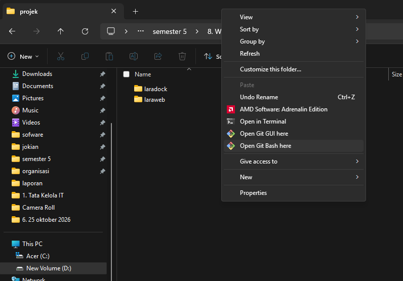

### 2. Memeriksa versi Node.js

Buka terminal Git Bash atau PowerShell, kemudian jalankan:

```bash
node -v
```

Perintah tersebut digunakan untuk memastikan Node.js sudah terpasang. Pada tangkapan layar sumber praktikum, versi yang ditampilkan adalah `v24.14.0`. Versi di komputer masing-masing dapat berbeda.

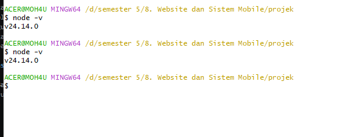

### 3. Membuat proyek Next.js (hanya jika belum ada)

Jika belum memiliki proyek dari Modul 5, pindah ke folder `projek`, lalu jalankan:

```bash
npx create-next-app@latest nextweb
```

Ikuti pertanyaan instalasi dan gunakan konfigurasi yang direkomendasikan. Setelah proses selesai, folder `nextweb` akan dibuat.

**Jika proyek Modul 5 sudah ada:** lewati langkah pembuatan proyek ini dan langsung gunakan folder `nextweb` yang sudah ada.

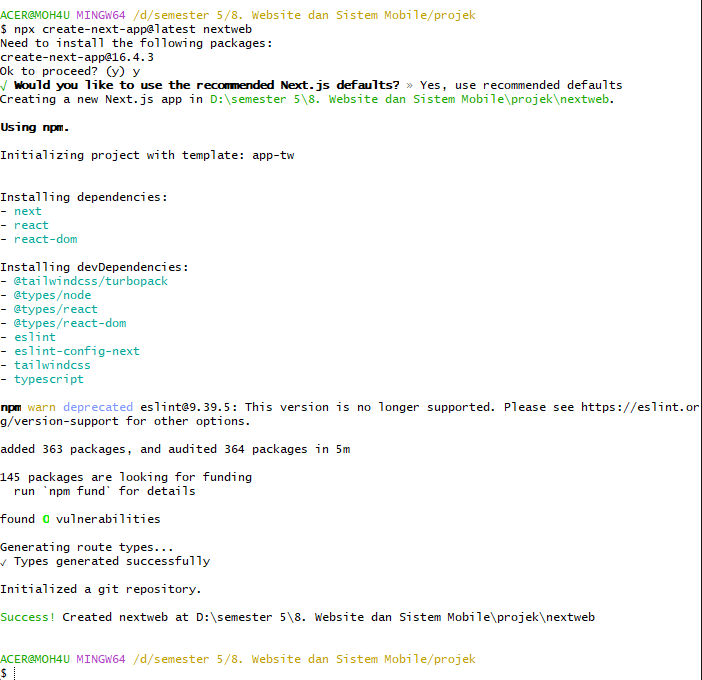

### 4. Masuk ke folder proyek dan memasang dependensi

Jalankan perintah berikut dari terminal:

```bash
cd nextweb
npm install
npm install js-cookie
npm install -D @types/js-cookie
```

Keterangan:

- `cd nextweb` masuk ke direktori proyek.
- `npm install` memasang dependensi yang tercantum pada `package.json`.
- `npm install js-cookie` memasang pustaka untuk membaca dan menghapus cookie pada Client Component.
- `npm install -D @types/js-cookie` memasang definisi tipe TypeScript untuk `js-cookie`.

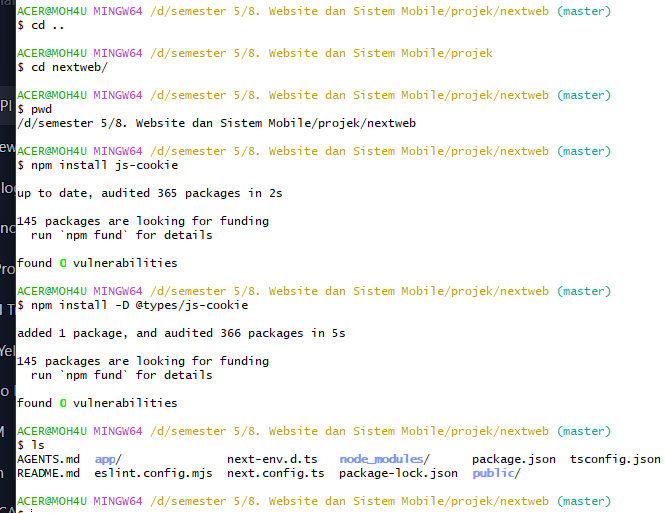

### 5. Menyiapkan file environment dan membuka VS Code

Pada root proyek `nextweb`, pastikan file `.env.local` tersedia. Jika belum ada, buat file tersebut. Isi alamat API sesuai konfigurasi backend lokal:

```env
NEXT_PUBLIC_API_URL=http://laraweb.test/api
```

Gunakan alamat API yang benar pada lingkungan masing-masing. Jangan mengganti nilai yang sudah benar dari Modul 5.

Buka proyek di Visual Studio Code:

```bash
code .
```

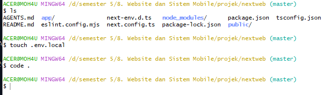

### 6. Membuat folder komponen dan halaman profil

Di terminal PowerShell pada root `nextweb`, jalankan:

```powershell
New-Item -ItemType Directory -Force app\dashboard\components
New-Item -ItemType Directory -Force app\dashboard\profil
```

Perintah pertama membuat folder `components` untuk komponen Sidebar. Perintah kedua membuat folder `profil` untuk subhalaman Profil Pengguna.

Jika folder tersebut sudah ada, perintah `-Force` akan mempertahankan folder yang tersedia.

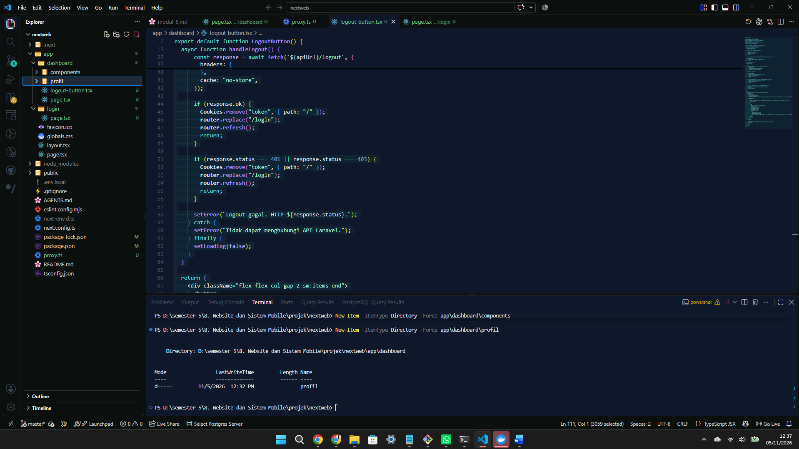

Periksa struktur folder melalui Explorer VS Code atau jalankan:

```powershell
Get-ChildItem app\dashboard
```

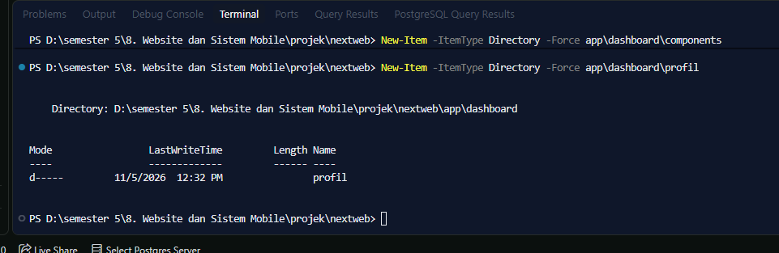

### 7. Membuat komponen Sidebar dan Active Link

Buat file baru:

```text
app/dashboard/components/Sidebar.tsx
```

Isi file dengan kode berikut:

```tsx
"use client";

import Link from "next/link";
import { usePathname } from "next/navigation";

const menuItems = [
  { name: "Beranda", href: "/dashboard", icon: "home" },
  { name: "Profil Pengguna", href: "/dashboard/profil", icon: "user" },
];

export default function Sidebar() {
  const pathname = usePathname();

  return (
    <aside className="flex min-h-full w-full flex-col border-r border-white/10 bg-[#0b1220] text-white lg:w-64">
      <div className="border-b border-white/10 px-6 py-7">
        <h2 className="text-2xl font-bold tracking-wider">
          NEXT<span className="text-cyan-400">WEB</span>
        </h2>
        <p className="mt-2 text-xs text-slate-400">
          Web Application Platform
        </p>
      </div>

      <nav className="flex-1 space-y-2 px-4 py-6">
        <p className="mb-4 px-3 text-xs font-semibold uppercase tracking-widest text-slate-500">
          Menu Utama
        </p>

        {menuItems.map((item) => {
          const active =
            item.href === "/dashboard"
              ? pathname === "/dashboard"
              : pathname.startsWith(item.href);

          return (
            <Link
              key={item.href}
              href={item.href}
              aria-current={active ? "page" : undefined}
              className={`flex items-center gap-3 rounded-xl px-4 py-3 text-sm font-medium transition ${
                active
                  ? "bg-blue-600 text-white shadow-lg shadow-blue-600/20"
                  : "text-slate-400 hover:bg-white/5 hover:text-white"
              }`}
            >
              {item.icon === "home" ? (
                <svg viewBox="0 0 24 24" fill="none" stroke="currentColor"
                  strokeWidth="1.8" className="h-5 w-5" aria-hidden="true">
                  <path strokeLinecap="round" strokeLinejoin="round"
                    d="m3 10 9-7 9 7v10a1 1 0 0 1-1 1h-6v-7h-4v7H4a1 1 0 0 1-1-1V10Z" />
                </svg>
              ) : (
                <svg viewBox="0 0 24 24" fill="none" stroke="currentColor"
                  strokeWidth="1.8" className="h-5 w-5" aria-hidden="true">
                  <circle cx="12" cy="8" r="4" />
                  <path strokeLinecap="round" strokeLinejoin="round"
                    d="M4 21a8 8 0 0 1 16 0" />
                </svg>
              )}
              {item.name}
            </Link>
          );
        })}
      </nav>

      <div className="border-t border-white/10 p-5">
        <p className="text-xs text-slate-500">NextWeb Dashboard</p>
        <p className="mt-1 text-xs text-slate-600">Modul Praktikum 6</p>
      </div>
    </aside>
  );
}
```

Penjelasan:

- Direktif `"use client"` digunakan karena Sidebar memakai hook `usePathname()`.
- `usePathname()` membaca alamat rute yang sedang dibuka.
- `Link` digunakan untuk berpindah halaman melalui navigasi Next.js.
- Jika rute aktif adalah `/dashboard`, menu Beranda diberi warna biru. Jika rute aktif adalah `/dashboard/profil`, menu Profil Pengguna diberi warna biru.

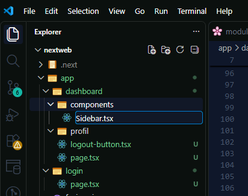

### 8. Membuat Nested Layout pada dashboard

Buat atau buka file:

```text
app/dashboard/layout.tsx
```

Masukkan kode berikut:

```tsx
import type { ReactNode } from "react";
import Sidebar from "./components/Sidebar";
import LogoutButton from "./logout-button";

export default function DashboardLayout({
  children,
}: {
  children: ReactNode;
}) {
  return (
    <div className="min-h-screen bg-[#080d1b] text-white lg:flex">
      {/* Sidebar */}
      <div className="border-b border-white/10 lg:fixed lg:inset-y-0 lg:left-0 lg:z-30 lg:w-64 lg:border-b-0 lg:border-r">
        <Sidebar />
      </div>

      {/* Konten utama */}
      <div className="flex min-w-0 flex-1 flex-col lg:pl-64">
        {/* Navbar */}
        <header className="flex min-h-20 items-center justify-between gap-4 border-b border-white/10 bg-[#101729] px-5 py-4 sm:px-8">
          <div>
            <p className="text-xs font-semibold tracking-widest text-cyan-400">
              NEXTWEB APPLICATION
            </p>
            <h1 className="mt-1 text-lg font-bold text-white">
              Panel Administrasi
            </h1>
          </div>
          <LogoutButton />
        </header>

        {/* Konten halaman aktif */}
        <main className="min-h-0 flex-1 p-4 sm:p-6 lg:p-8">
          {children}
        </main>

        <footer className="border-t border-white/10 px-5 py-4 text-center text-xs text-slate-500 sm:px-8">
          NextWeb · Nested Dashboard Layout
        </footer>
      </div>
    </div>
  );
}
```

Penjelasan:

- `DashboardLayout` membungkus halaman dashboard dan seluruh subhalamannya.
- `<Sidebar />` menampilkan menu di bagian kiri.
- `<header>` menjadi Navbar bagian atas.
- `<LogoutButton />` menampilkan tombol logout pada Navbar.
- `{children}` merupakan tempat konten dari `page.tsx` atau halaman anak ditampilkan.
- Layout merupakan Server Component secara default karena tidak menggunakan `"use client"`.

**Catatan lokasi komponen Logout:** Panduan ini menggunakan file `app/dashboard/logout-button.tsx` yang sudah dibuat pada Modul 5, sesuai jalur import `./logout-button` di atas. Jangan membuat komponen logout kedua dengan nama yang sama di folder lain.

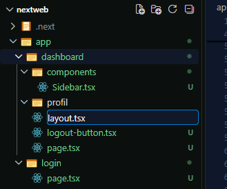

### 9. Menyesuaikan halaman Beranda dashboard

Buka file:

```text
app/dashboard/page.tsx
```

Halaman ini tetap mengambil profil pengguna dari Protected API Laravel seperti pada Modul 5. Karena Sidebar, Navbar, dan background utama sudah diatur oleh `layout.tsx`, konten `page.tsx` cukup berisi bagian Beranda.

Contoh implementasi lengkap:

```tsx
import { cookies } from "next/headers";
import { redirect } from "next/navigation";

export const instant = false;

interface UserProfile {
  id: number;
  name: string;
  email: string;
}

async function getUserProfile(): Promise<UserProfile | null> {
  const cookieStore = await cookies();
  const token = cookieStore.get("token")?.value;
  if (!token) return null;

  const apiUrl = process.env.NEXT_PUBLIC_API_URL?.replace(/\/+$/, "");
  if (!apiUrl) throw new Error("NEXT_PUBLIC_API_URL belum dikonfigurasi.");

  const response = await fetch(`${apiUrl}/user`, {
    method: "GET",
    headers: {
      Authorization: `Bearer ${token}`,
      Accept: "application/json",
    },
    cache: "no-store",
  });

  if (response.status === 401 || response.status === 403) return null;
  if (!response.ok) throw new Error(`Gagal mengambil profil: HTTP ${response.status}`);

  return (await response.json()) as UserProfile;
}

export default async function DashboardPage() {
  const user = await getUserProfile();
  if (!user) redirect("/login");

  return (
    <div className="mx-auto max-w-5xl space-y-6">
      <div>
        <p className="text-sm font-semibold tracking-widest text-cyan-400">
          HALAMAN UTAMA
        </p>
        <h2 className="mt-2 text-3xl font-bold text-white">
          Selamat Datang, {user.name}!
        </h2>
        <p className="mt-2 text-sm text-slate-400">
          Ini adalah halaman beranda dashboard NextWeb.
        </p>
      </div>

      <section className="rounded-2xl border border-white/10 bg-[#101729] p-6 shadow-xl">
        <h3 className="text-xl font-bold text-white">Informasi Akun</h3>
        <p className="mt-2 text-sm text-slate-400">
          Data pengguna yang diperoleh langsung dari API Laravel.
        </p>

        <div className="mt-6 grid gap-4 sm:grid-cols-2">
          <div className="rounded-xl border border-white/10 bg-white/[0.04] p-5">
            <p className="text-sm text-slate-400">ID Pengguna</p>
            <p className="mt-3 text-2xl font-bold text-cyan-400">{user.id}</p>
          </div>
          <div className="rounded-xl border border-white/10 bg-white/[0.04] p-5">
            <p className="text-sm text-slate-400">Email</p>
            <p className="mt-3 break-all text-lg font-semibold text-white">
              {user.email}
            </p>
          </div>
        </div>

        <div className="mt-5 rounded-xl border border-emerald-400/20 bg-emerald-400/5 p-4">
          <p className="font-semibold text-emerald-400">
            Status: Terautentikasi
          </p>
          <p className="mt-1 text-sm text-slate-400">
            Profil berhasil dimuat dari server Laravel.
          </p>
        </div>
      </section>
    </div>
  );
}
```

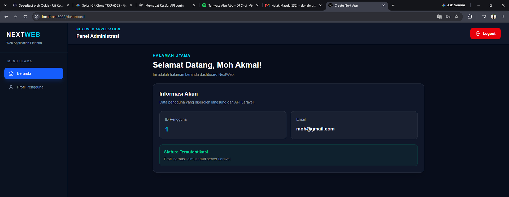

### 10. Membuat subhalaman Profil Pengguna

Buat file baru:

```text
app/dashboard/profil/page.tsx
```

Isi dengan kode berikut:

```tsx
export default function ProfilPage() {
  return (
    <div className="mx-auto max-w-5xl space-y-6">
      {/* Header halaman */}
      <div>
        <p className="text-sm font-semibold tracking-widest text-cyan-400">
          PENGATURAN AKUN
        </p>
        <h2 className="mt-2 text-3xl font-bold text-white">
          Profil Pengguna
        </h2>
        <p className="mt-2 text-sm text-slate-400">
          Halaman informasi profil pengguna NextWeb.
        </p>
      </div>

      {/* Kartu profil */}
      <section className="rounded-2xl border border-white/10 bg-[#101729] p-6 shadow-xl">
        <div className="flex flex-col items-center gap-4 border-b border-white/10 pb-6 sm:flex-row">
          <div className="flex h-20 w-20 items-center justify-center rounded-2xl bg-gradient-to-br from-cyan-400 to-violet-500 text-3xl font-bold text-white">
            U
          </div>
          <div className="text-center sm:text-left">
            <h3 className="text-xl font-bold text-white">Profil Pengguna</h3>
            <p className="mt-2 text-sm text-slate-400">
              Informasi akun pada aplikasi NextWeb.
            </p>
          </div>
        </div>

        <div className="mt-6 space-y-4">
          <div className="rounded-xl border border-white/10 bg-white/[0.04] p-5">
            <p className="text-sm text-slate-400">Nama Menu</p>
            <p className="mt-2 font-semibold text-white">Profil Pengguna</p>
          </div>
          <div className="rounded-xl border border-white/10 bg-white/[0.04] p-5">
            <p className="text-sm text-slate-400">Aplikasi</p>
            <p className="mt-2 font-semibold text-cyan-400">NextWeb</p>
          </div>
          <div className="rounded-xl border border-white/10 bg-white/[0.04] p-5">
            <p className="text-sm text-slate-400">Status Halaman</p>
            <p className="mt-2 font-semibold text-emerald-400">Aktif</p>
          </div>
        </div>
      </section>
    </div>
  );
}
```

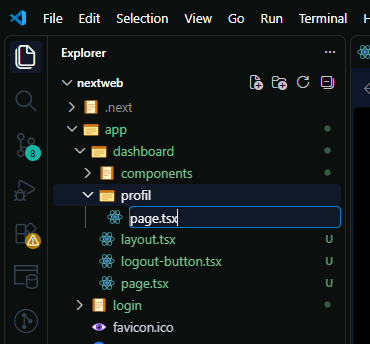

### 11. Memastikan komponen Logout tersedia

Pada proyek Modul 5, komponen logout sudah dibuat pada:

```text
app/dashboard/logout-button.tsx
```

Komponen tersebut merupakan Client Component karena menggunakan event `onClick`, `useState`, `useRouter`, dan `js-cookie`. Layout mengimpor komponen ini dengan:

```tsx
import LogoutButton from "./logout-button";
```

Pastikan komponen melakukan urutan berikut:

1. Membaca token dari cookie browser.
2. Mengirim permintaan `POST /api/logout` dengan header `Authorization: Bearer <token>`.
3. Menghapus cookie `token` menggunakan path yang sama dengan cookie saat dibuat, yaitu `/`.
4. Mengarahkan pengguna ke `/login` dan memperbarui router.

Jika komponen Logout dari Modul 5 sudah berjalan, gunakan kembali file tersebut dan tidak perlu membuat file duplikat.

### 12. Menjalankan aplikasi

Pastikan backend Laravel dan layanan Laradock berjalan. Kemudian buka terminal di root proyek `nextweb` dan jalankan:

```bash
npm run dev
```

Buka alamat yang ditampilkan oleh terminal. Pada lingkungan praktikum ini aplikasi berjalan di:

```text
http://localhost:3002/dashboard
```

Jika port `3000` tersedia, Next.js dapat menggunakan port tersebut. Gunakan port yang benar-benar tercantum pada terminal.

## D. Pengujian Praktikum

### 1. Pengujian halaman Beranda

1. Login menggunakan akun yang sudah terdaftar di backend Laravel.
2. Buka halaman `/dashboard`.
3. Periksa apakah Sidebar berada di sisi kiri.
4. Periksa apakah Navbar dan tombol Logout tampil di bagian atas.
5. Pastikan informasi akun pada halaman Beranda berhasil ditampilkan.


### 2. Pengujian halaman Profil Pengguna

1. Klik menu **Profil Pengguna** pada Sidebar.
2. Pastikan alamat berubah menjadi `/dashboard/profil`.
3. Periksa apakah konten utama berubah menjadi halaman Profil Pengguna.
4. Pastikan Sidebar dan Navbar tetap tampil.
5. Periksa apakah menu Profil Pengguna diberi warna aktif.

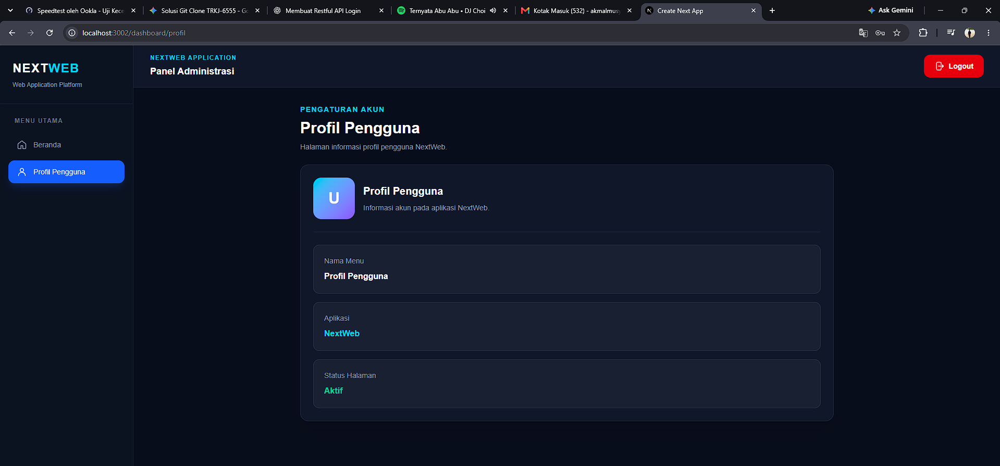

### 3. Pengujian navigasi aktif

1. Buka `/dashboard` dan amati menu Beranda yang aktif.
2. Klik Profil Pengguna dan amati menu Profil Pengguna yang aktif.
3. Klik kembali Beranda.
4. Amati bahwa area konten berubah, sedangkan Sidebar dan Navbar tetap berada pada layout dashboard.

Fungsi ini memanfaatkan `usePathname()` pada komponen Sidebar dan `Link` dari Next.js.

### 4. Pengujian Logout dari Navbar

1. Pastikan API Laravel berjalan dan cookie `token` tersedia karena pengguna sudah login.
2. Buka halaman `/dashboard` atau `/dashboard/profil`.
3. Klik tombol **Logout** pada Navbar.
4. Aplikasi mengirim permintaan ke endpoint Laravel `POST /api/logout` dengan Bearer Token.
5. Setelah proses logout, cookie `token` dihapus dan browser diarahkan ke `/login`.

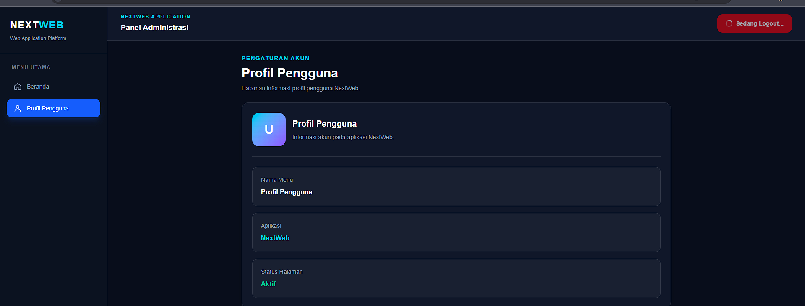

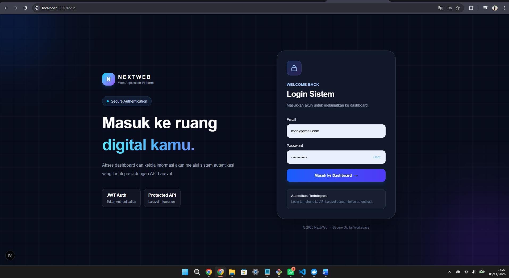

### 5. Pengujian akses dashboard setelah logout

1. Setelah logout, masukkan alamat `http://localhost:3002/dashboard` secara langsung.
2. Pastikan aplikasi mengarahkan pengguna ke halaman `/login` karena cookie token sudah tidak tersedia.

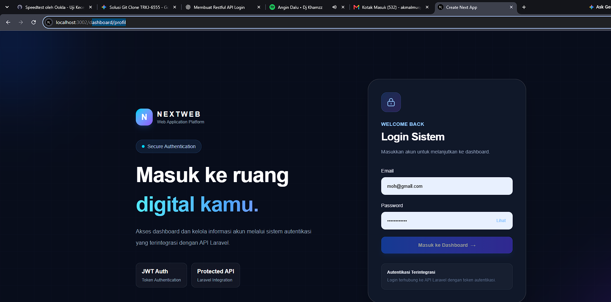

### 6. Pengujian akses profil tanpa login

1. Pastikan pengguna belum login.
2. Masukkan alamat `http://localhost:3002/dashboard/profil` secara langsung.
3. Pastikan Proxy dari Modul 5 mengarahkan pengguna ke halaman `/login`.

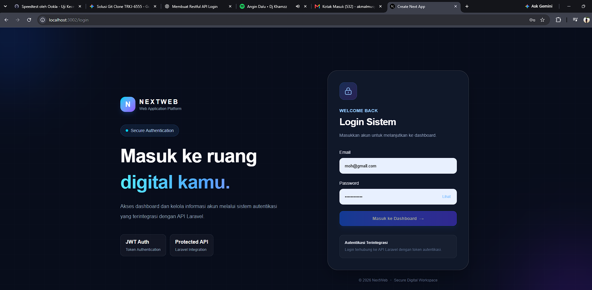

### 7. Tabel hasil pengujian

| No. | Skenario Pengujian | Hasil yang Diharapkan |
|---|---|---|
| 1 | Membuka `/dashboard` setelah login | Beranda tampil bersama Sidebar dan Navbar |
| 2 | Membuka `/dashboard/profil` | Halaman Profil tampil dengan layout yang sama |
| 3 | Berpindah antara Beranda dan Profil | Konten berubah, Sidebar dan Navbar tetap tampil |
| 4 | Klik Logout | Permintaan logout dikirim dan pengguna diarahkan ke `/login` |
| 5 | Membuka `/dashboard` setelah logout | Pengguna diarahkan ke `/login` |
| 6 | Membuka `/dashboard/profil` tanpa login | Pengguna diarahkan ke `/login` |

## E. Struktur Akhir Proyek

Struktur folder utama yang dihasilkan pada Modul 6 adalah:

```text
nextweb/
├── app/
│   ├── dashboard/
│   │   ├── components/
│   │   │   └── Sidebar.tsx
│   │   ├── profil/
│   │   │   └── page.tsx
│   │   ├── layout.tsx
│   │   ├── logout-button.tsx
│   │   └── page.tsx
│   ├── login/
│   │   └── page.tsx
│   └── ...
├── proxy.ts
├── .env.local
└── package.json
```


## E. Hasil dan Pembahasan


1. Pastikan API Laravel berjalan dan cookie `token` tersedia karena pengguna sudah login.
2. Buka halaman `/dashboard` atau `/dashboard/profil`.
3. Klik tombol **Logout** pada Navbar.
4. Aplikasi mengirim permintaan ke endpoint Laravel `POST /api/logout` dengan Bearer Token.
5. Setelah proses logout, cookie `token` dihapus dan browser diarahkan ke `/login`.


### 5. Pengujian akses dashboard setelah logout

1. Setelah logout, masukkan alamat `http://localhost:3002/dashboard` secara langsung.
2. Pastikan aplikasi mengarahkan pengguna ke halaman `/login` karena cookie token sudah tidak tersedia.


### 6. Pengujian akses profil tanpa login

1. Pastikan pengguna belum login.
2. Masukkan alamat `http://localhost:3002/dashboard/profil` secara langsung.
3. Pastikan Proxy dari Modul 5 mengarahkan pengguna ke halaman `/login`.


### 7. Tabel hasil pengujian

| No. | Skenario Pengujian | Hasil yang Diharapkan |
|---|---|---|
| 1 | Membuka `/dashboard` setelah login | Beranda tampil bersama Sidebar dan Navbar |
| 2 | Membuka `/dashboard/profil` | Halaman Profil tampil dengan layout yang sama |
| 3 | Berpindah antara Beranda dan Profil | Konten berubah, Sidebar dan Navbar tetap tampil |
| 4 | Klik Logout | Permintaan logout dikirim dan pengguna diarahkan ke `/login` |
| 5 | Membuka `/dashboard` setelah logout | Pengguna diarahkan ke `/login` |
| 6 | Membuka `/dashboard/profil` tanpa login | Pengguna diarahkan ke `/login` |

## E. Struktur Akhir Proyek

Struktur folder utama yang dihasilkan pada Modul 6 adalah:

```text
nextweb/
├── app/
│   ├── dashboard/
│   │   ├── components/
│   │   │   └── Sidebar.tsx
│   │   ├── profil/
│   │   │   └── page.tsx
│   │   ├── layout.tsx
│   │   ├── logout-button.tsx
│   │   └── page.tsx
│   ├── login/
│   │   └── page.tsx
│   └── ...
├── proxy.ts
├── .env.local
└── package.json
```
Berdasarkan praktikum Modul 6, pengembangan aplikasi NextWeb menggunakan konsep Nested Layout pada Next.js berhasil diterapkan. File layout.tsx digunakan untuk mengatur Sidebar, Navbar, dan area konten agar tetap tampil ketika pengguna berpindah halaman.

Sidebar berhasil dibuat dengan menu Beranda dan Profil Pengguna. Fitur Active Link menggunakan usePathname() juga berhasil diterapkan untuk menandai menu yang sedang aktif.

Selain itu, halaman Profil Pengguna berhasil dibuat melalui struktur routing /dashboard/profil. Tombol Logout pada Navbar juga berhasil diintegrasikan dengan API Laravel untuk mengakhiri sesi pengguna dan menghapus cookie autentikasi.

Hasil pengujian menunjukkan bahwa navigasi antarhalaman berjalan dengan baik, layout tetap konsisten, dan pengguna diarahkan kembali ke halaman login setelah melakukan logout. Dengan demikian, tujuan utama praktikum Modul 6 telah berhasil dilaksanakan.

## F. Kesimpulan
Berdasarkan praktikum Modul 6 tentang Nested Layout dan Implementasi Logout, dapat disimpulkan bahwa pengembangan aplikasi NextWeb menggunakan Next.js berhasil dilakukan. Nested Layout berhasil diterapkan untuk menampilkan Sidebar dan Navbar secara konsisten pada halaman Beranda dan Profil Pengguna.

Fitur Active Link menggunakan usePathname() berhasil diterapkan untuk menandai menu yang sedang aktif. Selain itu, proses logout berhasil diintegrasikan dengan API Laravel untuk mengakhiri sesi pengguna dan menghapus cookie autentikasi.

Hasil pengujian menunjukkan bahwa navigasi antarhalaman dan proses logout berjalan sesuai dengan tujuan praktikum. Dengan demikian, praktikum ini memberikan pemahaman mengenai pengelolaan layout, sistem navigasi, penggunaan komponen React, serta integrasi autentikasi antara Next.js dan Laravel.

## G. Referensi


[1] Vercel, “Layouts and Pages,” Next.js Documentation. [Online]. Available: https://nextjs.org/docs/app/getting-started/layouts-and-pages. [Accessed: Nov. 5, 2026].

[2] Vercel, “File-system Conventions: layout.js,” Next.js Documentation. [Online]. Available: https://nextjs.org/docs/app/api-reference/file-conventions/layout. [Accessed: Nov. 5, 2026].

[3] Vercel, “Link Component,” Next.js Documentation. [Online]. Available: https://nextjs.org/docs/app/api-reference/components/link. [Accessed: Nov. 5, 2026].

[4] Vercel, “Functions: usePathname,” Next.js Documentation. [Online]. Available: https://nextjs.org/docs/app/api-reference/functions/use-pathname. [Accessed: Nov. 5, 2026].

[5] Vercel, “Server and Client Components,” Next.js Documentation. [Online]. Available: https://nextjs.org/docs/app/getting-started/server-and-client-components. [Accessed: Nov. 5, 2026].

[6] Laravel, “Authentication,” Laravel Documentation. [Online]. Available: https://laravel.com/docs/13.x/authentication. [Accessed: Nov. 5, 2026].

[7] js-cookie, “A Simple, Lightweight JavaScript API for Handling Cookies,” GitHub Repository. [Online]. Available: https://github.com/js-cookie/js-cookie. [Accessed: Nov. 5, 2026].

[8] Tymon, “JSON Web Token Authentication for Laravel & Lumen,” GitHub Repository. [Online]. Available: https://github.com/tymondesigns/jwt-auth. [Accessed: Nov. 5, 2026].

