<div align="center">

## LAPORAN Website dan Sistem Mobile


### Disusun Oleh:  
Nama               : MOH. Akmal Musyaffa
NIM                : 2024903430018
Kelas              : TRKJ 3 A


### Program Studi Teknologi Rekayasa Komputer Jaringan
### Jurusan Teknologi Informasi dan Komputer
### Politeknik Negeri Lhokseumawe
### 2026


---


## Lembar Pengesahan


| No. Praktikum     | : | 04 |
|------------------:|:-:|:--------------|
| Judul Praktikum   | : | Restful API CRUD Mahasiswa Dan dosen|
| Tanggal Praktikum | : | 15 Oktober 2026 |
| Tanggal Penyerahan| : | 15 Oktober 2026 ||
| Nama Praktikan    | : | MOH. Akaml Musyaffa |
| NIM/Kelas Praktikan| : | 2024903430018  / TRKJ 3 A |
| Nilai Praktikum   | : | .......................... |
| Dosen Pengampu    | : | Muhammad Davi, S.Kom., M.Cs. |

Mengetahui,  
Dosen Pengampu
<br><br><br><br><br>

Muhammad Davi, S.Kom., M.Cs.
</div>


## Daftar Isi
- [Lembar Pengesahan](#lembar-pengesahan)
- [Daftar Isi](#daftar-isi)
- [Tujuan Praktikum](#tujuan-praktikum)
- [Dasar Teori](#dasar-teori)
- [Alat dan Bahan](#alat-dan-bahan)
- [Langkah Kerja](#langkah-kerja)
- [Hasil dan Pembahasan](#hasil-dan-pembahasan)
- [Kesimpulan](#kesimpulan)
- [Referensi](#referensi)
---

## A. Tujuan Praktikum

1. Membuat **RESTful API CRUD Mahasiswa** menggunakan Laravel.
2. Membuat **RESTful API CRUD Dosen** menggunakan Laravel.
3. Membuat dan mengatur **Model, Migration, Resource, Controller, dan Route** pada Laravel.
4. Mengimplementasikan **relasi antar tabel** menggunakan foreign key, seperti Program Studi, Pangkat, Kelompok Bidang Keahlian, dan User.
5. Mengimplementasikan operasi **Create, Read, Update, dan Delete (CRUD)** melalui RESTful API.
6. Menguji endpoint RESTful API menggunakan **Postman**.
7. Memahami proses pengelolaan data melalui API dengan metode HTTP `GET`, `POST`, `PUT/PATCH`, dan `DELETE`.

## B. Dasar Teori
### 1. RESTful API

RESTful API (*Representational State Transfer Application Programming Interface*) merupakan pendekatan dalam membangun layanan yang memungkinkan aplikasi saling berkomunikasi menggunakan protokol HTTP. Pada praktikum ini, RESTful API digunakan untuk mengelola data **Mahasiswa** dan **Dosen**.

Data yang dikelola diperlakukan sebagai *resource* dan diakses melalui endpoint tertentu, seperti:


/api/mahasiswa
/api/mahasiswa/{id}

/api/dosen
/api/dosen/{id}

RESTful API memungkinkan client mengirim request ke server dan menerima response dalam format JSON.
2. HTTP Method
RESTful API menggunakan beberapa HTTP method untuk melakukan operasi terhadap resource.
HTTP Method	Fungsi
GET	Mengambil atau menampilkan data
POST	Menambahkan data baru
PUT	Mengubah data
PATCH	Mengubah sebagian data
DELETE	Menghapus data


Contoh endpoint yang digunakan pada praktikum:
GET /api/mahasiswa
POST /api/mahasiswa
GET /api/mahasiswa/1
PUT /api/mahasiswa/1
DELETE /api/mahasiswa/1

Untuk Dosen:
GET /api/dosen
POST /api/dosen
GET /api/dosen/1
PUT /api/dosen/1
DELETE /api/dosen/1

3. CRUD
CRUD merupakan singkatan dari:
- Create: membuat atau menambahkan data.
- Read: membaca atau mengambil data.
- Update: mengubah data.
- Delete: menghapus data.
Pada praktikum, CRUD diterapkan pada data Mahasiswa dan Dosen.
Operasi	Method	Endpoint
Create	POST	/api/mahasiswa
Read	GET	/api/mahasiswa
Read Detail	GET	/api/mahasiswa/{id}
Update	PUT/PATCH	/api/mahasiswa/{id}
Delete	DELETE	/api/mahasiswa/{id}
Create	POST	/api/dosen
Read	GET	/api/dosen
Read Detail	GET	/api/dosen/{id}
Update	PUT/PATCH	/api/dosen/{id}
Delete	DELETE	/api/dosen/{id}


4. Laravel
Laravel merupakan framework PHP yang digunakan untuk membangun aplikasi web dan RESTful API. Pada praktikum ini Laravel digunakan untuk mengembangkan backend yang menangani data Mahasiswa dan Dosen.
Laravel menyediakan beberapa komponen yang digunakan dalam praktikum, yaitu:
Model
Migration
Resource
Controller
Route
Validation
Eloquent ORM

Struktur project yang digunakan:
app/
├── Models/
└── Http/
    ├── Controllers/
    └── Resources/

database/
└── migrations/

routes/
└── api.php

5. Model
Model merupakan bagian Laravel yang digunakan untuk merepresentasikan tabel database. Model memungkinkan aplikasi melakukan operasi terhadap data melalui Eloquent ORM.
Model yang digunakan pada praktikum antara lain:
ProgramStudi
Mahasiswa
Pangkat
KelompokBidangKeahlian
Dosen
User

Contoh penggunaan model:
\App\Models\Mahasiswa::all();

Untuk mengambil data.
\App\Models\Mahasiswa::find(1);

Untuk mengambil data berdasarkan ID.
\App\Models\Mahasiswa::create([
    'nim' => '2301012345678',
    'nama' => 'Moh Akmal'
]);

Untuk menambahkan data.
6. Eloquent ORM
Eloquent ORM merupakan fitur Laravel yang digunakan untuk berinteraksi dengan database menggunakan model.
Dengan Eloquent, operasi database dapat dilakukan menggunakan sintaks PHP tanpa harus menulis query SQL secara manual untuk setiap operasi.
Contoh mengambil seluruh data:
Mahasiswa::all();

Contoh membuat data:
Mahasiswa::create([
    'nim' => '2301012345678',
    'nama' => 'Moh Akmal'
]);

Contoh mengubah data:
$mahasiswa->update($request->all());

Contoh menghapus data:
$mahasiswa->delete();

7. Migration
Migration digunakan untuk mendefinisikan struktur tabel database melalui kode PHP.
Migration dapat digunakan untuk menentukan:
- Primary key.
- Nama kolom.
- Tipe data.
- Foreign key.
- Timestamp.
- Soft delete.
Contoh migration Program Studi:
Schema::create('program_studis', function (Blueprint $table) {
    $table->id();
    $table->string('program_studi', 100);
    $table->timestamps();
});

Migration Mahasiswa:
Schema::create('mahasiswas', function (Blueprint $table) {
    $table->id();
    $table->char('nim', 13)->unique();
    $table->string('nama', 100);
    $table->foreignId('program_studi_id')
          ->constrained('program_studis');
    $table->string('email', 100)->unique();
    $table->string('nomor_hp', 15)->unique();
    $table->boolean('jenis_kelamin')->default(true);
    $table->string('tempat_lahir', 100);
    $table->date('tanggal_lahir');
    $table->char('golongan_darah', 2)->nullable();
    $table->timestamps();
});

8. Primary Key
Primary key merupakan identitas unik yang digunakan untuk membedakan setiap record dalam tabel.
Pada Laravel, primary key dibuat menggunakan:
$table->id();

Contoh data:
id = 1
id = 2
id = 3

ID tersebut kemudian digunakan untuk mengakses data tertentu:
/api/mahasiswa/1
/api/dosen/1

9. Foreign Key
Foreign key digunakan untuk menghubungkan satu tabel dengan tabel lainnya.
Pada tabel Mahasiswa terdapat:
$table->foreignId('program_studi_id')
      ->constrained('program_studis');

Artinya data Mahasiswa mempunyai hubungan dengan tabel Program Studi.
Pada tabel Dosen terdapat beberapa foreign key:
pangkat_id
kelompok_bidang_keahlian_id
user_id
program_studi_id

Foreign key digunakan untuk menjaga hubungan dan keterkaitan data antar tabel.
10. Eloquent Relationship
Laravel menyediakan relationship untuk menghubungkan model yang mempunyai hubungan database.
Contoh pada ProgramStudi:
public function mahasiswas(): HasMany
{
    return $this->hasMany(Mahasiswa::class);
}

Artinya satu Program Studi dapat mempunyai banyak Mahasiswa.
Pada model Mahasiswa:
public function programStudi(): BelongsTo
{
    return $this->belongsTo(
        ProgramStudi::class,
        'program_studi_id'
    );
}

Artinya Mahasiswa memiliki hubungan dengan satu Program Studi.
Pada model Dosen juga terdapat relationship dengan beberapa model:
public function pangkat(): BelongsTo
{
    return $this->belongsTo(Pangkat::class);
}

public function kelompokBidangKeahlian(): BelongsTo
{
    return $this->belongsTo(
        KelompokBidangKeahlian::class,
        'kelompok_bidang_keahlian_id'
    );
}

public function user(): BelongsTo
{
    return $this->belongsTo(User::class);
}

public function programStudi(): BelongsTo
{
    return $this->belongsTo(
        ProgramStudi::class,
        'program_studi_id'
    );
}

11. API Resource
API Resource digunakan untuk mengatur bentuk response API.
Pada praktikum digunakan:
MahasiswaResource.php
DosenResource.php

Contoh response Resource:
return [
    'status' => $this->status,
    'message' => $this->message,
    'data' => $this->resource,
];

Dengan Resource, response API memiliki struktur yang konsisten.
Contoh:
{
    "status": true,
    "message": "Data Dosen Berhasil Ditambahkan!",
    "data": {
        "id": 1,
        "nama_lengkap": "Muhammad Davi"
    }
}

12. Controller
Controller digunakan untuk menangani request dan menjalankan proses CRUD.
Controller yang dibuat pada praktikum:
MahasiswaController.php
DosenController.php

Method utama yang digunakan:
index()
store()
show()
update()
destroy()

Fungsi masing-masing method:
Method	Fungsi
index()	Menampilkan daftar data
store()	Menambahkan data
show()	Menampilkan detail
update()	Mengubah data
destroy()	Menghapus data


Contoh:
public function index(Request $request)
{
    $mahasiswas = Mahasiswa::latest()->paginate(5);

    return new MahasiswaResource(
        true,
        'List Data Mahasiswa',
        $mahasiswas
    );
}

13. Routing API
Route digunakan untuk menentukan URL dan controller yang menangani request.
Laravel menyediakan Route::apiResource() untuk membuat route CRUD.
Contoh route Mahasiswa:
Route::apiResource('mahasiswa', MahasiswaController::class, [
    'except' => ['create', 'edit']
]);

Contoh route Dosen:
Route::apiResource('dosen', DosenController::class, [
    'except' => ['create', 'edit']
]);

Route tersebut menghasilkan endpoint:
GET       /api/mahasiswa
POST      /api/mahasiswa
GET       /api/mahasiswa/{mahasiswa}
PUT/PATCH /api/mahasiswa/{mahasiswa}
DELETE    /api/mahasiswa/{mahasiswa}

dan:
GET       /api/dosen
POST      /api/dosen
GET       /api/dosen/{dosen}
PUT/PATCH /api/dosen/{dosen}
DELETE    /api/dosen/{dosen}

Route dapat diperiksa menggunakan:
php artisan route:list

14. Validasi Data
Validasi digunakan untuk memeriksa apakah data yang dikirim client sesuai dengan aturan yang ditentukan.
Contoh validasi Mahasiswa:
$validator = Validator::make($request->all(), [
    'nim' => 'required|size:13|unique:mahasiswas',
    'nama' => 'required|max:100',
    'program_studi_id' => 'required|exists:program_studis,id',
    'email' => 'required|email|max:100|unique:mahasiswas',
    'nomor_hp' => 'required|max:15|unique:mahasiswas',
    'jenis_kelamin' => 'required|boolean',
    'tempat_lahir' => 'required|max:100',
    'tanggal_lahir' => 'required|date',
    'golongan_darah' => 'nullable|in:A,B,AB,O',
]);

Validasi Dosen antara lain:
'nidn' => 'nullable|size:10|unique:dosens,nidn',
'nip' => 'nullable|size:18|unique:dosens,nip',
'nama_lengkap' => 'required|max:100',
'pangkat_id' => 'nullable|exists:pangkats,id',
'kelompok_bidang_keahlian_id'
    => 'nullable|exists:kelompok_bidang_keahlians,id',
'user_id' => 'nullable|exists:users,id',
'program_studi_id'
    => 'nullable|exists:program_studis,id',

Jika validasi gagal:
return response()->json(
    $validator->errors(),
    422
);

15. JSON
JSON (JavaScript Object Notation) digunakan sebagai format pertukaran data antara client dan server.
Contoh request Mahasiswa:
{
    "nim": "2301012345678",
    "nama": "Moh Akmal",
    "program_studi_id": 1,
    "email": "mohakmal@gmail.com"
}

JSON tersusun dari pasangan key dan value.
Dalam praktikum, JSON digunakan sebagai request body dan response dari RESTful API.
16. Authentication
Endpoint API yang dilindungi menggunakan middleware:
Route::group(['middleware' => 'auth:api'], function () {
    // endpoint API
});

Autentikasi dilakukan menggunakan token.
Pada Postman digunakan:
Authorization
→ Bearer Token

Header yang dikirim:
Authorization: Bearer <token>

Token tersebut digunakan agar client dapat mengakses endpoint yang dilindungi.
17. Postman
Postman merupakan aplikasi yang digunakan untuk melakukan pengujian RESTful API.
Pada praktikum, Postman digunakan untuk:
- Mengatur HTTP method.
- Memasukkan URL.
- Mengatur Authorization.
- Mengirim JSON.
- Melihat response server.
- Menguji seluruh operasi CRUD.
Contoh:
POST   http://laraweb.test/api/mahasiswa
GET    http://laraweb.test/api/mahasiswa
PUT    http://laraweb.test/api/mahasiswa/1
DELETE http://laraweb.test/api/mahasiswa/1

Untuk Dosen:
POST   http://laraweb.test/api/dosen
GET    http://laraweb.test/api/dosen
PUT    http://laraweb.test/api/dosen/1
DELETE http://laraweb.test/api/dosen/1

18. HTTP Status Code
HTTP status code digunakan untuk menunjukkan hasil request.
Status Code	Keterangan
200 OK	Request berhasil
201 Created	Data berhasil dibuat
401 Unauthorized	Autentikasi tidak valid
404 Not Found	Resource tidak ditemukan
422 Unprocessable Entity	Data gagal validasi
500 Internal Server Error	Terjadi kesalahan pada server


Contoh response ketika data berhasil dibuat:
201 Created

Sedangkan kesalahan validasi dapat menghasilkan:
422 Unprocessable Entity

19. Pagination
Controller Mahasiswa dan Dosen menggunakan pagination:
->paginate(5);

Pagination digunakan untuk membatasi jumlah data yang ditampilkan dalam satu response.
Contohnya:
$dosens = Dosen::latest()->paginate(5);

Response pagination dapat berisi informasi seperti:
current_page
first_page_url
last_page
per_page
total

20. Soft Delete
Pada model Dosen digunakan fitur SoftDeletes:
use Illuminate\Database\Eloquent\SoftDeletes;

Pada migration digunakan:
$table->softDeletes();

Fitur ini menggunakan kolom:
deleted_at

Ketika data dihapus menggunakan:
$dosen->delete();

data tidak langsung dihapus secara fisik, tetapi waktu penghapusan disimpan pada deleted_at.
21. Docker dan Laradock
Praktikum menggunakan Laradock sebagai lingkungan pengembangan Laravel berbasis Docker.
Container yang digunakan antara lain:
workspace
mysql
nginx

Workspace digunakan untuk menjalankan perintah Laravel:
php artisan

Perintah untuk masuk workspace:
docker compose exec workspace bash

Kemudian:
cd /var/www

22. MySQL
MySQL digunakan sebagai database untuk menyimpan data aplikasi.
Pada praktikum terdapat beberapa tabel:
users
program_studis
mahasiswas
pangkats
kelompok_bidang_keahlians
dosens

Hubungan antar tabel dibangun menggunakan primary key dan foreign key.
23. Laravel Tinker
Tinker digunakan untuk melakukan interaksi langsung dengan aplikasi Laravel melalui terminal.
Tinker dijalankan menggunakan:
php artisan tinker

Contoh membuat data Program Studi:
\App\Models\ProgramStudi::create([
    'program_studi' => 'Teknologi Rekayasa Komputer Jaringan'
]);

Contoh membuat data Pangkat:
\App\Models\Pangkat::create([
    'pangkat' => 'Lektor'
]);

Contoh membuat data Kelompok Bidang Keahlian:
\App\Models\KelompokBidangKeahlian::create([
    'kelompok_bidang_keahlian' => 'Jaringan Komputer'
]);

Contoh mengecek data:
\App\Models\ProgramStudi::all();
\App\Models\Pangkat::all();
\App\Models\KelompokBidangKeahlian::all();
\App\Models\User::all();

24. Alur Kerja RESTful API
```
Alur proses request pada praktikum dapat digambarkan sebagai berikut:
Client / Postman
       |
       v
   API Route
       |
       v
   Controller
       |
       v
   Validation
       |
       v
     Model
       |
       v
   Eloquent ORM
       |
       v
    Database
       |
       v
    Resource
       |
       v
 JSON Response
```
```
Contoh proses penambahan Mahasiswa:
Postman
   |
   | POST /api/mahasiswa
   v
Route
   |
   v
MahasiswaController@store
   |
   v
Validasi
   |
   v
Mahasiswa::create()
   |
   v
MySQL
   |
   v
MahasiswaResource
   |
   v
JSON Response

Contoh proses penambahan Dosen:
Postman
   |
   | POST /api/dosen
   v
Route
   |
   v
DosenController@store
   |
   v
Validasi
   |
   v
Dosen::create()
   |
   v
MySQL
   |
   v
DosenResource
   |
   v
JSON Response
```


## C. Alat dan Bahan

| No. | Alat/Bahan | Keterangan |
|---|---|---|
| 1 | Laptop/PC | Digunakan sebagai perangkat utama untuk pengembangan aplikasi. |
| 2 | Sistem Operasi | Windows, Linux, atau macOS. |
| 3 | JetBrains Toolbox | Digunakan untuk mengelola dan memasang JetBrains PhpStorm. |
| 4 | PhpStorm | IDE untuk menulis dan mengelola kode program Laravel. |
| 5 | Google Chrome | Digunakan untuk mengakses dan menguji aplikasi melalui browser. |
| 6 | Git | Digunakan sebagai version control dalam pengembangan proyek. |
| 7 | GitHub | Digunakan sebagai repository berbasis web untuk menyimpan proyek. |
| 8 | Docker | Digunakan untuk menjalankan lingkungan aplikasi dalam container. |
| 9 | Laradock | Digunakan sebagai lingkungan kerja Docker untuk aplikasi Laravel. |
| 10 | Composer | Digunakan untuk mengelola dan menginstal library atau package Laravel. |
| 11 | Markdown | Digunakan untuk membuat dan menyusun laporan praktikum. |
| 12 | Laravel | Framework PHP yang digunakan untuk membangun RESTful API. |
| 13 | MySQL | Database yang digunakan untuk menyimpan data aplikasi. |
| 14 | Postman | Digunakan untuk melakukan pengujian endpoint RESTful API. |


## D. Langkah Kerja


### 1.1 Struktur Project

Struktur project:

```text
projek/
├── laradock/
└── laraweb/
```

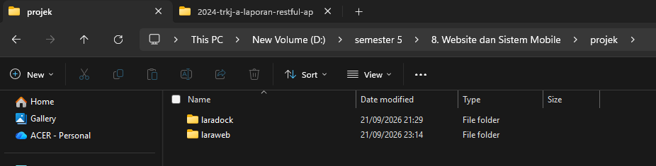

### 1.2 Masuk ke Laradock

```bash
cd "/d/semester 5/8. Website dan Sistem Mobile/projek/laradock"
```

Jalankan container:

```bash
docker compose up -d nginx mysql workspace
```

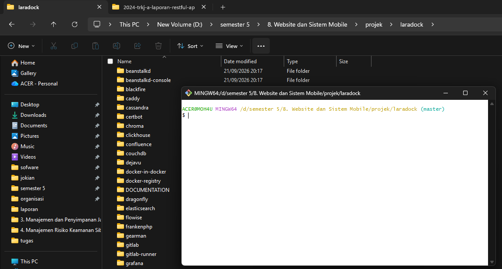

### 1.3 Cek Container

```bash
docker compose ps
```

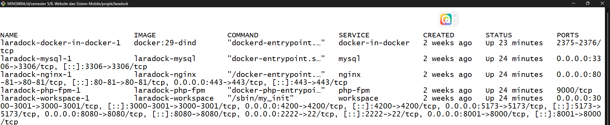

### 1.4 Masuk Workspace

```bash
docker compose exec workspace bash
cd /var/www
pwd
```

Output yang diharapkan:

```text
/var/www
```

---

# 2. CRUD Mahasiswa

## 2.1 Membuat Model, Migration, Resource, dan Controller

```bash
php artisan make:model ProgramStudi -m
php artisan make:model Mahasiswa -m
php artisan make:resource MahasiswaResource
php artisan make:controller MahasiswaController --model=Mahasiswa
```

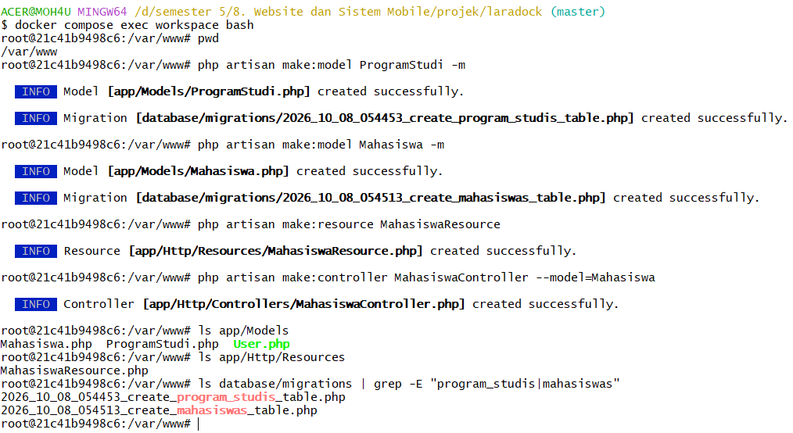

Struktur file:

```text
app/
├── Http/
│   ├── Controllers/
│   │   └── MahasiswaController.php
│   └── Resources/
│       └── MahasiswaResource.php
└── Models/
    ├── Mahasiswa.php
    ├── ProgramStudi.php
    └── User.php
```

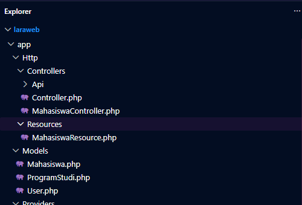

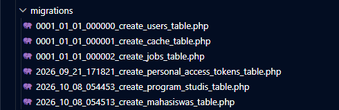

## 2.2 Migration Program Studi

File:

```text
database/migrations/xxxx_create_program_studis_table.php
```

```php
Schema::create('program_studis', function (Blueprint $table) {
    $table->id();
    $table->string('program_studi', 100);
    $table->timestamps();
});
```

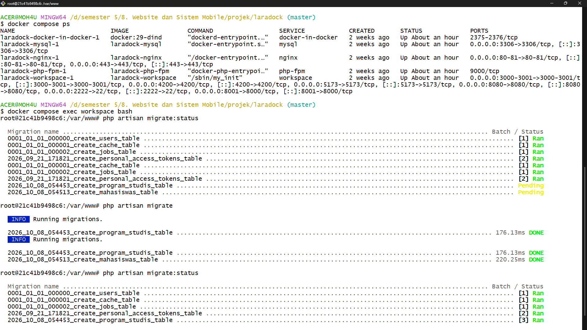

## 2.3 Migration Mahasiswa

```php
Schema::create('mahasiswas', function (Blueprint $table) {
    $table->id();
    $table->char('nim', 13)->unique();
    $table->string('nama', 100);
    $table->foreignId('program_studi_id')
          ->constrained('program_studis');
    $table->string('email', 100)->unique();
    $table->string('nomor_hp', 15)->unique();
    $table->boolean('jenis_kelamin')->default(true);
    $table->string('tempat_lahir', 100);
    $table->date('tanggal_lahir');
    $table->char('golongan_darah', 2)->nullable();
    $table->timestamps();
});
```

## 2.4 Model Mahasiswa

```php
protected $fillable = [
    'nim',
    'nama',
    'program_studi_id',
    'email',
    'nomor_hp',
    'jenis_kelamin',
    'tempat_lahir',
    'tanggal_lahir',
    'golongan_darah',
];

protected $casts = [
    'jenis_kelamin' => 'boolean',
    'tanggal_lahir' => 'date',
];

public function programStudi(): BelongsTo
{
    return $this->belongsTo(
        ProgramStudi::class,
        'program_studi_id'
    );
}
```

## 2.5 Resource Mahasiswa

```php
class MahasiswaResource extends JsonResource
{
    public $status;
    public $message;

    public function __construct($status, $message, $resource)
    {
        parent::__construct($resource);
        $this->status = $status;
        $this->message = $message;
    }

    public function toArray(Request $request): array
    {
        return [
            'status' => $this->status,
            'message' => $this->message,
            'data' => $this->resource,
        ];
    }
}
```

## 2.6 Controller Mahasiswa

### `index()`

```php
$mahasiswas = Mahasiswa::when($request->q, function ($mahasiswas, $request) {
    $mahasiswas->where('nama', 'like', '%' . $request->q . '%');
})
->latest()
->paginate(5);

return new MahasiswaResource(
    true,
    'List Data Mahasiswa',
    $mahasiswas
);
```

### `store()`

```php
$validator = Validator::make($request->all(), [
    'nim' => 'required|size:13|unique:mahasiswas',
    'nama' => 'required|max:100',
    'program_studi_id' => 'required|exists:program_studis,id',
    'email' => 'required|email|max:100|unique:mahasiswas',
    'nomor_hp' => 'required|max:15|unique:mahasiswas',
    'jenis_kelamin' => 'required|boolean',
    'tempat_lahir' => 'required|max:100',
    'tanggal_lahir' => 'required|date',
    'golongan_darah' => 'nullable|in:A,B,AB,O',
]);

if ($validator->fails()) {
    return response()->json($validator->errors(), 422);
}

$mahasiswa = Mahasiswa::create($request->all());
```

### `update()`

```php
$mahasiswa->update($request->all());
```

### `destroy()`

```php
$mahasiswa->delete();
```

## 2.7 Route Mahasiswa

```php
use App\Http\Controllers\MahasiswaController;

Route::apiResource('mahasiswa', MahasiswaController::class, [
    'except' => ['create', 'edit']
]);
```

## 2.8 Migration Database

```bash
php artisan migrate:status
php artisan migrate
php artisan migrate:status
```

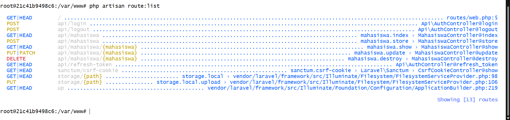

## 2.9 Data Program Studi

Masuk Tinker:

```bash
php artisan tinker
```

Buat data:

```php
$prodi = \App\Models\ProgramStudi::create([
    'program_studi' => 'Teknologi Rekayasa Komputer Jaringan',
]);

$prodi->id;

\App\Models\ProgramStudi::all(['id', 'program_studi']);
```

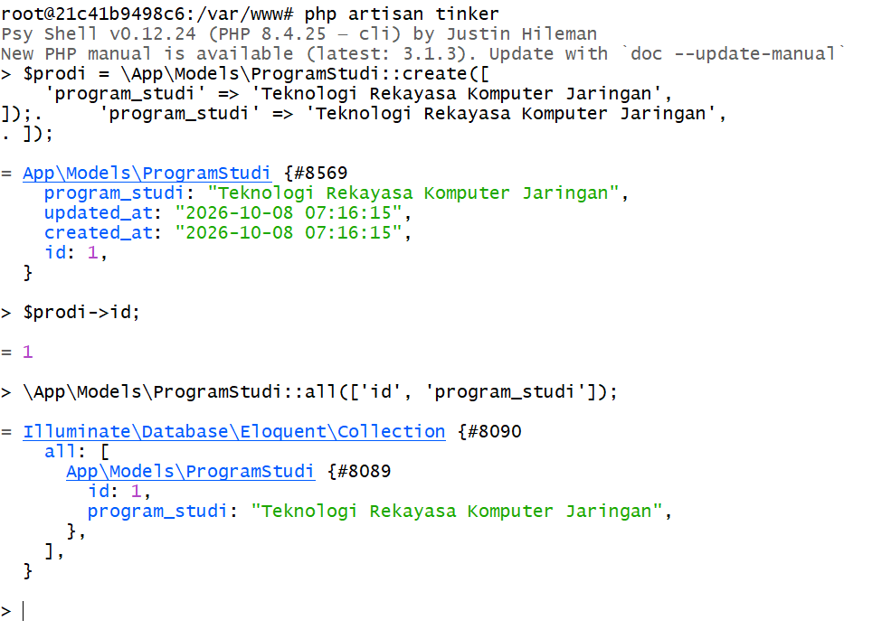

## 2.10 Pengujian API Mahasiswa dengan Postman

### GET

```http
GET http://laraweb.test/api/mahasiswa
```

### POST

```http
POST http://laraweb.test/api/mahasiswa
```

```json
{
    "nim": "2301012345678",
    "nama": "Moh Akmal",
    "program_studi_id": 1,
    "email": "mohakmal@gmail.com",
    "nomor_hp": "081234567890",
    "jenis_kelamin": true,
    "tempat_lahir": "Lhokseumawe",
    "tanggal_lahir": "2005-05-17",
    "golongan_darah": "O"
}
```

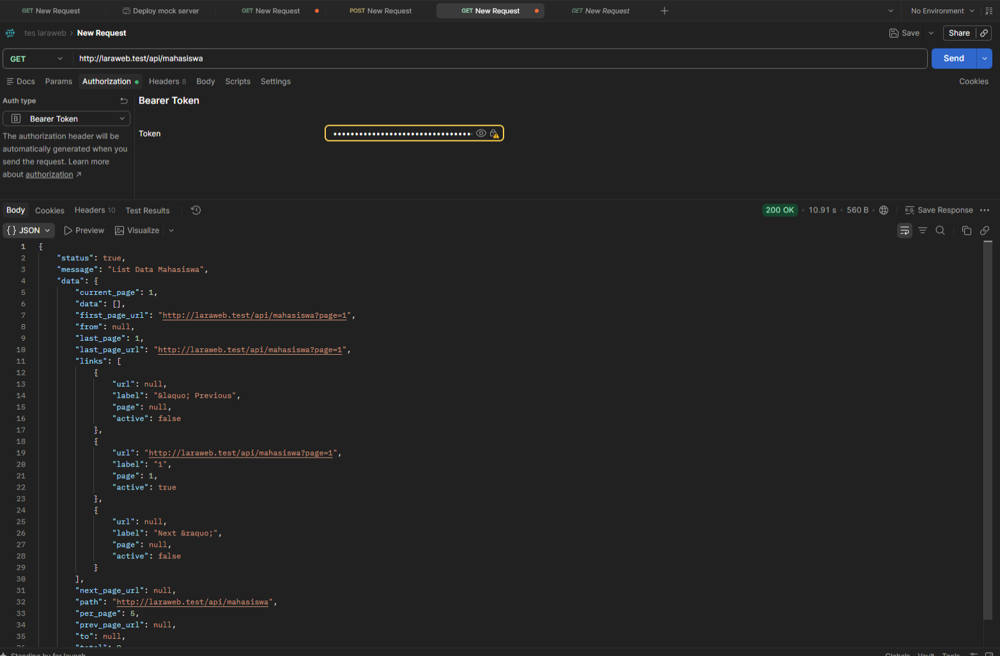

### GET Detail

```http
GET http://laraweb.test/api/mahasiswa/1
```

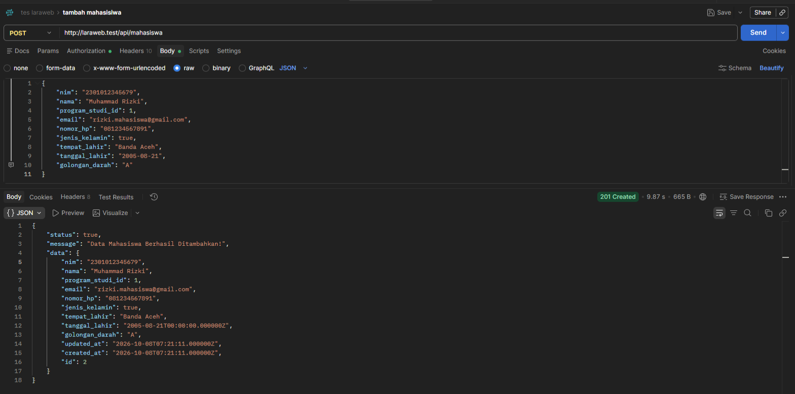

### UPDATE

```http
PUT http://laraweb.test/api/mahasiswa/1
```

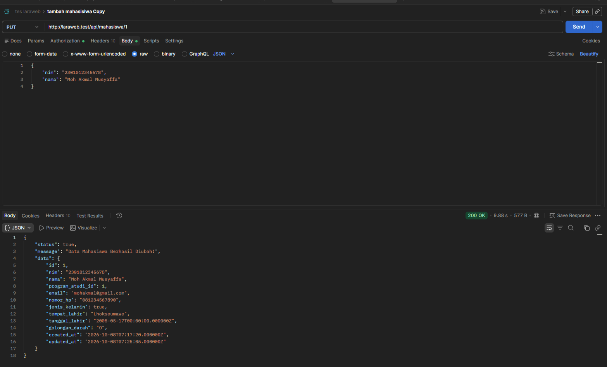

### DELETE

```http
DELETE http://laraweb.test/api/mahasiswa/1
```

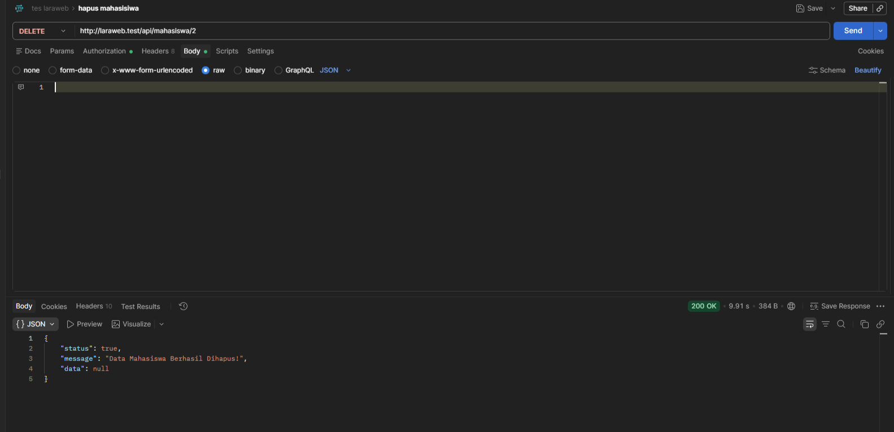

### Hasil Akhir

```http
GET http://laraweb.test/api/mahasiswa
```

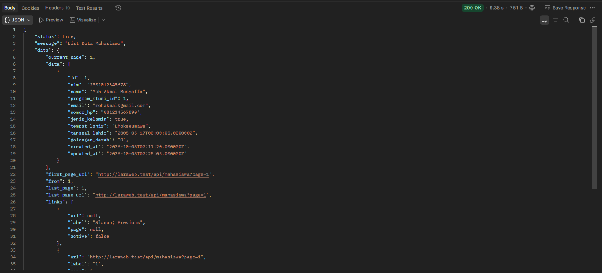

---

# 3. CRUD Dosen

## 3.1 Membuat Model, Resource, dan Controller

```bash
php artisan make:model Dosen -m
php artisan make:resource DosenResource
php artisan make:controller DosenController --model=Dosen
```

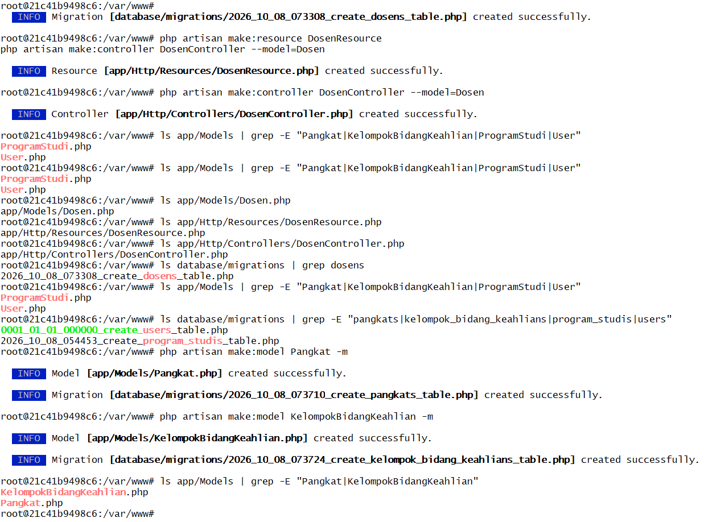

Buat tabel pendukung:

```bash
php artisan make:model Pangkat -m
php artisan make:model KelompokBidangKeahlian -m
```

## 3.2 Migration Pangkat

```php
Schema::create('pangkats', function (Blueprint $table) {
    $table->id();
    $table->string('pangkat', 100);
    $table->timestamps();
});
```

## 3.3 Migration Kelompok Bidang Keahlian

```php
Schema::create('kelompok_bidang_keahlians', function (Blueprint $table) {
    $table->id();
    $table->string('kelompok_bidang_keahlian', 100);
    $table->timestamps();
});
```

## 3.4 Migration Dosen

```php
Schema::create('dosens', function (Blueprint $table) {
    $table->id();

    $table->string('nidn', 10)->unique()->nullable();
    $table->string('nip', 18)->unique()->nullable();
    $table->date('tmt')->nullable();
    $table->string('nama_lengkap', 100);

    $table->foreignId('pangkat_id')
          ->nullable()
          ->constrained('pangkats');

    $table->boolean('jenis_kelamin')->default(1);

    $table->string('foto', 255)
          ->default('https://www.gravatar.com/avatar/?d=identicon');

    $table->foreignId('kelompok_bidang_keahlian_id')
          ->nullable()
          ->constrained('kelompok_bidang_keahlians');

    $table->text('bidang_keilmuan')->nullable();

    $table->enum('fungsi_fungsional', [
        'tenaga pengajar',
        'asisten ahli',
        'lektor',
        'lektor kepala',
        'guru besar'
    ])->default('tenaga pengajar');

    $table->enum('status', [
        'aktif',
        'cuti',
        'ijin belajar',
        'tugas di instansi lain',
        'tugas belajar'
    ])->default('aktif');

    $table->foreignId('user_id')
          ->nullable()
          ->constrained('users')
          ->onUpdate('cascade')
          ->onDelete('cascade');

    $table->foreignId('program_studi_id')
          ->nullable()
          ->constrained('program_studis')
          ->onUpdate('cascade')
          ->onDelete('cascade');

    $table->timestamps();
    $table->softDeletes();
});
```

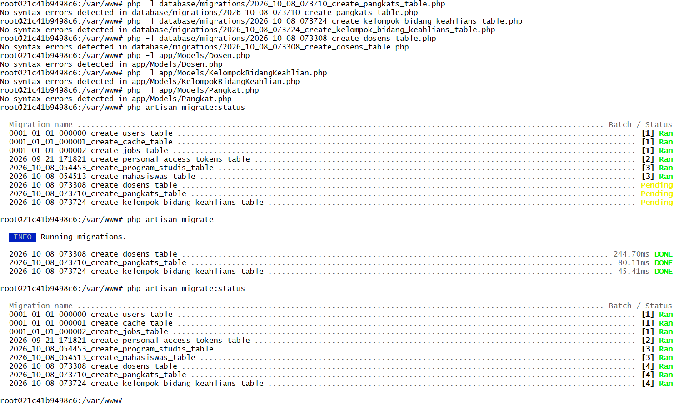

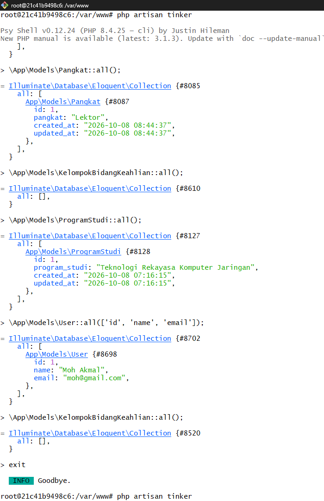

## 3.5 Model Dosen

```php
class Dosen extends Model
{
    use SoftDeletes;

    protected $fillable = [
        'nidn',
        'nip',
        'tmt',
        'nama_lengkap',
        'pangkat_id',
        'jenis_kelamin',
        'foto',
        'kelompok_bidang_keahlian_id',
        'bidang_keilmuan',
        'fungsi_fungsional',
        'status',
        'user_id',
        'program_studi_id',
    ];

    protected $casts = [
        'tmt' => 'date',
        'jenis_kelamin' => 'boolean',
    ];

    public function pangkat(): BelongsTo
    {
        return $this->belongsTo(Pangkat::class);
    }

    public function kelompokBidangKeahlian(): BelongsTo
    {
        return $this->belongsTo(
            KelompokBidangKeahlian::class,
            'kelompok_bidang_keahlian_id'
        );
    }

    public function user(): BelongsTo
    {
        return $this->belongsTo(User::class);
    }

    public function programStudi(): BelongsTo
    {
        return $this->belongsTo(
            ProgramStudi::class,
            'program_studi_id'
        );
    }
}
```

## 3.6 DosenResource

```php
class DosenResource extends JsonResource
{
    public $status;
    public $message;

    public function __construct($status, $message, $resource)
    {
        parent::__construct($resource);
        $this->status = $status;
        $this->message = $message;
    }

    public function toArray(Request $request): array
    {
        return [
            'status' => $this->status,
            'message' => $this->message,
            'data' => $this->resource,
        ];
    }
}
```

## 3.7 DosenController

### `index()`

```php
$dosens = Dosen::when($request->q, function ($dosens, $request) {
    $dosens->where('nama_lengkap', 'like', '%' . $request->q . '%');
})
->latest()
->paginate(5);

return new DosenResource(
    true,
    'List Data Dosen',
    $dosens
);
```

### `store()`

```php
$validator = Validator::make($request->all(), [
    'nidn' => 'nullable|size:10|unique:dosens,nidn',
    'nip' => 'nullable|size:18|unique:dosens,nip',
    'tmt' => 'nullable|date',
    'nama_lengkap' => 'required|max:100',
    'pangkat_id' => 'nullable|exists:pangkats,id',
    'jenis_kelamin' => 'required|boolean',
    'foto' => 'nullable|string|max:255',
    'kelompok_bidang_keahlian_id' => 'nullable|exists:kelompok_bidang_keahlians,id',
    'bidang_keilmuan' => 'nullable|string',
    'fungsi_fungsional' => 'required|in:tenaga pengajar,asisten ahli,lektor,lektor kepala,guru besar',
    'status' => 'required|in:aktif,cuti,ijin belajar,tugas di instansi lain,tugas belajar',
    'user_id' => 'nullable|exists:users,id',
    'program_studi_id' => 'nullable|exists:program_studis,id',
]);

$dosen = Dosen::create($request->all());
```

### `update()`

```php
$dosen->update($request->all());
```

### `destroy()`

```php
$dosen->delete();
```

## 3.8 Data Master Dosen

```bash
php artisan tinker
```

### Pangkat

```php
\App\Models\Pangkat::create([
    'pangkat' => 'Lektor'
]);
```

### Kelompok Bidang Keahlian

```php
\App\Models\KelompokBidangKeahlian::create([
    'kelompok_bidang_keahlian' => 'Jaringan Komputer'
]);
```

### Program Studi

```php
\App\Models\ProgramStudi::all();
```

### User

```php
\App\Models\User::all(['id', 'name', 'email']);
```

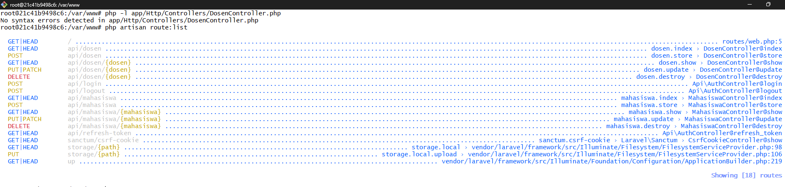

## 3.9 Cek Struktur Tabel Dosen

```php
\Illuminate\Support\Facades\Schema::getColumnListing('dosens');
```

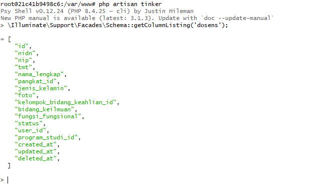

## 3.10 Route Dosen

```php
use App\Http\Controllers\DosenController;

Route::apiResource('dosen', DosenController::class, [
    'except' => ['create', 'edit']
]);
```

Cek:

```bash
php artisan route:list
```

Endpoint:

```text
GET|HEAD   api/dosen
POST       api/dosen
GET|HEAD   api/dosen/{dosen}
PUT|PATCH  api/dosen/{dosen}
DELETE     api/dosen/{dosen}
```

## 3.11 POST Dosen

```http
POST http://laraweb.test/api/dosen
```

Gunakan:

```text
Authorization → Bearer Token
```

Body:

```json
{
    "nidn": "0123456789",
    "nip": "198765432101234567",
    "tmt": "2020-01-01",
    "nama_lengkap": "Muhammad Davi",
    "pangkat_id": 1,
    "jenis_kelamin": true,
    "foto": "https://www.gravatar.com/avatar/?d=identicon",
    "kelompok_bidang_keahlian_id": 1,
    "bidang_keilmuan": "Jaringan Komputer dan Keamanan Siber",
    "fungsi_fungsional": "lektor",
    "status": "aktif",
    "user_id": 1,
    "program_studi_id": 1
}
```

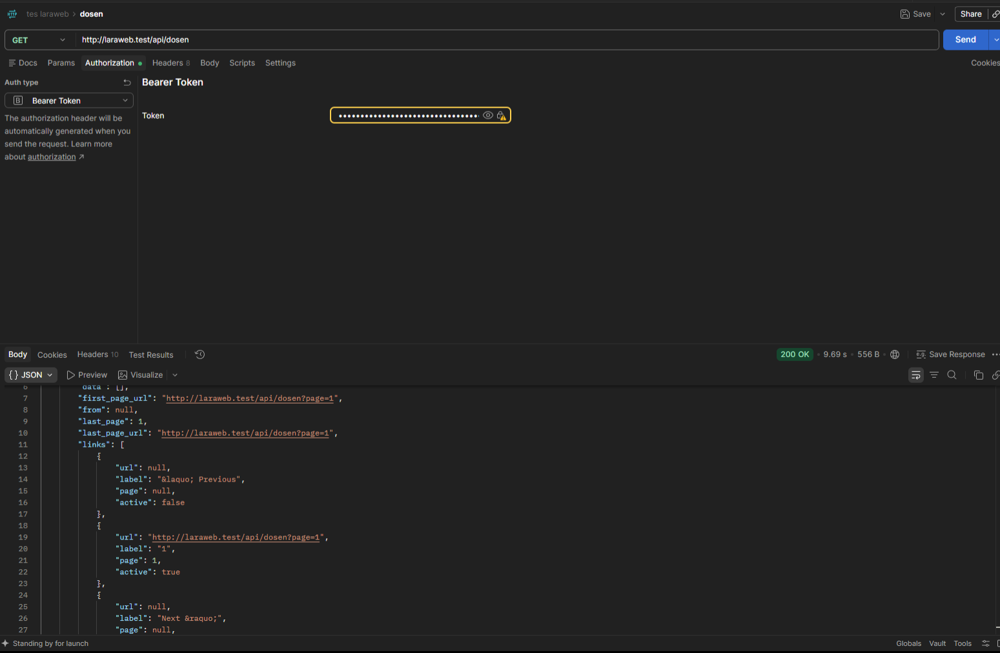

## 3.12 GET Dosen

```http
GET http://laraweb.test/api/dosen
```

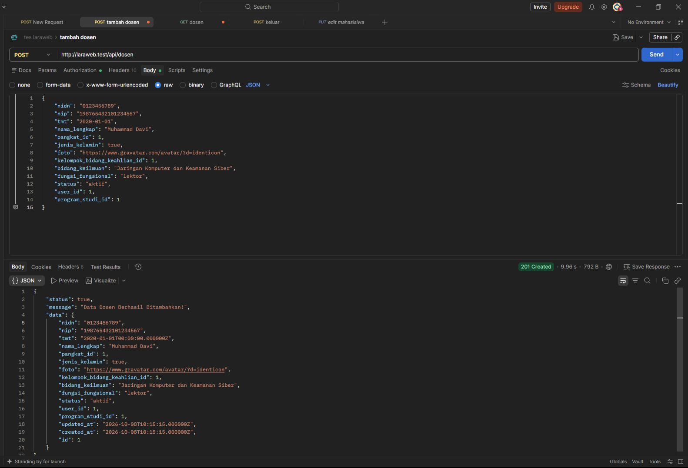

## 3.13 GET Detail Dosen

```http
GET http://laraweb.test/api/dosen/1
```

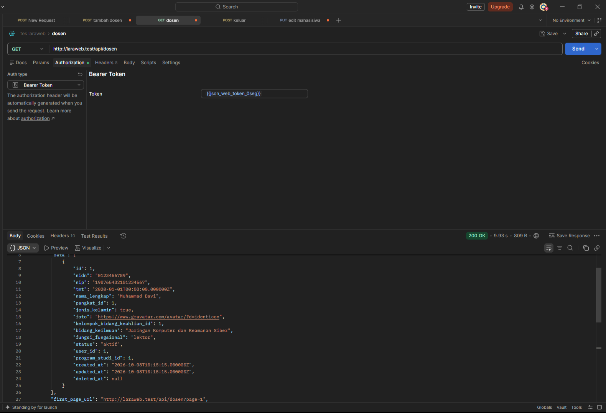

## 3.14 UPDATE Dosen

```http
PUT http://laraweb.test/api/dosen/1
```

Contoh body:

```json
{
    "nidn": "0123456789",
    "nip": "198765432101234567",
    "nama_lengkap": "Muhammad Davi Akmal",
    "pangkat_id": 1,
    "jenis_kelamin": true,
    "foto": "https://www.gravatar.com/avatar/?d=identicon",
    "kelompok_bidang_keahlian_id": 1,
    "bidang_keilmuan": "Jaringan Komputer, Keamanan Siber, dan Cloud Computing",
    "fungsi_fungsional": "lektor kepala",
    "status": "aktif",
    "user_id": 1,
    "program_studi_id": 1
}
```

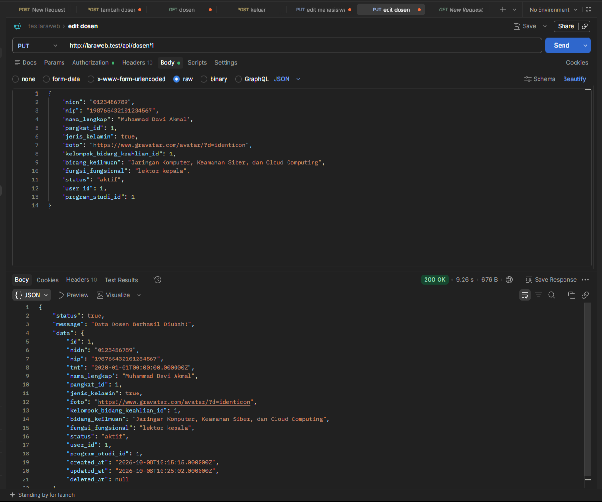

## 3.15 DELETE Dosen

```http
DELETE http://laraweb.test/api/dosen/1
```

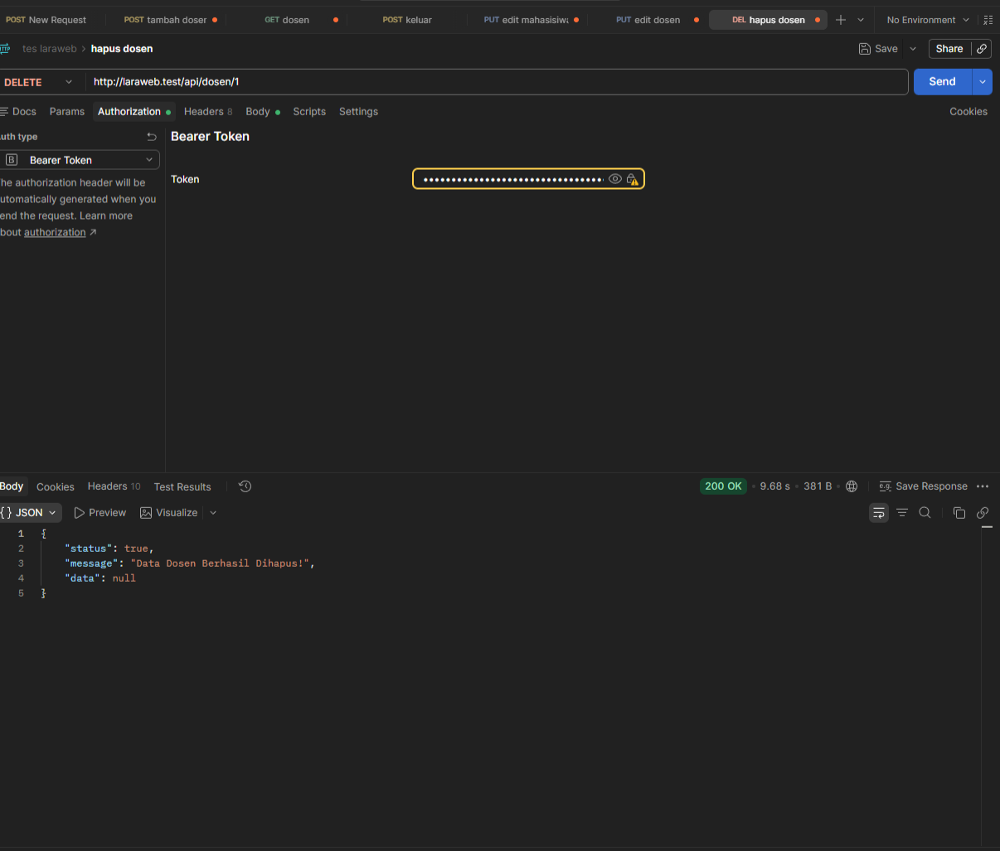

## 3.16 Hasil Akhir

```http
GET http://laraweb.test/api/dosen
```

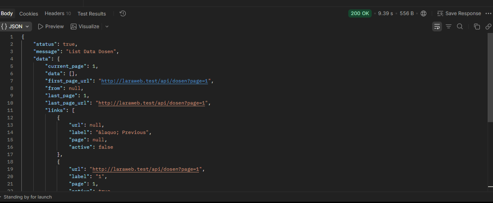

---
## E. Hasil dan Pembahasan


### GET

```http
GET http://laraweb.test/api/mahasiswa
```

### POST

```http
POST http://laraweb.test/api/mahasiswa
```

```json
{
    "nim": "2301012345678",
    "nama": "Moh Akmal",
    "program_studi_id": 1,
    "email": "mohakmal@gmail.com",
    "nomor_hp": "081234567890",
    "jenis_kelamin": true,
    "tempat_lahir": "Lhokseumawe",
    "tanggal_lahir": "2005-05-17",
    "golongan_darah": "O"
}
```


### GET Detail

```http
GET http://laraweb.test/api/mahasiswa/1
```


### UPDATE

```http
PUT http://laraweb.test/api/mahasiswa/1
```


### DELETE

```http
DELETE http://laraweb.test/api/mahasiswa/1
```


### Hasil Akhir

```http
GET http://laraweb.test/api/mahasiswa
```


---

# Analisis
Berdasarkan hasil implementasi dan pengujian menggunakan Postman, RESTful API CRUD Mahasiswa berhasil dibuat dan dapat digunakan untuk mengelola data mahasiswa. Proses CRUD meliputi **Create, Read, Update, dan Delete** yang terhubung dengan database melalui model `Mahasiswa` dan relasi dengan `ProgramStudi`. :chatgpt-content-reference{index="0"}

### 1. Create

Proses **Create** digunakan untuk menambahkan data mahasiswa baru ke dalam database. Data yang dikirim melalui API akan divalidasi terlebih dahulu.

Validasi yang diterapkan meliputi:

- `nim` wajib diisi, memiliki panjang 13 karakter, dan harus unik.
- `nama` wajib diisi dengan maksimal 100 karakter.
- `program_studi_id` wajib mengacu pada data yang tersedia pada tabel `program_studis`.
- `email` wajib menggunakan format email dan bersifat unik.
- `nomor_hp` wajib diisi dan bersifat unik.
- `jenis_kelamin` harus berupa nilai boolean.
- `tempat_lahir` wajib diisi.
- `tanggal_lahir` harus memiliki format tanggal.
- `golongan_darah` hanya dapat berisi `A`, `B`, `AB`, atau `O`.

Jika seluruh validasi berhasil, data disimpan menggunakan `Mahasiswa::create()`. API kemudian mengembalikan pesan **"Data Mahasiswa Berhasil Ditambahkan!"**. Apabila validasi gagal, API mengembalikan response dengan status HTTP `422`. :chatgpt-content-reference{index="1"}

### 2. Read

Proses **Read** digunakan untuk mengambil data mahasiswa dari database.

Pada fungsi `index`, API dapat menampilkan daftar mahasiswa dengan fitur:

- pencarian berdasarkan nama menggunakan parameter `q`;
- pengurutan data berdasarkan data terbaru;
- pagination sebanyak 5 data setiap halaman.

Selain itu, fungsi `show` digunakan untuk menampilkan detail mahasiswa berdasarkan ID.

Data hasil pembacaan dikembalikan melalui `MahasiswaResource` dengan struktur response yang terdiri dari `status`, `message`, dan `data`. :chatgpt-content-reference{index="2"}

### 3. Update

Proses **Update** digunakan untuk mengubah data mahasiswa yang sudah tersimpan.

Sebelum proses perubahan dilakukan, data kembali melalui validasi. Pada proses update, `nim` tetap harus memiliki 13 karakter dan harus unik, tetapi ID mahasiswa yang sedang diubah dikecualikan dari pemeriksaan duplikasi.

Setelah validasi berhasil, perubahan dilakukan menggunakan:

```php
$mahasiswa->update($request->all());

```


## Route Dosen


```php
use App\Http\Controllers\DosenController;

Route::apiResource('dosen', DosenController::class, [
    'except' => ['create', 'edit']
]);
```

Cek:

```bash
php artisan route:list
```

Endpoint:

```text
GET|HEAD   api/dosen
POST       api/dosen
GET|HEAD   api/dosen/{dosen}
PUT|PATCH  api/dosen/{dosen}
DELETE     api/dosen/{dosen}
```

## POST Dosen

```http
POST http://laraweb.test/api/dosen
```

Gunakan:

```text
Authorization → Bearer Token
```

Body:

```json
{
    "nidn": "0123456789",
    "nip": "198765432101234567",
    "tmt": "2020-01-01",
    "nama_lengkap": "Muhammad Davi",
    "pangkat_id": 1,
    "jenis_kelamin": true,
    "foto": "https://www.gravatar.com/avatar/?d=identicon",
    "kelompok_bidang_keahlian_id": 1,
    "bidang_keilmuan": "Jaringan Komputer dan Keamanan Siber",
    "fungsi_fungsional": "lektor",
    "status": "aktif",
    "user_id": 1,
    "program_studi_id": 1
}
```


##  GET Dosen

```http
GET http://laraweb.test/api/dosen
```


## GET Detail Dosen

```http
GET http://laraweb.test/api/dosen/1
```


## UPDATE Dosen

```http
PUT http://laraweb.test/api/dosen/1
```

Contoh body:

```json
{
    "nidn": "0123456789",
    "nip": "198765432101234567",
    "nama_lengkap": "Muhammad Davi Akmal",
    "pangkat_id": 1,
    "jenis_kelamin": true,
    "foto": "https://www.gravatar.com/avatar/?d=identicon",
    "kelompok_bidang_keahlian_id": 1,
    "bidang_keilmuan": "Jaringan Komputer, Keamanan Siber, dan Cloud Computing",
    "fungsi_fungsional": "lektor kepala",
    "status": "aktif",
    "user_id": 1,
    "program_studi_id": 1
}
```


## DELETE Dosen

```http
DELETE http://laraweb.test/api/dosen/1
```


## Hasil Akhir

```http
GET http://laraweb.test/api/dosen
```


# Analisis

Berdasarkan hasil implementasi dan pengujian menggunakan Postman, RESTful API CRUD Dosen berhasil dibuat dan dapat digunakan untuk mengelola data dosen. API menyediakan fungsi untuk menampilkan, menambahkan, mengubah, dan menghapus data dosen melalui endpoint yang telah ditentukan.

### 1. Create

Proses **Create** digunakan untuk menambahkan data dosen baru ke dalam database. Data yang dikirim akan terlebih dahulu melalui proses validasi untuk memastikan format dan nilai data sesuai dengan aturan yang telah ditentukan.

Beberapa validasi yang diterapkan antara lain:

- `nama_lengkap` wajib diisi dan maksimal 100 karakter.
- `nidn` harus memiliki panjang 10 karakter dan bersifat unik.
- `nip` harus memiliki panjang 18 karakter dan bersifat unik.
- `jenis_kelamin` harus memiliki nilai boolean.
- `pangkat_id`, `kelompok_bidang_keahlian_id`, `user_id`, dan `program_studi_id` harus mengacu pada data yang tersedia pada tabel terkait.
- `fungsi_fungsional` dan `status` hanya menerima nilai yang telah ditentukan.

Apabila validasi berhasil, data dosen disimpan menggunakan `Dosen::create()` dan API mengembalikan pesan **"Data Dosen Berhasil Ditambahkan!"**. Apabila terdapat kesalahan validasi, API mengembalikan HTTP status `422` beserta informasi kesalahan. :chatgpt-content-reference{index="1"}

### 2. Read

Proses **Read** digunakan untuk mengambil data dosen dari database.

Pada fungsi `index`, data dosen dapat ditampilkan dalam bentuk daftar. API juga mendukung pencarian berdasarkan `nama_lengkap` melalui parameter `q` dan menggunakan pagination sebanyak 5 data per halaman.

Selain menampilkan daftar data, fungsi `show` digunakan untuk melihat detail satu data dosen berdasarkan ID.

Hasil pengujian menunjukkan bahwa API dapat mengembalikan data dalam format JSON melalui `DosenResource`, sehingga data lebih terstruktur dan mudah digunakan oleh aplikasi client seperti Postman atau aplikasi frontend. :chatgpt-content-reference{index="2"}

### 3. Update

Proses **Update** digunakan untuk mengubah data dosen yang sudah tersimpan.

Sebelum perubahan dilakukan, data kembali divalidasi untuk memastikan data yang dikirim tetap sesuai dengan aturan. Setelah validasi berhasil, proses pembaruan dilakukan menggunakan metode:

```php
$dosen->update($request->all());

```

## F. Kesimpulan

Berdasarkan praktikum yang telah dilakukan, dapat disimpulkan bahwa RESTful API menggunakan Laravel berhasil diimplementasikan untuk mengelola data **Mahasiswa** dan **Dosen**. Implementasi dilakukan menggunakan model, migration, resource, controller, serta routing API yang terhubung dengan database.

Pada CRUD **Mahasiswa**, API berhasil digunakan untuk melakukan proses **Create, Read, Update, dan Delete** terhadap data mahasiswa. Data mahasiswa juga memiliki relasi dengan data **Program Studi**, serta dilengkapi dengan validasi untuk menjaga agar data yang dimasukkan sesuai dengan aturan yang telah ditentukan. 

Pada CRUD **Dosen**, API juga berhasil menjalankan proses **Create, Read, Update, dan Delete** dengan menerapkan validasi serta relasi terhadap beberapa data seperti **Pangkat, Kelompok Bidang Keahlian, User, dan Program Studi**. 

Pengujian menggunakan **Postman** menunjukkan bahwa endpoint RESTful API dapat digunakan untuk mengelola data melalui metode HTTP seperti `GET`, `POST`, `PUT`, dan `DELETE`. Dengan demikian, praktikum ini memberikan pemahaman mengenai penerapan Laravel dalam membangun RESTful API, pengelolaan database menggunakan Eloquent ORM, validasi data, relasi antartabel, serta pengujian API menggunakan Postman. 

## G. Referensi

[1] M. Davi, *TIK-6555 — Website dan Sistem Mobile*, Modul Praktikum, Program Studi Teknologi Rekayasa Komputer Jaringan, Jurusan Teknologi Informasi dan Komputer, Politeknik Negeri Lhokseumawe, 2025–2026.

[2] Laravel, “Laravel Documentation,” [Online]. Available: https://laravel.com/docs

[3] Laradock, “Laradock Documentation,” [Online]. Available: https://laradock.io/

[4] Git, “Git Handbook,” [Online]. Available: https://git-scm.com/book/

[5] GitHub, “GitHub,” [Online]. Available: https://github.com/

[6] Auth0, “JSON Web Tokens,” [Online]. Available: https://jwt.io/
