<div align="center">

## LAPORAN [NAMA MATAKULIAH]


### Disusun Oleh:  
Nama               : MOH. Akmal Musyaffa 
<br><br>
NIM                : 2024903430018
<br><br>
Kelas              : TRKJ 3A


### Program Studi Teknologi Rekayasa Komputer Jaringan
### Jurusan Teknologi Informasi dan Komputer
### Politeknik Negeri Lhokseumawe
### 2026


---


## Lembar Pengesahan


| No. Praktikum     | : | 02 |
|------------------:|:-:|:--------------|
| Judul Praktikum   | : | laporan-restful-api-login .| 
| Tanggal Praktikum | : | 17 September 2026 |
| Tanggal Penyerahan| : | 22 September 2026 |
| Nama Praktikan    | : | MOH. Akmal Musyaffa  |
| NIM/Kelas Praktikan| : | 2024903430018 / TRKJ 3A |
| Nilai Praktikum   | : | .......................... |
| Dosen Pengampu    | : | Muhammad Davi, S.Kom., M.Cs. |

<br>

Mengetahui,  
Dosen Pengampu
<br><br><br><br><br>

Muhammad Davi, S.Kom., M.Cs.
</div>


## Daftar Isi
- [Lembar Pengesahan](#lembar-pengesahan)
- [Daftar Isi](#daftar-isi)
- [Tujuan Praktikum](#tujuan-praktikum)
- [Dasar Teori](#dasar-teori)
- [Alat dan Bahan](#alat-dan-bahan)
- [Langkah Kerja](#langkah-kerja)
- [Hasil dan Pembahasan](#hasil-dan-pembahasan)
- [Kesimpulan](#kesimpulan)
- [Referensi](#referensi)
---

## A. Tujuan Praktikum

1. Memahami dan mempersiapkan lingkungan pengembangan Laravel menggunakan Laradock dan Docker.
Membuat dan mengonfigurasi project Laravel agar dapat dijalankan melalui Nginx dan domain lokal laraweb.test.

2. Mengimplementasikan RESTful API Login menggunakan JSON Web Token (JWT) sebagai mekanisme autentikasi.
3. Membuat konfigurasi authentication pada Laravel melalui guard API, model User, dan AuthController.
4. Membuat dan mengonfigurasi route API untuk proses login, refresh token, dan logout.
5. Menguji RESTful API Login menggunakan Postman untuk memastikan endpoint API dapat berjalan sesuai fungsi yang telah dibuat.

## B. Dasar Teori
Praktikum ini didukung oleh beberapa konsep utama, yaitu Laravel, Laradock, Docker, RESTful API, autentikasi, dan JSON Web Token (JWT). Materi tersebut digunakan sebagai dasar dalam membangun RESTful API Login pada project Laravel. Modul praktikum mencantumkan Laravel Documentation, Laradock Documentation, Git Handbook, GitHub, serta bahan bacaan mengenai JWT sebagai referensi pendukung praktikum.

1. Laravel

Laravel merupakan framework yang digunakan dalam praktikum untuk membangun aplikasi berbasis web dan RESTful API. Dalam praktikum, Laravel digunakan sebagai inti aplikasi, termasuk pengelolaan model User, controller API, routing, konfigurasi authentication, serta migration database. Project Laravel dibuat dengan nama laraweb dan ditempatkan sejajar dengan folder laradock.

2. Laradock dan Docker

Laradock digunakan sebagai lingkungan kerja untuk menjalankan aplikasi Laravel melalui container Docker. Modul menjelaskan bahwa Docker digunakan untuk mengemas dan menjalankan aplikasi atau service dalam lingkungan terisolasi, seperti Nginx dan MySQL. Dengan Laradock, komponen aplikasi dapat dijalankan secara terpisah tetapi tetap terhubung dalam lingkungan pengembangan yang sama.

3. Nginx

Nginx digunakan sebagai web server dan reverse proxy dalam lingkungan Laradock. Pada praktikum, Nginx dikonfigurasi agar domain lokal laraweb.test mengarah ke project Laravel. Konfigurasi tersebut dilakukan melalui file laraweb.conf, termasuk penentuan server_name, document root, serta penerusan request PHP ke PHP-FPM. Struktur konfigurasi ini ditunjukkan pada dokumentasi praktikum.

4. RESTful API

RESTful API merupakan pendekatan yang digunakan untuk menyediakan layanan aplikasi melalui endpoint HTTP. Pada praktikum, API digunakan untuk menjalankan proses autentikasi pengguna melalui endpoint login, refresh token, dan logout. Route API yang digunakan adalah POST /api/login, GET /api/refresh-token, dan POST /api/logout.

5. JSON Web Token (JWT)

JSON Web Token (JWT) digunakan sebagai mekanisme autentikasi pada RESTful API. Pada praktikum, package tymon/jwt-auth digunakan untuk membuat dan mengelola token autentikasi. Laravel kemudian dikonfigurasi menggunakan guard api dengan driver jwt dan provider users.

Model User juga harus mengimplementasikan JWTSubject agar dapat digunakan dalam proses autentikasi JWT. Method getJWTIdentifier() digunakan untuk menentukan identifier pengguna, sedangkan getJWTCustomClaims() digunakan untuk menyediakan custom claims pada token.

6. Authentication

Authentication merupakan proses untuk memverifikasi identitas pengguna sebelum pengguna memperoleh akses ke resource yang dilindungi. Dalam praktikum, proses authentication dilakukan melalui AuthController. Fungsi login() melakukan validasi email dan password, kemudian menghasilkan JWT ketika kredensial pengguna valid. Endpoint refresh_token() digunakan untuk menghasilkan token baru, sedangkan logout() digunakan untuk melakukan invalidasi token.

7. API Route dan Middleware

Route API digunakan untuk menghubungkan request HTTP dengan fungsi pada controller. Pada praktikum, endpoint refresh-token dan logout dilindungi oleh middleware auth:api, sehingga request memerlukan autentikasi JWT yang valid.

8. Postman

Postman digunakan sebagai alat pengujian RESTful API. Melalui Postman, request dapat dikirim menggunakan method HTTP seperti POST dan GET, kemudian response API dapat diamati. Dalam praktikum, Postman digunakan untuk menguji proses login, memperoleh JWT token, mengirim Bearer Token untuk endpoint yang dilindungi, melakukan refresh token, dan menguji logout. Modul secara khusus mengarahkan pengujian API menggunakan Postman.

9. Hubungan Dasar Teori dengan Praktikum

Konsep-konsep tersebut saling berhubungan dalam proses implementasi:

```text
Laravel


    ↓

Laradock + Docker

  
   ↓


Nginx + PHP-FPM + MySQL
 
   ↓
RESTful API
 
   ↓
JWT Authentication
  
   ↓
AuthController
 
   ↓
API Route + Middleware
  
   ↓
Postman
```


Dengan dasar teori tersebut, praktikum dapat mengimplementasikan proses autentikasi API mulai dari validasi pengguna, pembentukan JWT, penggunaan Bearer Token, refresh token, hingga logout. Struktur implementasi tersebut sesuai dengan tahapan RESTful API Login pada modul praktikum.

## C. Alat dan Bahan
| No. | Alat/Bahan                         | Keterangan                                                                                                  |
| --- | ---------------------------------- | ----------------------------------------------------------------------------------------------------------- |
| 1.  | Laptop/PC                          | Digunakan sebagai perangkat utama untuk menjalankan seluruh proses praktikum.                               |
| 2.  | Sistem Operasi Windows/Linux/macOS | Sistem operasi untuk menjalankan tools dan lingkungan pengembangan.                                         |
| 3.  | JetBrains Toolbox                  | Digunakan untuk menginstal dan mengelola aplikasi JetBrains.                                                |
| 4.  | PhpStorm                           | IDE yang digunakan untuk membuat dan mengedit project Laravel.                                              |
| 5.  | Git Bash                           | Digunakan untuk menjalankan perintah Git dan command-line selama praktikum.                                 |
| 6.  | Google Chrome                      | Digunakan sebagai web browser untuk mengakses aplikasi Laravel.                                             |
| 7.  | Git                                | Digunakan sebagai version control pada project.                                                             |
| 8.  | GitHub                             | Digunakan sebagai repository berbasis web untuk penyimpanan dan pengumpulan project.                        |
| 9.  | Docker                             | Digunakan untuk menjalankan service dalam container terisolasi seperti Nginx dan MySQL.                     |
| 10. | Laradock                           | Digunakan sebagai lingkungan kerja untuk pengembangan aplikasi Laravel.                                     |
| 11. | Composer                           | Digunakan untuk mengelola dan menginstal package/dependency yang diperlukan Laravel, termasuk library JWT.  |
| 12. | Laravel                            | Framework utama yang digunakan untuk membangun RESTful API.                                                 |
| 13. | MySQL                              | Database yang dijalankan melalui lingkungan Laradock/Docker.                                                |
| 14. | Nginx                              | Web server yang digunakan untuk melayani project Laravel melalui domain lokal.                              |
| 15. | JWT (`tymon/jwt-auth`)             | Library yang digunakan untuk implementasi autentikasi berbasis JSON Web Token.                              |
| 16. | Postman                            | Digunakan untuk menguji endpoint RESTful API Login.                                                         |
| 17. | Markdown                           | Digunakan untuk menulis dokumentasi atau laporan praktikum.                                                 |


## D. Langkah Kerja

---

# FASE 1 — Persiapan Project

## 1.1 Struktur Folder

Project dibuat dengan struktur:

```text
projek/
├── laradock/
└── laraweb/
```

Project Laravel `laraweb` berada sejajar dengan folder `laradock`.

## 1.2 Masuk ke Folder Project

```bash
cd "/d/semester 5/8. Website dan Sistem Mobile/projek"
```

Periksa isi folder:

```bash
ls
```

Hasil yang diharapkan:

```text
laradock
laraweb
```

## 1.3 Masuk ke Laravel

```bash
cd laraweb
```

Cek:

```bash
ls
```

Folder utama Laravel akan terlihat seperti:

```text
app/
bootstrap/
config/
database/
public/
resources/
routes/
storage/
vendor/
artisan
composer.json
.env
```

---
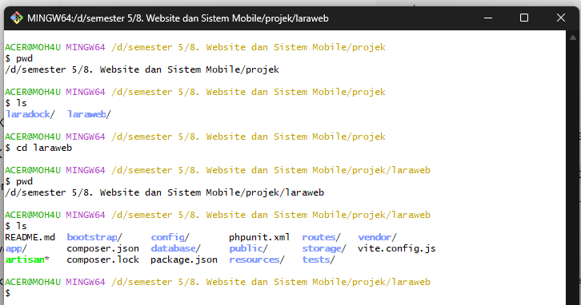

# FASE 2 — Konfigurasi Hosts

## 2.1 Masuk ke Folder Hosts Windows

```bash
cd /c/Windows/System32/drivers/etc
```

Cek lokasi:

```bash
pwd
```

## 2.2 Buka File Hosts

```bash
nano hosts
```
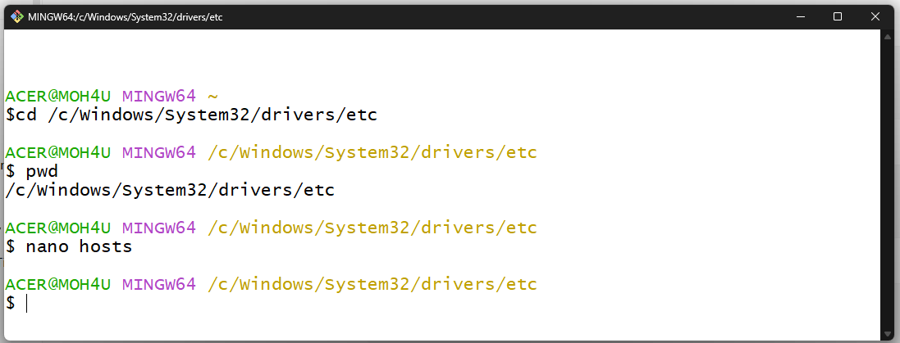
Tambahkan:

```text
127.0.0.1 laraweb.test
```

Contoh:

```text
# Laradock
127.0.0.1 laraweb.test
```
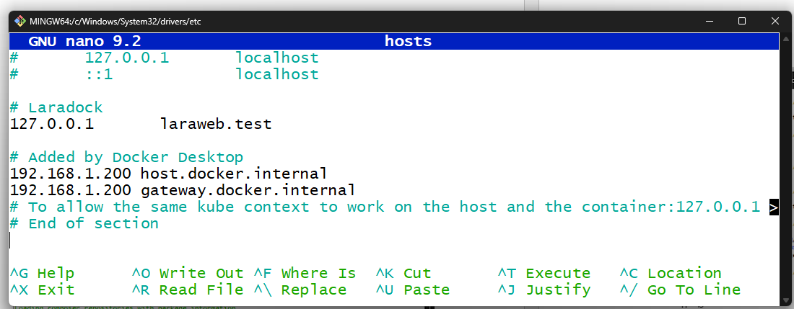
Simpan:

```text
CTRL + O
ENTER
CTRL + X
```

## 2.3 Cek Hosts

```bash
cat hosts
```

Pastikan terdapat:

```text
127.0.0.1 laraweb.test
```

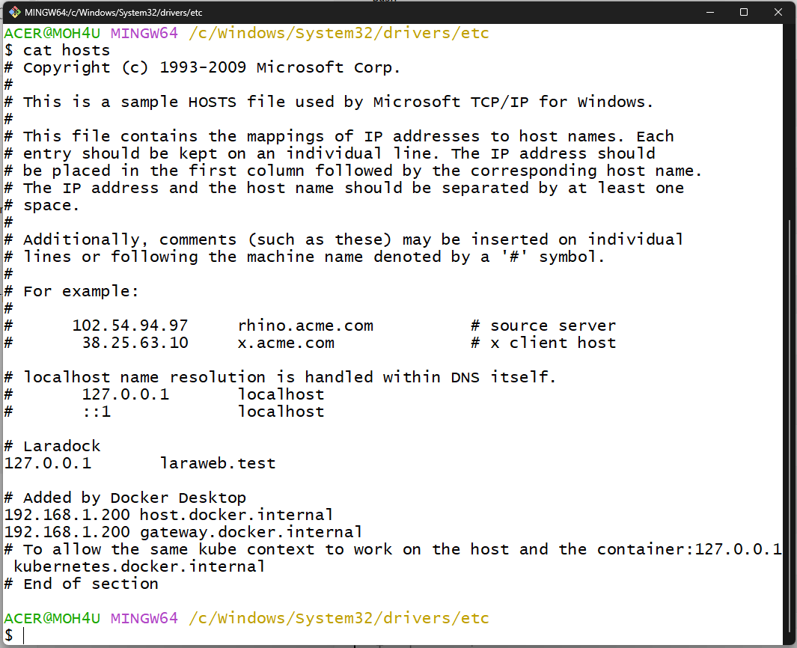

---

# FASE 3 — Konfigurasi Nginx Laradock

## 3.1 Masuk ke Folder Nginx

```bash
cd "/d/semester 5/8. Website dan Sistem Mobile/projek/laradock"
cd nginx/sites
```

Cek:

```bash
ls
```

Cari:

```text
laravel.conf.example
```

## 3.2 Salin File Konfigurasi

```bash
cp laravel.conf.example laraweb.conf
```

## 3.3 Edit Konfigurasi

```bash
nano laraweb.conf
```

Gunakan konfigurasi:

```nginx
server {

    listen 80;
    listen [::]:80;

    server_name laraweb.test;
    root /var/www/public;

    index index.php index.html index.htm;

    location / {
        try_files $uri $uri/ /index.php$is_args$args;
    }

    location ~ \.php$ {
        try_files $uri /index.php =404;
        fastcgi_pass php-upstream;
        fastcgi_index index.php;
        fastcgi_buffers 16 16k;
        fastcgi_buffer_size 32k;
        fastcgi_param SCRIPT_FILENAME $document_root$fastcgi_script_name;
        fastcgi_read_timeout 600;
        include fastcgi_params;
    }

    location ~ /\.ht {
        deny all;
    }

    location /.well-known/acme-challenge/ {
        root /var/www/letsencrypt/;
        log_not_found off;
    }

    error_log /var/log/nginx/laravel_error.log;
    access_log /var/log/nginx/laravel_access.log;
}
```

> **Catatan penting:** pada praktik ini `APP_CODE_PATH_CONTAINER=/var/www`, sehingga source project Laravel ter-mount langsung ke `/var/www`. Karena itu document root adalah:
>
> ```nginx
> root /var/www/public;
> ```
>
> Bukan `/var/www/laraweb/public`.

Simpan:

```text
CTRL + O
ENTER
CTRL + X
```

Cek file:

```bash
cat laraweb.conf
```

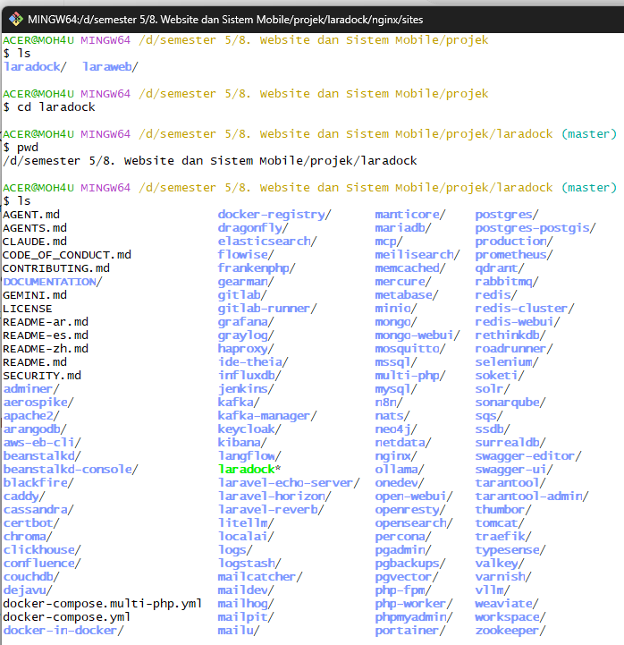
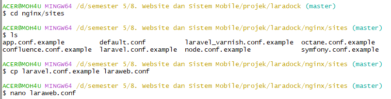
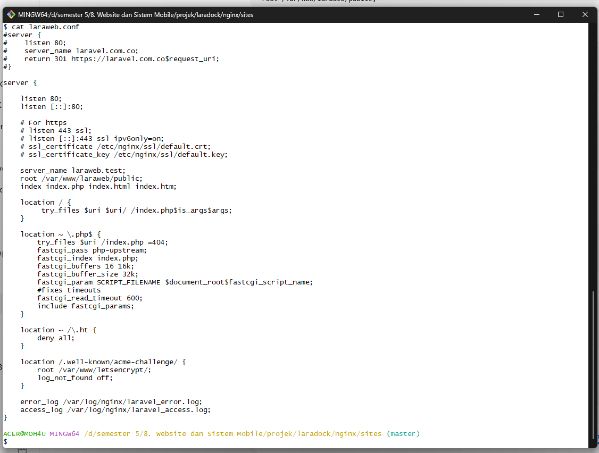

---

# FASE 4 — Konfigurasi Laradock `.env`

## 4.1 Masuk ke Folder Laradock

```bash
cd "/d/semester 5/8. Website dan Sistem Mobile/projek/laradock"
```

## 4.2 Pastikan `.env` Ada

```bash
ls -la
```

Jika belum ada `.env`, salin:

```bash
cp .env.example .env
```

## 4.3 Konfigurasi Path Project

Buka:

```bash
nano .env
```

Konfigurasi yang digunakan:

```env
APP_CODE_PATH_HOST=../laraweb
APP_CODE_PATH_CONTAINER=/var/www
APP_CODE_CONTAINER_FLAG=:cached

DATA_PATH_HOST=~/.laradock/data

VOLUMES_DRIVER=local
NETWORKS_DRIVER=bridge
```

Cek nilai:

```bash
grep -E "APP_CODE_PATH_HOST|APP_CODE_PATH_CONTAINER|VOLUMES_DRIVER" .env
```

Hasil penting:

```text
APP_CODE_PATH_HOST=../laraweb
APP_CODE_PATH_CONTAINER=/var/www
VOLUMES_DRIVER=local
```

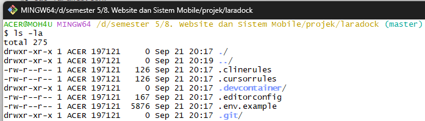
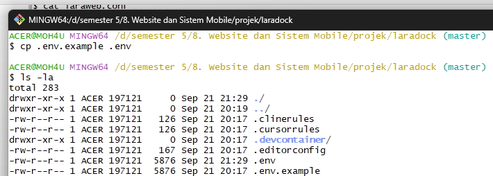
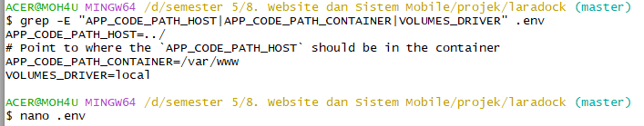


---

# FASE 5 — Menjalankan Docker

## 5.1 Jalankan Container

Dari folder `laradock`:

```bash
docker compose up -d nginx mysql workspace
```

Tunggu proses build dan startup selesai.

## 5.2 Cek Container

```bash
docker compose ps
```

Container yang harus aktif:

```text
mysql
nginx
php-fpm
workspace
```

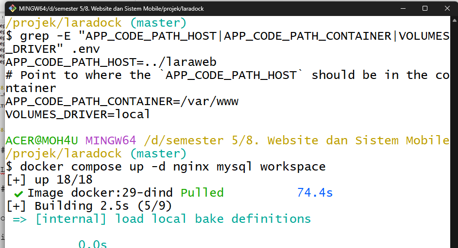
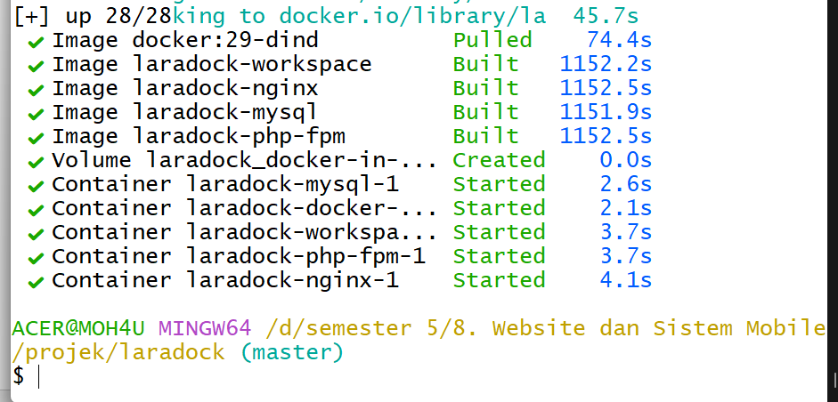
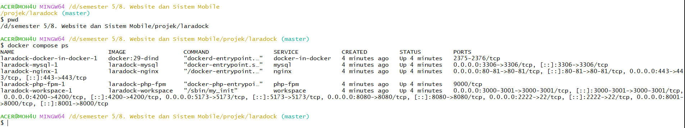


---

# FASE 6 — Uji Laravel melalui Browser

Buka browser:

```text
http://laraweb.test
```

Jika berhasil, halaman Laravel akan tampil.

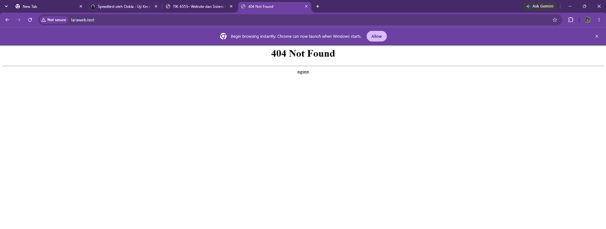

Jika muncul `404 Not Found`, periksa kembali:

```nginx
server_name laraweb.test;
root /var/www/public;
```

Kemudian restart Nginx:

```bash
docker compose restart nginx
```

---

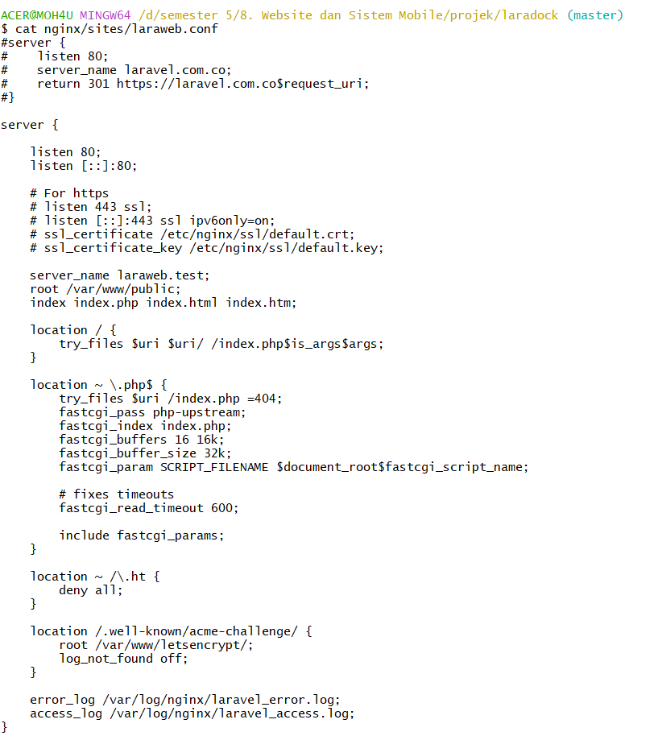
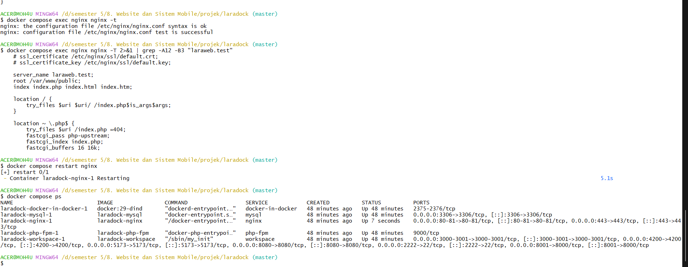
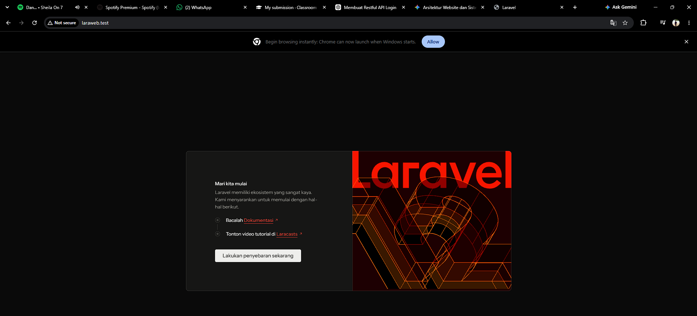


# FASE 7 — Masuk ke Workspace Laravel

## 7.1 Masuk ke Container Workspace

```bash
docker compose exec workspace bash
```

## 7.2 Masuk ke Directory Laravel

```bash
cd /var/www
```

Cek:

```bash
pwd
```

Hasil:

```text
/var/www
```

## 7.3 Cek Versi Laravel

```bash
php artisan --version
```

Contoh hasil praktik:

```text
Laravel Framework 12.69.2
```

---
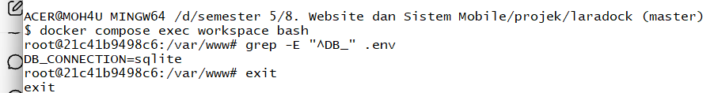

# FASE 8 — Konfigurasi Database Laravel

## 8.1 Cek `.env` Laravel

Masih di:

```text
/var/www
```

jalankan:

```bash
grep -E "^DB_" .env
```

Pada awalnya project dapat menunjukkan:

```env
DB_CONNECTION=sqlite
```

## 8.2 Ubah ke MySQL

Edit:

```bash
nano .env
```

Sesuaikan:

```env
DB_CONNECTION=mysql
DB_HOST=mysql
DB_PORT=3306
DB_DATABASE=default
DB_USERNAME=default
DB_PASSWORD=PASSWORD_MYSQL
```

> Isi `DB_PASSWORD` harus mengikuti konfigurasi MySQL Laradock yang digunakan pada project.

## 8.3 Bersihkan Cache

```bash
php artisan config:clear
```

## 8.4 Jalankan Migration

```bash
php artisan migrate
```

Periksa status migration:

```bash
php artisan migrate:status
```

Migration harus berstatus:

```text
Ran
```
 
---
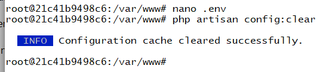
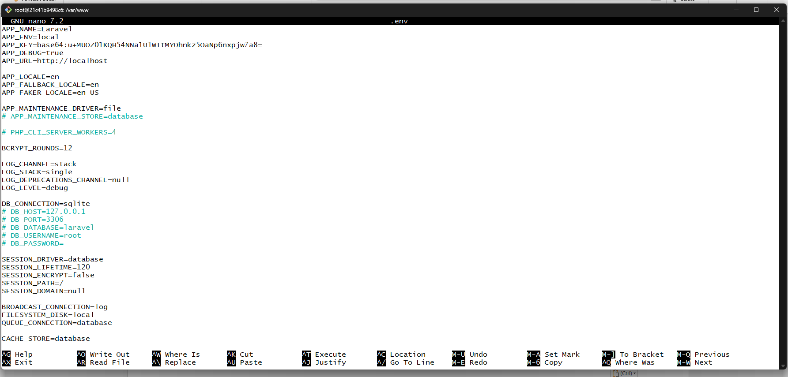

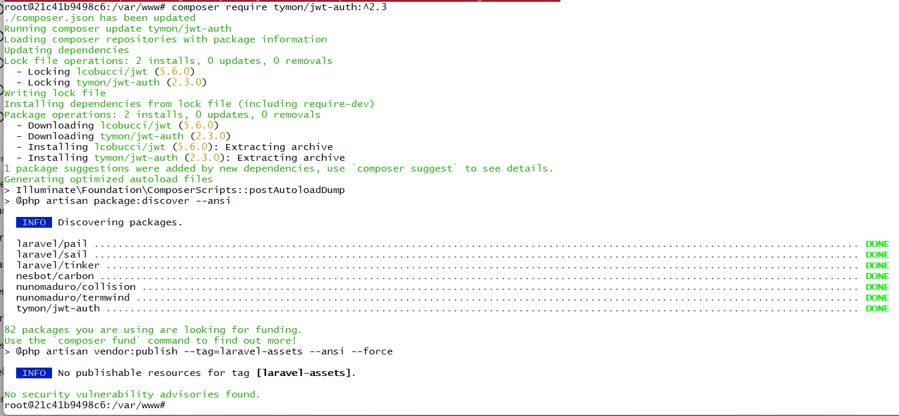

# FASE 9 — Instalasi JWT

Modul menggunakan JWT untuk authentication.

## 9.1 Install JWT

Untuk Laravel 12 pada project praktik ini:

```bash
composer require tymon/jwt-auth:^2.3
```

Periksa package:

```bash
composer show tymon/jwt-auth
```

## 9.2 Publish Konfigurasi

```bash
php artisan vendor:publish --provider="Tymon\JWTAuth\Providers\LaravelServiceProvider"
```

## 9.3 Generate Secret

```bash
php artisan jwt:secret
```

Periksa:

```bash
grep JWT_SECRET .env
```

Jangan membagikan nilai `JWT_SECRET`.

Periksa file:

```bash
ls -l config/jwt.php
```

---

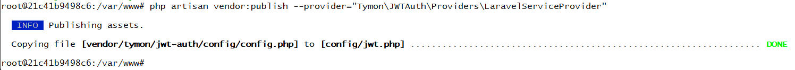
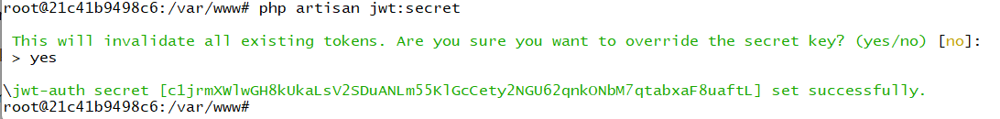
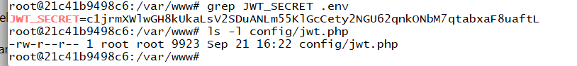


# FASE 10 — Konfigurasi `config/auth.php`

Buka:

```bash
nano config/auth.php
```

Gunakan:

```php
<?php

use App\Models\User;

return [

    'defaults' => [
        'guard' => 'web',
        'passwords' => 'users',
    ],

    'guards' => [
        'web' => [
            'driver' => 'session',
            'provider' => 'users',
        ],

        'api' => [
            'driver' => 'jwt',
            'provider' => 'users',
            'hash' => false,
        ],
    ],

    'providers' => [
        'users' => [
            'driver' => 'eloquent',
            'model' => User::class,
        ],
    ],

    'passwords' => [
        'users' => [
            'provider' => 'users',
            'table' => 'password_reset_tokens',
            'expire' => 60,
            'throttle' => 60,
        ],
    ],

    'password_timeout' => 10800,

];
```

## 10.1 Cek Syntax

```bash
php -l config/auth.php
```

Hasil:

```text
No syntax errors detected in config/auth.php
```

## 10.2 Bersihkan Cache

```bash
php artisan config:clear
```

## 10.3 Verifikasi Guard

```bash
php artisan config:show auth
```

Pastikan:

```text
guards → api → driver   jwt
guards → api → provider users
guards → api → hash     false
```

---
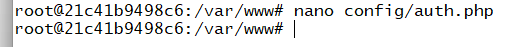
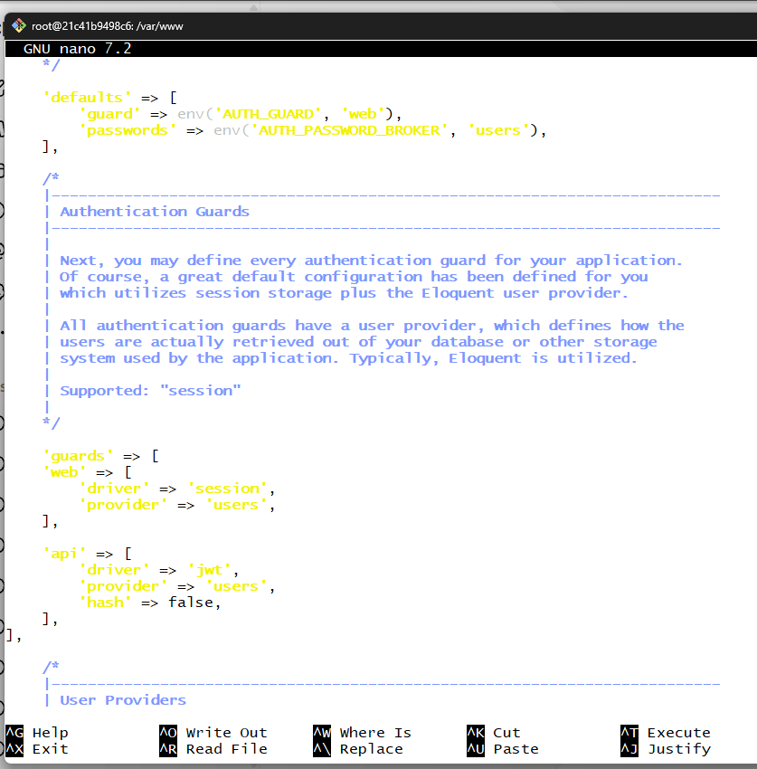
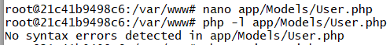


# FASE 11 — Konfigurasi `app/Models/User.php`

Buka:

```bash
nano app/Models/User.php
```

Gunakan:

```php
<?php

namespace App\Models;

use Illuminate\Database\Eloquent\Factories\HasFactory;
use Illuminate\Foundation\Auth\User as Authenticatable;
use Illuminate\Notifications\Notifiable;
use Tymon\JWTAuth\Contracts\JWTSubject;

class User extends Authenticatable implements JWTSubject
{
    use HasFactory, Notifiable;

    protected $fillable = [
        'name',
        'email',
        'password',
    ];

    protected $hidden = [
        'password',
        'remember_token',
    ];

    protected function casts(): array
    {
        return [
            'email_verified_at' => 'datetime',
            'password' => 'hashed',
        ];
    }

    public function getJWTIdentifier()
    {
        return $this->getKey();
    }

    public function getJWTCustomClaims(): array
    {
        return [];
    }
}
```

Cek syntax:

```bash
php -l app/Models/User.php
```

Hasil:

```text
No syntax errors detected in app/Models/User.php
```

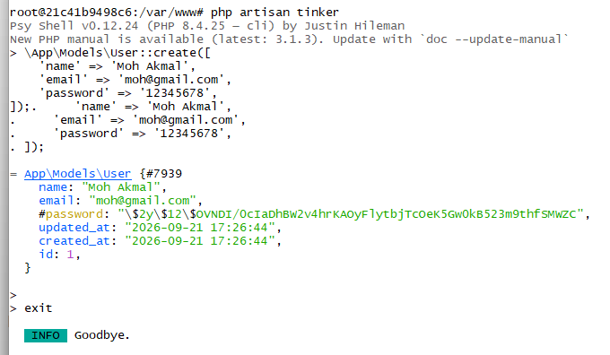
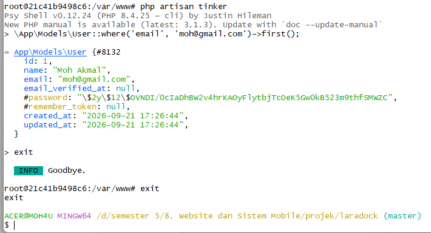
---

# FASE 12 — Membuat AuthController

## 12.1 Buat Controller

```bash
php artisan make:controller Api/AuthController
```

## 12.2 Edit Controller

```bash
nano app/Http/Controllers/Api/AuthController.php
```

Gunakan:

```php
<?php

namespace App\Http\Controllers\Api;

use App\Http\Controllers\Controller;
use Illuminate\Http\Request;
use Illuminate\Support\Facades\Validator;
use Tymon\JWTAuth\Facades\JWTAuth;

class AuthController extends Controller
{
    public function login(Request $request)
    {
        $validator = Validator::make($request->all(), [
            'email' => 'required|email',
            'password' => 'required',
        ]);

        if ($validator->fails()) {
            return response()->json($validator->errors(), 422);
        }

        $credentials = $request->only('email', 'password');

        if (!auth('api')->attempt($credentials)) {
            return response()->json([
                'success' => false,
                'message' => 'Invalid Email or Password',
            ], 401);
        }

        return response()->json([
            'success' => true,
            'token' => auth('api')->tokenById(auth('api')->user()->id),
            'user' => auth('api')->user(),
        ], 200);
    }

    public function refresh_token(Request $request)
    {
        $refreshToken = JWTAuth::refresh(JWTAuth::getToken());

        $user = JWTAuth::setToken($refreshToken)->toUser();

        $request->headers->set(
            'Authorization',
            'Bearer ' . $refreshToken
        );

        return response()->json([
            'success' => true,
            'token' => $refreshToken,
            'user' => $user,
        ], 200);
    }

    public function logout()
    {
        JWTAuth::invalidate(JWTAuth::getToken());

        return response()->json([
            'success' => true,
            'message' => 'User logged out successfully',
        ], 200);
    }
}
```

Cek syntax:

```bash
php -l app/Http/Controllers/Api/AuthController.php
```

---

# FASE 13 — Konfigurasi API Route

## 13.1 Install API

```bash
php artisan install:api
```

## 13.2 Edit `routes/api.php`

```bash
nano routes/api.php
```

Isi:

```php
<?php

use App\Http\Controllers\Api\AuthController;
use Illuminate\Support\Facades\Route;

Route::post('/login', [AuthController::class, 'login']);

Route::group(['middleware' => 'auth:api'], function () {
    Route::get('/refresh-token', [AuthController::class, 'refresh_token']);
    Route::post('/logout', [AuthController::class, 'logout']);
});
```

## 13.3 Cek Route

```bash
php artisan route:list
```

Target:

```text
POST   api/login
GET    api/refresh-token
POST   api/logout
```


---

# FASE 14 — Membuat User untuk Pengujian

## 14.1 Masuk Tinker

```bash
php artisan tinker
```

## 14.2 Buat User

```php
\App\Models\User::create([
    'name' => 'Moh Akmal',
    'email' => 'moh@gmail.com',
    'password' => '12345678',
]);
```

## 14.3 Cek User

```php
\App\Models\User::where('email', 'moh@gmail.com')->first();
```

Keluar:

```php
exit
```


---

# FASE 15 — Test Login dengan Postman

## 15.1 Method dan URL

```text
POST
http://laraweb.test/api/login
```

## 15.2 Body

Pilih:

```text
Body → raw → JSON
```

Masukkan:

```json
{
    "email": "moh@gmail.com",
    "password": "12345678"
}
```

Header:

```text
Content-Type: application/json
```
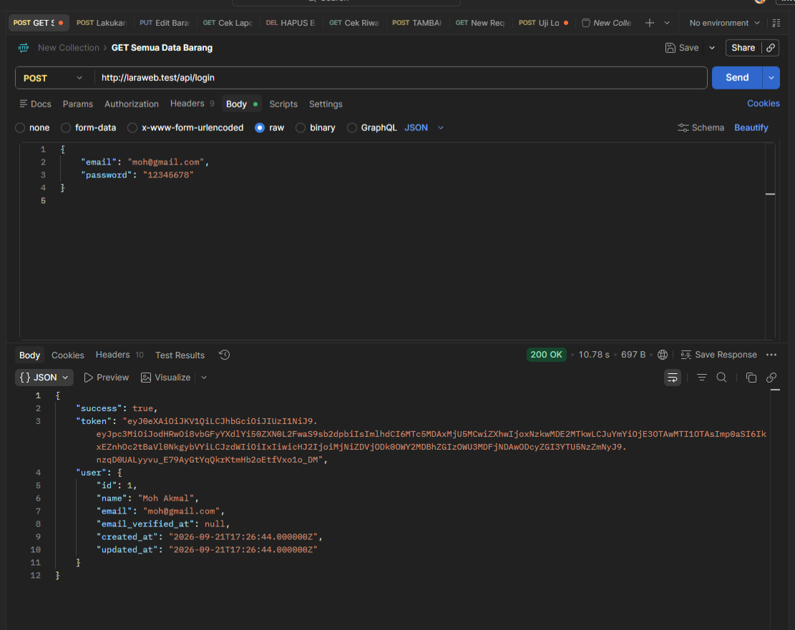
## 15.3 Kirim Request

Klik:

```text
Send
```

Hasil yang diharapkan:

```json
{
    "success": true,
    "token": "JWT_TOKEN",
    "user": {
        "id": 1,
        "name": "Moh Akmal",
        "email": "moh@gmail.com"
    }
}
```

Status:

```text
200 OK
```

> Jangan menguji `POST /api/login` dengan mengetik URL di browser. Browser akan menggunakan `GET`, sedangkan route login menggunakan `POST`.


---

# FASE 16 — Test Refresh Token

## 16.1 Request

```text
GET
http://laraweb.test/api/refresh-token
```

## 16.2 Authorization

Pilih:

```text
Authorization
```

Auth Type:

```text
Bearer Token
```

Masukkan token dari response login:

```text
eyJ...
```

Jangan menulis `Bearer` di field Token jika Postman sudah memakai tipe **Bearer Token**.

## 16.3 Kirim

Klik:

```text
Send
```

Target:

```text
200 OK
```

Response:

```json
{
    "success": true,
    "token": "TOKEN_BARU",
    "user": {
        "id": 1,
        "name": "Moh Akmal",
        "email": "moh@gmail.com"
    }
}
```

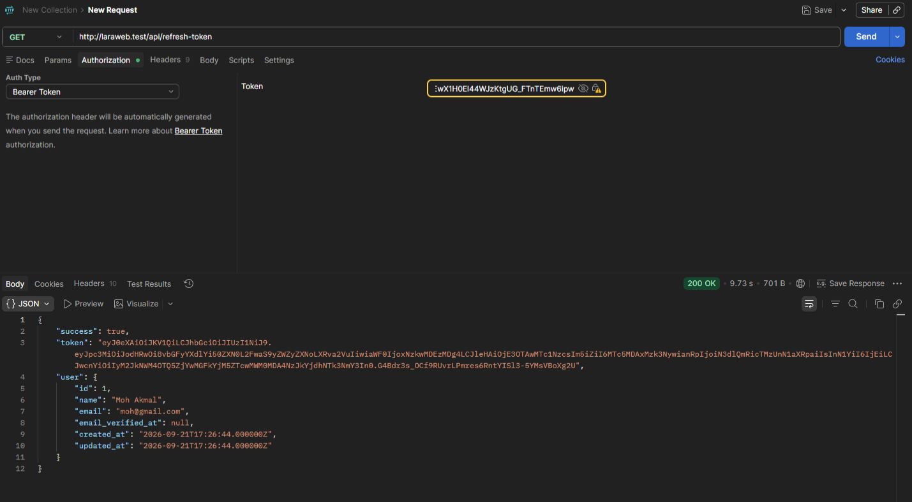

---

# FASE 17 — Test Logout

## 17.1 Request

```text
POST
http://laraweb.test/api/logout
```

## 17.2 Authorization

Pilih:

```text
Authorization → Bearer Token
```

Gunakan token yang masih valid.

## 17.3 Kirim

```text
Send
```

Target response:

```json
{
    "success": true,
    "message": "User logged out successfully"
}
```

Status:

```text
200 OK
```

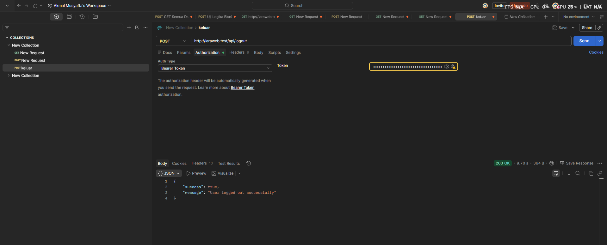


---

# FASE 18 — Ringkasan Hasil Pengujian

| Endpoint | Method | Fungsi | Hasil |
|---|---|---|---|
| `/api/login` | POST | Login dan menghasilkan JWT | ✅ |
| `/api/refresh-token` | GET | Menghasilkan token baru | ✅ |
| `/api/logout` | POST | Invalidate token | ✅ |

Alur authentication:

```text
POST /api/login
      ↓
Validasi email + password
      ↓
JWT Token
      ↓
Bearer Token
      ↓
GET /api/refresh-token
      ↓
Token Baru
      ↓
POST /api/logout
      ↓
Token Invalid
```

---

# FASE 19 — Troubleshooting

## Error 405 Method Not Allowed

Contoh:

```text
Method GET tidak didukung untuk route api/login.
Method yang didukung: POST.
```

Penyebab:

```text
Browser → GET /api/login
```

Solusi:

```text
Postman → POST /api/login
```

## Error `/var/www/laraweb` Tidak Ditemukan

Dengan konfigurasi:

```env
APP_CODE_PATH_CONTAINER=/var/www
```

project Laravel berada di:

```text
/var/www
```

bukan:

```text
/var/www/laraweb
```

Periksa:

```bash
docker compose exec nginx ls -la /var/www
```

## Nginx 404

Periksa:

```nginx
server_name laraweb.test;
root /var/www/public;
```

Tes:

```bash
docker compose exec nginx nginx -t
```

Restart:

```bash
docker compose restart nginx
```

## Syntax Error `config/auth.php`

Tes:

```bash
php -l config/auth.php
```

Kemudian:

```bash
php artisan config:clear
```

## Periksa Route API

```bash
php artisan route:list
```

Pastikan:

```text
POST api/login
GET  api/refresh-token
POST api/logout
```

---


## E. Hasil dan Pembahasan

## Test Login Postman


## Test Refresh Token


## logout


analisis :
Berdasarkan praktikum yang telah dilakukan, RESTful API Login berhasil dibangun menggunakan Laravel, Laradock, MySQL, dan JWT (JSON Web Token). Tahap awal dimulai dengan menyiapkan project Laravel dan konfigurasi lingkungan Laradock. Project laraweb ditempatkan sejajar dengan folder laradock, kemudian dibuat konfigurasi hostname laraweb.test pada file hosts Windows. Pada file Nginx juga dilakukan konfigurasi virtual host agar request dengan domain laraweb.test dapat diarahkan ke project Laravel. Dokumentasi praktikum menunjukkan proses konfigurasi tersebut pada bagian persiapan hingga menjalankan container Laradock.

Setelah lingkungan kerja aktif, container nginx, mysql, php-fpm, dan workspace berhasil dijalankan. Laravel kemudian dapat diakses melalui browser menggunakan alamat http://laraweb.test. Hal ini menunjukkan bahwa konfigurasi antara hostname, Nginx, Docker, dan Laravel telah terhubung dengan baik. Pada tahap berikutnya, database Laravel dikonfigurasi dan migration berhasil dijalankan sehingga tabel yang diperlukan, termasuk tabel users, tersedia untuk proses autentikasi.

Tahap berikutnya adalah implementasi JWT. Package tymon/jwt-auth dipasang dan konfigurasi JWT dipublikasikan ke dalam project. Setelah secret JWT dibuat, file config/auth.php dikonfigurasi dengan guard api menggunakan driver jwt dan provider users. Konfigurasi tersebut merupakan bagian utama agar Laravel dapat menggunakan JWT sebagai mekanisme autentikasi API. File praktikum juga menunjukkan verifikasi konfigurasi melalui php artisan config:show auth.

Pada model User, class diubah agar mengimplementasikan JWTSubject. Model tersebut kemudian dilengkapi dengan method getJWTIdentifier() dan getJWTCustomClaims(). Dengan konfigurasi tersebut, model User dapat digunakan oleh library JWT untuk membuat dan memproses token autentikasi. Struktur implementasi ini terlihat pada bagian model User dalam dokumentasi praktikum.

Selanjutnya dibuat AuthController pada direktori app/Http/Controllers/Api. Controller tersebut menyediakan tiga fungsi utama, yaitu login(), refresh_token(), dan logout(). Fungsi login() digunakan untuk melakukan validasi email dan password kemudian menghasilkan JWT ketika kredensial benar. Fungsi refresh_token() digunakan untuk memperoleh token baru, sedangkan fungsi logout() digunakan untuk melakukan invalidasi token. Struktur ketiga fungsi tersebut ditunjukkan pada bagian controller dalam file praktikum.

Route API kemudian dibuat untuk menghubungkan endpoint dengan AuthController. Endpoint yang digunakan adalah POST /api/login, GET /api/refresh-token, dan POST /api/logout. Route refresh token dan logout ditempatkan pada middleware auth:api, sehingga endpoint tersebut memerlukan token autentikasi.

Pengujian dilakukan menggunakan Postman. Pada pengujian login, request POST /api/login dikirim menggunakan data email dan password user yang telah dibuat sebelumnya. Hasil pengujian menunjukkan response 200 OK dengan nilai success: true, JWT token, dan informasi user. Pengujian berikutnya pada endpoint refresh token juga menghasilkan response 200 OK dan token baru. Dengan demikian, mekanisme autentikasi JWT, penggunaan Bearer Token, dan proses pembaruan token dapat berjalan sesuai rancangan. Dokumentasi praktikum menampilkan hasil pengujian Postman pada bagian akhir dokumen.

Dalam proses implementasi juga ditemukan beberapa kendala konfigurasi, seperti penyesuaian path project pada Docker dan syntax pada config/auth.php. Kendala tersebut diselesaikan dengan menyesuaikan lokasi source Laravel di dalam container dan memperbaiki struktur konfigurasi authentication. Setelah perbaikan dilakukan, Laravel dapat berjalan melalui laraweb.test, route API dapat dikenali, migration berhasil, dan proses login JWT dapat diuji.

Secara keseluruhan, hasil praktikum menunjukkan bahwa RESTful API Login telah berhasil diimplementasikan. Sistem mampu melakukan autentikasi menggunakan email dan password, menghasilkan JWT, memperbarui token menggunakan refresh token, serta melakukan logout dengan invalidasi token. Implementasi ini memenuhi tujuan utama praktikum mengenai pembuatan RESTful API Login berbasis J

## F. Kesimpulan
Berdasarkan praktikum yang telah dilakukan, dapat disimpulkan bahwa RESTful API Login berbasis Laravel dan JWT berhasil diimplementasikan dan diuji. Lingkungan pengembangan berhasil dijalankan menggunakan Laradock dengan Docker, Nginx, PHP-FPM, dan MySQL, serta project Laravel dapat diakses melalui domain lokal laraweb.test.

Konfigurasi autentikasi berhasil dilakukan dengan menambahkan guard api menggunakan JWT, menyesuaikan model User agar mendukung JWTSubject, serta membuat AuthController yang menangani proses login, refresh token, dan logout.

Hasil pengujian menggunakan Postman menunjukkan bahwa endpoint POST /api/login berhasil menghasilkan JWT token, endpoint GET /api/refresh-token berhasil menghasilkan token baru, dan endpoint POST /api/logout digunakan untuk melakukan invalidasi token. Dengan demikian, tujuan praktikum untuk membangun dan menguji RESTful API Login menggunakan JWT telah tercapai.

Secara keseluruhan, praktikum ini memberikan pemahaman mengenai penerapan authentication berbasis token pada RESTful API Laravel, mulai dari konfigurasi lingkungan, database, JWT, model pengguna, controller, routing, hingga pengujian API menggunakan Postman.

## G. Referensi
[1] M. Davi, “TIK-6555 — Website dan Sistem Mobile,” Modul Praktikum,
    Program Studi Teknologi Rekayasa Komputer Jaringan, Jurusan Teknologi
    Informasi dan Komputer, Politeknik Negeri Lhokseumawe,
    2025–2026 Ganjil.

[2] Laravel, “Laravel Documentation,” Laravel Documentation.

[3] Laradock, “Laradock Documentation,” Laradock Documentation.

[4] GitHub, “GitHub,” GitHub.

[5] Git, “Git Handbook,” Git Handbook.

[6] “Laravel 12 JWT #7: Test API Register,” bahan bacaan yang tercantum
    dalam modul praktikum TIK-6555.

[7] “JWT (JSON Web Token),” bahan bacaan yang tercantum dalam modul
    praktikum TIK-6555.

