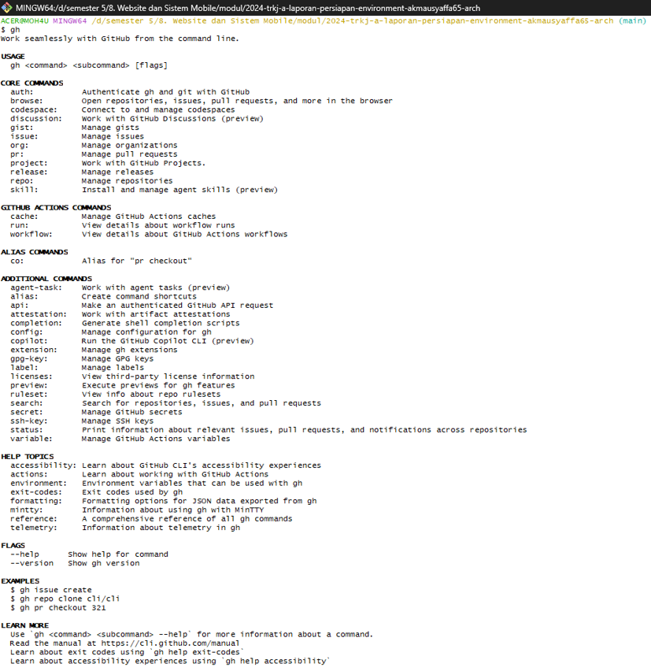
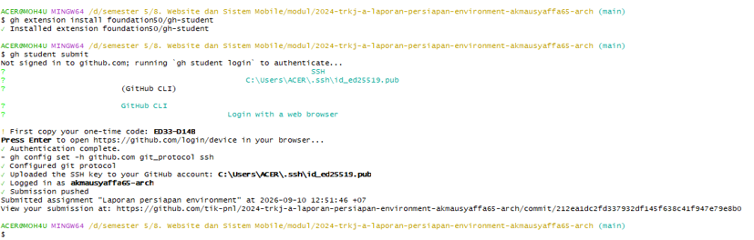
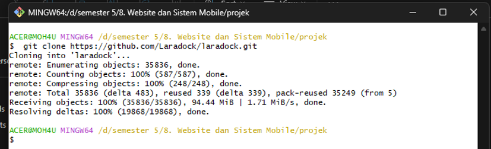
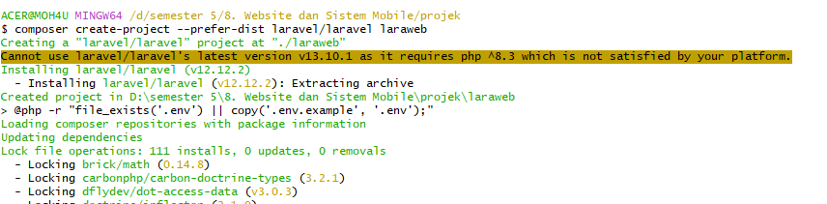
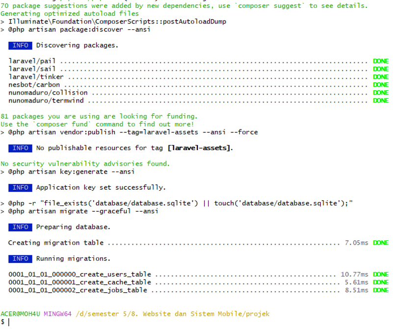
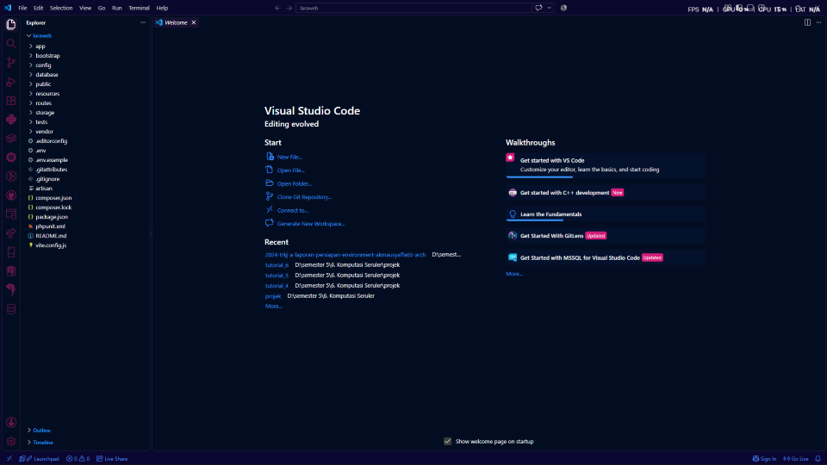
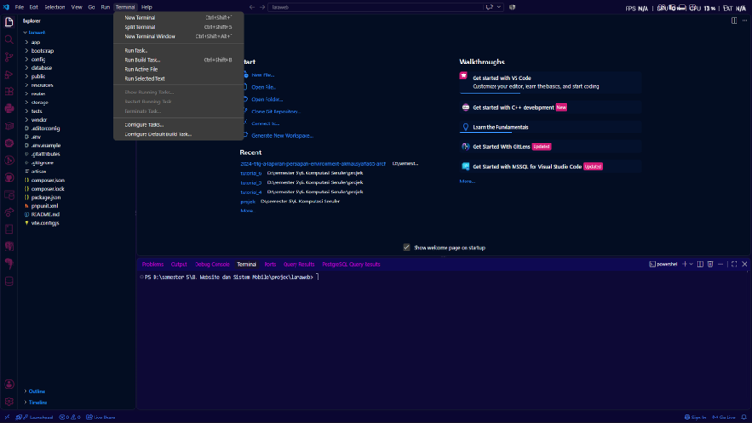
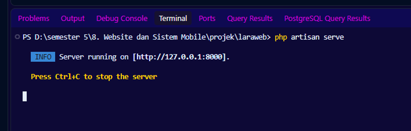
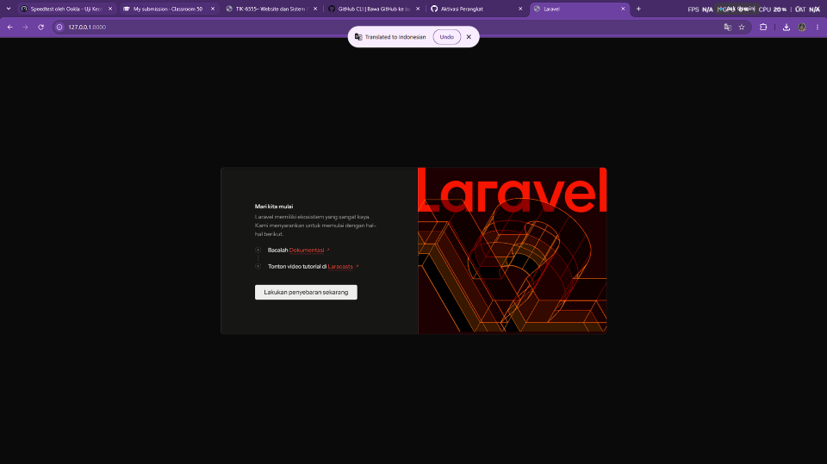

<div align="center">

## LAPORAN WEBSITE DAN SISITEM MOBILE


### Disusun Oleh:  
Nama               : MOH. Akmal Musyaffa 
<br><br>
NIM                : 2024903430018
<br><br>
Kelas              : TRKJ 3A


### Program Studi Teknologi Rekayasa Komputer Jaringan
### Jurusan Teknologi Informasi dan Komputer
### Politeknik Negeri Lhokseumawe
### 2026


--- 


## Lembar Pengesahan


| No. Praktikum     | : | 01 |
|------------------:|:-:|:--------------|
| Judul Praktikum   | : | persiapan project Laravel menggunakan GitHub CLI, Git, Composer, VS Code, lalu menjalankan Laravel development server.| 
| Tanggal Praktikum | : | 10 September 2026 |
| Tanggal Penyerahan| : | 10 September 2026 |
| Nama Praktikan    | : | MOH. Akmal Musyaffa  |
| NIM/Kelas Praktikan| : | 2024903430018 / TRKJ 3A |
| Nilai Praktikum   | : | .......................... |
| Dosen Pengampu    | : | Muhammad Davi, S.Kom., M.Cs. |

Mengetahui,  
Dosen Pengampu
<br><br><br><br><br>

Muhammad Davi, S.Kom., M.Cs.
</div>


## Daftar Isi
- [Lembar Pengesahan](#lembar-pengesahan)
- [Daftar Isi](#daftar-isi)
- [Tujuan Praktikum](#tujuan-praktikum)
- [Dasar Teori](#dasar-teori)
- [Alat dan Bahan](#alat-dan-bahan)
- [Langkah Kerja](#langkah-kerja)
- [Hasil dan Pembahasan](#hasil-dan-pembahasan)
- [Kesimpulan](#kesimpulan)
- [Referensi](#referensi)
---

## A. Tujuan Praktikum

- Menyiapkan lingkungan kerja untuk membuat aplikasi menggunakan Laravel.
- Mengetahui cara menggunakan GitHub CLI dan Git untuk mengelola project.
- Menggunakan Composer untuk memasang dan mengatur kebutuhan Laravel.
- Membuat project Laravel dengan nama `laraweb`.
- Membuka dan mengelola project menggunakan Visual Studio Code.
- Menjalankan Laravel di komputer melalui development server.
- Memastikan project Laravel dapat berjalan dengan baik sebelum masuk ke tahap pengembangan berikutnya.
<br><br>
<div align="justify">
## B. Dasar Teori
Laravel merupakan salah satu framework berbasis bahasa pemrograman PHP yang digunakan untuk membantu proses pengembangan aplikasi web. Laravel menyediakan struktur pengembangan yang lebih terorganisir sehingga programmer dapat membangun aplikasi dengan lebih mudah dan efisien. Dalam pengembangan menggunakan Laravel, terdapat beberapa komponen utama seperti routing, model, controller, migration, serta berbagai package pendukung yang dapat digunakan sesuai kebutuhan aplikasi.

Dalam praktikum ini, Laravel digunakan sebagai framework utama untuk membuat project aplikasi web. Sebelum melakukan pengembangan aplikasi, diperlukan persiapan lingkungan kerja dan beberapa tools pendukung. Modul praktikum menjelaskan bahwa lingkungan kerja yang digunakan adalah Laradock, sedangkan tools yang diperlukan antara lain sistem operasi, IDE, web browser, GitHub, Markdown, Git, Docker, dan Composer.

Git merupakan sistem version control yang digunakan untuk mencatat dan mengelola perubahan pada source code. Dengan Git, setiap perubahan yang dilakukan pada project dapat dilacak sehingga memudahkan dalam proses pengembangan dan pengelolaan versi aplikasi. Git juga dapat digunakan untuk bekerja dengan repository yang tersimpan pada layanan seperti GitHub.

GitHub merupakan layanan berbasis web yang digunakan sebagai repository untuk menyimpan dan mengelola source code. GitHub dapat digunakan bersama Git untuk melakukan proses seperti penyimpanan project, pengelolaan perubahan, dan kolaborasi. Dalam praktikum ini, GitHub juga digunakan untuk mengakses repository Laradock dan nantinya dapat digunakan sebagai tempat penyimpanan project hasil praktikum. Modul mencantumkan GitHub sebagai salah satu kebutuhan dalam lingkungan kerja praktikum.

GitHub CLI (GitHub Command Line Interface) merupakan command-line tool yang memungkinkan pengguna berinteraksi dengan GitHub melalui terminal. Penggunaan GitHub CLI dapat mempermudah proses autentikasi dan pengelolaan repository tanpa harus selalu melakukan proses melalui antarmuka web. Pada praktikum sebelumnya, GitHub CLI digunakan untuk melakukan proses autentikasi akun GitHub sebelum bekerja dengan repository.

Composer merupakan dependency manager untuk PHP yang digunakan untuk mengelola library atau package yang dibutuhkan oleh sebuah project. Composer dapat melakukan instalasi package secara otomatis berdasarkan kebutuhan project. Dalam pengembangan Laravel, Composer memiliki peran penting karena Laravel dan berbagai dependency yang digunakan oleh aplikasi dapat dipasang dan dikelola melalui Composer. Modul menyebutkan Composer sebagai tools untuk mengelola dan menginstal library serta package eksternal yang dibutuhkan oleh project.

Docker merupakan teknologi yang digunakan untuk mengemas dan menjalankan aplikasi di dalam lingkungan terisolasi yang disebut container. Dengan container, komponen aplikasi seperti web server dan database dapat dijalankan pada lingkungan yang lebih terkontrol. Dalam modul praktikum, Docker digunakan sebagai bagian dari lingkungan Laradock untuk menjalankan aplikasi dan layanan yang diperlukan.

Laradock merupakan lingkungan pengembangan berbasis Docker yang digunakan untuk membantu menjalankan aplikasi Laravel beserta service pendukungnya. Penggunaan Laradock bertujuan agar konfigurasi environment untuk Laravel dapat lebih mudah disiapkan. Modul praktikum secara khusus menyebutkan bahwa Laradock digunakan sebagai lingkungan kerja untuk pengembangan aplikasi Laravel.

Visual Studio Code merupakan code editor yang digunakan untuk membuka dan mengelola source code project. Dalam proses pengembangan Laravel, editor digunakan untuk mengubah file konfigurasi, source code, dan struktur project. Dengan editor seperti Visual Studio Code, programmer dapat mengelola berbagai file Laravel dalam satu workspace.

Laravel Development Server adalah server pengembangan yang digunakan untuk menjalankan aplikasi Laravel pada komputer lokal. Server ini digunakan selama proses pengembangan dan pengujian aplikasi sebelum aplikasi dijalankan pada server production. Laravel menyediakan perintah php artisan serve untuk menjalankan development server sehingga aplikasi dapat diakses melalui browser pada alamat localhost.

Artisan merupakan command-line interface yang disediakan oleh Laravel. Artisan digunakan untuk menjalankan berbagai perintah yang berhubungan dengan pengelolaan project Laravel. Beberapa pekerjaan seperti membuat controller, model, resource, migration, menjalankan server, dan melakukan konfigurasi tertentu dapat dilakukan menggunakan perintah Artisan. Penggunaan Artisan membuat proses pengembangan menjadi lebih cepat karena banyak pekerjaan dapat dilakukan langsung melalui terminal.

Project Laravel memiliki struktur direktori yang terorganisir. Di dalam project terdapat beberapa folder penting yang digunakan untuk menyimpan source code aplikasi, konfigurasi, database, routing, resource, dan dependency. Struktur yang terorganisir ini menjadi salah satu alasan framework Laravel banyak digunakan dalam pengembangan aplikasi berbasis web.

Pada proses pembuatan project, Composer digunakan untuk membuat project Laravel beserta dependency yang diperlukan. Modul praktikum menjelaskan bahwa project Laravel dibuat dengan nama laraweb, dan project tersebut ditempatkan di dalam folder project sejajar dengan folder laradock.

Secara umum, proses pengembangan Laravel dimulai dari menyiapkan lingkungan kerja, memasang tools, membuat project, mengatur dependency, kemudian menjalankan aplikasi pada development server. Persiapan yang baik diperlukan agar project dapat berjalan dengan baik dan proses pengembangan berikutnya dapat dilakukan tanpa kendala konfigurasi yang tidak diperlukan.

Dengan memahami Git, GitHub, GitHub CLI, Composer, Docker, Laradock, Visual Studio Code, dan Laravel Development Server, mahasiswa dapat memiliki dasar lingkungan kerja yang dibutuhkan sebelum masuk ke tahap pengembangan aplikasi Laravel yang lebih lanjut, seperti pembuatan RESTful API, authentication, dan pengelolaan database. Modul praktikum berikutnya memang melanjutkan pembahasan ke Restful API Login menggunakan JWT dan Restful API CRUD Mahasiswa.
</div>

## Konsep yang Digunakan dalam Praktikum

Secara sederhana, hubungan antar tools yang digunakan dalam praktikum dapat digambarkan sebagai berikut:

```text

                                     GitHub
                                        │
                                        ▼
                               GitHub CLI / Git
                                        │
                                        ▼
                               Repository / Project
                                        │
                                        ▼
                                    Composer
                                        │
                                        ▼
                                       Laravel
                                        │
                                        ├── Laradock
                                        │      └── Docker
                                        │
                                        ▼
                                  Visual Studio   
                                     Codeod                             │
                                        ▼
                           Laravel Development Server
                                        │
                                        ▼
                                     Web Browser
```
<br><br>


## C. Alat dan Bahan
- Laptop atau komputer.
- Sistem operasi Windows, Linux, atau macOS.
- Git dan Git Bash.
- GitHub.
- GitHub CLI.
- Composer.
- Visual Studio Code.
- Google Chrome atau web browser.
- Laravel.
- Laradock.
<br><br>

## D. Langkah Kerja
### 1. Membuka Git Bash dan mengecek GitHub CLI
Buka Git Bash, kemudian jalankan:
```
gh --help 
```
Perintah tersebut digunakan untuk melihat bantuan dan daftar perintah yang tersedia pada GitHub CLI. Pada gambar pertama terlihat daftar command seperti auth, repo, issue, pr, dan lainnya.


### 2. Melakukan autentikasi GitHub
```
gh extension install foundation50/gh-student

```


### 3. Clone repository Laradock
```
git clone https://github.com/Laradock/laradock.git
Cloning into 'laradock'...
Receiving objects: 100%
Resolving deltas: 100%
```


### 4. Membuat project Laravel menggunakan Compose
```
composer create-project --prefer-dist laravel/laravel laraweb
```


### 5. Mengecek folder project
```
dir
cd laraweb
code .
```


### 6. Membuka project Laravel di Visual Studio Code


### 7. Membuka Terminal di Visual Studio Code
```
Di VS Code pilih:

Terminal → New Terminal

atau menggunakan shortcut:

Ctrl + Shift + `

terminal VS Code sudah berada di direktori:

D:\semester 5\8. Website dan Sistem Mobile\projek\laraweb
```


### 8. Menjalankan Laravel Development Server
```
Pada terminal VS Code jalankan:

php artisan serve

Jika berhasil, akan muncul:

INFO  Server running on [http://127.0.0.1:8000].

Kemudian server tetap berjalan sampai dihentikan dengan:

Ctrl + C
```

### 9. Membuka aplikasi Laravel di browser
```
Membuka aplikasi Laravel di browser

Buka browser dan masukkan alamat:

http://127.0.0.1:8000

Pada screenshot terakhir berhasil muncul halaman default Laravel, sehingga dapat disimpulkan bahwa project Laravel telah berhasil dijalankan melalui local development server.
```

<br><br>

## E. Hasil dan Pembahasan
1. Hasil Praktikum

Hasil praktikum menunjukkan bahwa proses persiapan project Laravel berhasil dilakukan mulai dari penggunaan GitHub CLI, pengambilan repository Laradock, pembuatan project Laravel menggunakan Composer, membuka project melalui Visual Studio Code, hingga menjalankan Laravel Development Server. Tahapan tersebut sesuai dengan modul praktikum yang menempatkan persiapan lingkungan kerja sebagai tahap awal sebelum pengembangan aplikasi Laravel lebih lanjut.

Pada tahap awal, Git Bash digunakan sebagai terminal untuk menjalankan berbagai perintah yang diperlukan. GitHub CLI berhasil digunakan untuk melihat bantuan perintah dan melakukan autentikasi ke akun GitHub. Proses ini menunjukkan bahwa lingkungan kerja telah terhubung dengan layanan GitHub sehingga repository dapat dikelola melalui terminal.

Gambar 1. Pengecekan GitHub CLI

<div align="center">



</div>

Analisis:
Perintah gh --help menghasilkan daftar perintah yang tersedia pada GitHub CLI. Hal ini menunjukkan bahwa GitHub CLI telah terpasang dan dapat dijalankan dengan baik. Dari hasil tersebut dapat diketahui bahwa terminal sudah siap digunakan untuk melakukan proses yang berhubungan dengan GitHub. Penggunaan command line juga membuat proses pengelolaan repository dapat dilakukan secara langsung tanpa harus berpindah-pindah aplikasi.

Gambar 2. Autentikasi GitHub melalui GitHub CLI

<div align="center">



</div>

Analisis:
Proses gh auth login digunakan untuk menghubungkan GitHub CLI dengan akun GitHub. Keberhasilan autentikasi menunjukkan bahwa akun GitHub telah berhasil dikenali oleh GitHub CLI. Tahapan ini penting karena repository dan aktivitas Git berikutnya dapat dilakukan menggunakan akun yang telah terautentikasi. Dengan demikian, komunikasi antara komputer lokal dan repository GitHub telah berhasil dipersiapkan.

2. Proses Clone Repository Laradock

Gambar 3. Clone repository Laradock

<div align="center">



</div>

Analisis:
Perintah git clone https://github.com/Laradock/laradock.git digunakan untuk menyalin repository Laradock dari GitHub ke komputer lokal. Pada hasil terminal terlihat proses Receiving objects dan Resolving deltas selesai hingga 100%, yang menunjukkan bahwa repository berhasil diunduh.

Keberhasilan proses clone berarti folder laradock telah tersedia pada direktori project. Hal ini sesuai dengan modul yang menjelaskan bahwa Laradock digunakan sebagai lingkungan kerja untuk pengembangan Laravel.

3. Pembuatan Project Laravel

Gambar 4. Pembuatan project Laravel

<div align="center">



</div>

Analisis:
Project Laravel dibuat menggunakan Composer dengan nama laraweb. Composer menjalankan proses instalasi dependency yang diperlukan oleh Laravel secara otomatis. Pada hasil proses terlihat bahwa project berhasil dibuat dan berbagai package berhasil dipasang. Modul juga menjelaskan bahwa project Laravel laraweb ditempatkan di dalam folder project dan sejajar dengan laradock.

Keberhasilan tahap ini menunjukkan bahwa Composer telah bekerja dengan baik dan struktur awal project Laravel telah terbentuk. Dengan adanya struktur project tersebut, proses pengembangan aplikasi dapat dilanjutkan ke tahap berikutnya.

Gambar 5. Proses konfigurasi dan migration Laravel

<div align="center">



</div>

Analisis:
Pada hasil terminal terlihat proses pembuatan application key dan proses migration database berhasil dijalankan. Beberapa migration seperti users, cache, dan jobs berhasil dieksekusi. Hal tersebut menunjukkan bahwa project Laravel tidak hanya berhasil dibuat, tetapi juga telah melakukan konfigurasi awal yang diperlukan untuk menjalankan aplikasi.

4. Membuka Project pada Visual Studio Code

Gambar 6. Membuka folder project

<div align="center">



</div>

Analisis:
Perintah cd laraweb digunakan untuk masuk ke direktori project Laravel. Setelah berada pada direktori tersebut, perintah code . digunakan untuk membuka project melalui Visual Studio Code. Pada screenshot terlihat project Laravel telah terbuka pada editor dan struktur file project dapat diakses.

Tahap ini penting karena seluruh source code Laravel nantinya akan dikelola melalui editor. Dengan adanya struktur folder yang sudah terbentuk, programmer dapat melakukan konfigurasi serta pengembangan fitur sesuai kebutuhan.

5. Menjalankan Laravel Development Server

Gambar 7. Terminal Visual Studio Code

<div align="center">



</div>

Analisis:
Setelah project berhasil dibuka, terminal pada Visual Studio Code digunakan untuk menjalankan project Laravel. Penggunaan terminal terintegrasi memudahkan proses pengembangan karena source code dan command line dapat digunakan dalam satu aplikasi.

Gambar 8. Laravel Development Server

<div align="center">



</div>

Analisis:
Perintah php artisan serve berhasil menjalankan Laravel Development Server. Pada terminal muncul informasi:

INFO  Server running on [http://127.0.0.1:8000].

Hasil tersebut menandakan bahwa aplikasi Laravel telah berhasil dijalankan pada komputer lokal.

Dari sisi pengujian, tahap ini menjadi indikator utama bahwa konfigurasi awal Laravel berhasil. Apabila server tidak dapat berjalan, biasanya terdapat masalah pada instalasi PHP, Composer, dependency, konfigurasi project, atau environment. Karena server berhasil aktif, maka project telah memenuhi kondisi dasar untuk dilakukan pengujian melalui browser.

6. Pengujian melalui Web Browser

Gambar 9. Halaman Laravel pada browser

<div align="center">



</div>

Analisis:
Browser digunakan untuk mengakses alamat http://127.0.0.1:8000. Tampilan halaman awal Laravel berhasil ditampilkan sehingga membuktikan bahwa request dari browser telah diterima oleh Laravel Development Server dan aplikasi dapat memberikan response dengan benar.

Hasil ini merupakan tahap akhir dari proses persiapan project. Berhasilnya halaman Laravel ditampilkan menunjukkan bahwa komponen utama, yaitu source code Laravel, dependency Composer, PHP, development server, dan browser telah bekerja secara terintegrasi.


<br><br>

## F. Kesimpulan
<div align="justify">
Berdasarkan seluruh hasil praktikum, dapat dianalisis bahwa setiap tools memiliki fungsi yang saling berhubungan dalam proses pengembangan aplikasi. GitHub digunakan sebagai repository, Git dan GitHub CLI membantu proses pengelolaan serta autentikasi, Composer menangani instalasi project dan dependency, sedangkan Visual Studio Code digunakan sebagai lingkungan penulisan dan pengelolaan source code.

Laradock dan Docker berperan sebagai bagian dari lingkungan pengembangan yang mendukung aplikasi Laravel. Modul praktikum memang menetapkan Laradock sebagai lingkungan kerja pengembangan Laravel dan Docker sebagai teknologi untuk menjalankan aplikasi atau service dalam container.

Dari sisi hasil, tidak ditemukan kegagalan pada tahapan utama yang ditunjukkan dalam screenshot. Repository berhasil di-clone, project Laravel berhasil dibuat, migration awal berhasil dijalankan, project dapat dibuka pada Visual Studio Code, Laravel Development Server berhasil aktif, dan halaman Laravel dapat ditampilkan pada browser. Dengan demikian, lingkungan kerja Laravel telah berhasil dipersiapkan dan siap digunakan untuk tahap pengembangan berikutnya.
<br><br>

## G. Referensi

1. Politeknik Negeri Lhokseumawe, *TIK-6555 Website dan Sistem Mobile*, Jurusan Teknologi Informasi dan Komputer, Program Studi Teknologi Rekayasa Komputer Jaringan, 2025–2026 Ganjil.

2. Laravel, *Laravel Documentation*. Referensi ini tercantum sebagai bahan bacaan pada modul praktikum.

3. Laradock, *Laradock Documentation*. Referensi ini digunakan sebagai bahan pendukung lingkungan kerja Laravel.

4. Git, *Git Handbook*. Referensi Git tercantum pada bahan bacaan modul praktikum.

5. GitHub, *GitHub Documentation*. Referensi GitHub juga tercantum pada bahan bacaan modul praktikum.